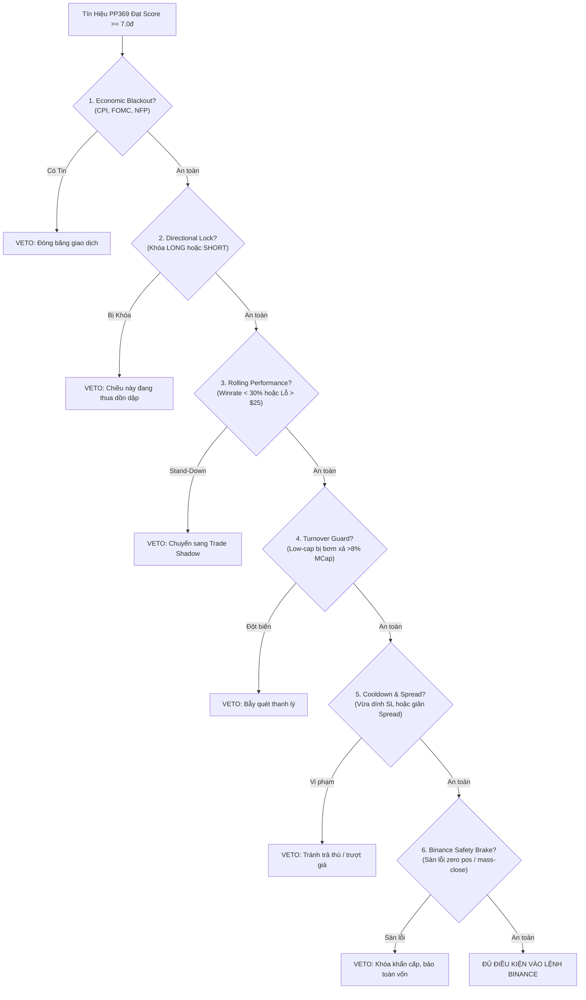

# MO_TA_CHI_TIET_369FUTURES.md — MÔ TẢ CHI TIẾT VÀ TOÀN DIỆN HỆ THỐNG 369FUTURES (BOT-H4)

> **Dự án**: 369futures (PP369 AutoTrade Bot — Phiên bản Bot-H4 Chuẩn Cấp Độ Tổ Chức)  
> **Ngôn ngữ**: Node.js (CommonJS ES6+) & Python (Huấn luyện Machine Learning ngầm)  
> **Nền tảng**: Binance Futures REST & User Data WebSocket API, Telegram Bot API (Tương tác 2 chiều), Web Dashboard Real-time (Port 3000), Google Gemini & Anthropic Claude LLM  
> **Ngày cập nhật**: 19/11/2026 (Phiên bản Hoàn thiện Nâng cấp Toàn diện: Fibonacci Hybrid SL 3 Tầng, Smart Anchored TP, Persistent Deep Cache, On-exchange Dual Bracket, Web Dashboard & Reversal Auto-Entry)  

---

## 📋 MỤC LỤC

1. [TỔNG QUAN HỆ THỐNG](#1-tổng-quan-hệ-thống)
2. [KIẾN TRÚC THƯ MỤC VÀ TỆP CỐT LÕI](#2-kiến-trúc-thư-mục-và-tệp-cốt-lõi)
3. [PHƯƠNG PHÁP & THUẬT TOÁN LÕI PP369 (PP369 CORE)](#3-phương-pháp--thuật-toán-lõi-pp369-pp369-core)
   * 3.1. Thuật toán Lấy Giá Open & Close Nến H4 Đầu Năm (Mốc Gốc)
   * 3.2. Bảng Quy Tắc Bước Giá (Price Step Rules) & Đơn Vị Unit
   * 3.3. Thuật toán Roundtrip, Trạng thái Lần Chạm (`lastSide`) & Nến M1
   * 3.4. Bộ Lọc An Toàn Cơ Bản (Grid Width & Volatility Safety Filter)
   * 3.5. Quy Trình Lọc và Giám Sát Danh Sách Mã (Symbol Selection Workflow)
   * 3.6. Kiến Trúc Persistent Deep Candle Cache (Lưu bền vững JSON H1: 300, H4: 300, D1: 180)
4. [HỆ THỐNG ĐÁNH ĐIỂM HỢP LƯU ĐỊNH LƯỢNG (DETERMINISTIC CONFLUENCE SCORER)](#4-hệ-thống-đánh-điểm-hợp-lưu-định-lượng-deterministic-confluence-scorer)
   * 4.1. 5 Trụ Cột Hợp Lưu Định Lượng (Whale, Derivatives, Sentiment, Multi-TF TA, Past S/R)
   * 4.2. Phân Tầng Điểm Số & Bộ Lọc Hard Filters
5. [MÔ HÌNH QUẢN TRỊ RỦI RO & THOÁT LỆNH THÔNG MINH (RISK & EXIT ENGINE)](#5-mô-hình-quản-trị-rủi-ro--thoát-lệnh-thông-minh-risk--exit-engine)
   * 5.1. Thuật toán Vùng Cản Cụm (Cluster Zones Detection & Touches Counting)
   * 5.2. Mô Hình Hybrid SL 3 Tầng Thông Minh (Loại bỏ trần 3.5% mù quáng)
     - Tầng 1: Cản Sweet Spot H1/H4 gần ($\le 3.5\%$)
     - Tầng 2: Cản D1 Tầm Trung 6 tháng ($\le 4.0\%$) & Dynamic Leverage Risk Normalization
     - Tầng 3: Cản Động Fibonacci (Fib 0.786 trên sóng H1 24h & Golden ATR 1.618x)
     - 5 Cải tiến chống tử huyệt (Liquidation Guard, Round Number Evasion, TickSize Rounding...)
   * 5.3. Cơ Chế Cài Đặt TP Thông Minh (S/R & 369 Grid Anchored TP)
     - Kỹ thuật Front-Running TP (lùi $0.2\%$)
     - Cơ chế Bỏ qua Cản Yếu (Weak S/R Bypass - Tránh reject oan uổng)
     - Chốt chặn VETO Cản Cứng Duy Nhất (`RR_BLOCKED_BY_MAJOR_SR`)
   * 5.4. Cơ Chế Kích Hoạt Breakeven 35% & Trailing SL Williams Fractal
6. [BỘ NÃO TRÍ TUỆ NHÂN TẠO & HỌC MÁY (AI & LLM REVIEWER)](#6-bộ-não-trí-tuệ-nhân-tạo--học-máy-ai--llm-reviewer)
   * 6.1. Mô Hình AI Offline & Cơ Chế Tự Động Re-train Định Kỳ
   * 6.2. Gemini & Claude LLM Reviewer & Cơ Sở Tri Thức (Knowledge Base)
   * 6.3. Cơ Chế AI Pre-Fill Cancel & Thoát Hiểm Phòng Thủ (Defensive Escape)
   * 6.4. Cơ Chế Cảnh Báo & Tự Động Vào Lệnh Đảo Chiều (Reversal Auto-Entry $\ge 9.0$đ)
7. [HỆ THỐNG VI CẤU TRÚC & PHÒNG VỆ ĐA TẦNG (CIRCUIT BREAKERS)](#7-hệ-thống-vi-cấu-trúc--phòng-vệ-đa-tầng-circuit-breakers)
   * 7.1. Microstructure Scanner (Spread Guard & CVD Momentum)
   * 7.2. Economic Calendar Guard (Blackout Giờ Tin Vĩ Mô Lớn CPI/FOMC/NFP)
   * 7.3. Directional Circuit Breaker (Cầu Chì Khóa Hướng LONG/SHORT)
   * 7.4. Rolling Performance Guard (Cửa Sổ Trượt Hiệu Suất & Stand-Down)
   * 7.5. Turnover Guard & Cooldown Manager
   * 7.6. Binance Safety Brake (Chặn thảm họa Mass-Close & Reverse Check 60s)
8. [HỆ THỐNG THỰC THI & QUẢN TRỊ TRÊN SÀN (ON-EXCHANGE DUAL BRACKET)](#8-hệ-thống-thực-thi--quản-trị-trên-sàn-on-exchange-dual-bracket)
   * 8.1. Binance User Data Stream WebSocket (< 50ms Event Detection)
   * 8.2. Cặp Lệnh Bảo Vệ Kép On-Exchange Dual Bracket (Limit TP & Stop-Market SL)
   * 8.3. On-Exchange Dynamic Ratchet (Dời SL Breakeven và Trailing SL trực tiếp trên sàn)
   * 8.4. Tự Động Dọn Dẹp Lệnh Chờ Đối Ứng (Auto-Clean Opposing Orders on Fill)
   * 8.5. Limit Timeout & Bounce Cancel
   * 8.6. Hệ Thống Giao Dịch Bóng (Shadow Trading Engine 24/7)
9. [HỆ THỐNG GIÁM SÁT, BÁO CÁO & GIAO DIỆN NGƯỜI DÙNG](#9-hệ-thống-giám-sát-báo-cáo--giao-diện-người-dùng)
   * 9.1. Local Real-Time Web Dashboard (Port 3000 WebSocket)
   * 9.2. Telegram Bot Tương Tác 2 Chiều (`/status`, `/trades`, `/forcesync`, `/balance`, `/help`)
   * 9.3. Báo Cáo Hiệu Suất Tự Động Telegram
   * 9.4. Cấu Hình Quản Lý Tiến Trình PM2
10. [BẢNG TỔNG KẾT TÍNH NĂNG BOT-H4 HOÀN THIỆN](#10-bảng-tổng-kết-tính-năng-bot-h4-hoàn-thiện)

---

## 1. TỔNG QUAN HỆ THỐNG

**Bot-H4 (`369futures`)** là hệ thống giao dịch tự động cấp độ tổ chức (Institutional-grade Quant Trading System) được thiết kế đặc thù cho thị trường **Binance USDT-M Futures**. Khác biệt hoàn toàn với các bot lưới hoặc bot chỉ báo thông thường, Bot-H4 là sự giao thoa toàn diện giữa:

1. **Toán học Hình học Không gian PP369**: Khai thác tính quy luật và phản ứng nảy giá tại các bội số của 3 dựa trên cây nến **H4 đầu tiên của năm** (`01/01 00:00 UTC`).
2. **Độ phủ thị trường siêu rộng**: Giám sát tức thời **hơn 450+ cặp coin** bằng luồng WebSocket Mark Price tốc độ cao (1 giây/lần).
3. **Persistent Deep Candle Cache (Bộ nhớ đệm nến sâu bền vững)**: Lưu trữ trên đĩa cứng **300 nến H1**, **300 nến H4** và **180 nến D1** (~6 tháng) cho toàn bộ 450+ coin, nạp vào RAM $< 500\text{ms}$ khi khởi động, cho phép quét lệnh và tính toán hoàn toàn trong RAM (**0ms latency, 0 API calls, 0 weight**).
4. **Mô hình Hybrid SL 3 Tầng & S/R-Anchored TP**: Loại bỏ hoàn toàn trần cứng $3.5\%$ cơ học, tích hợp vùng cản cụm (Cluster Zones), cản D1 tầm trung 6 tháng, và cản động Fibonacci Retracement 0.786 / Golden ATR 1.618x. Take Profit được neo theo cản đối diện/mốc 369 với kỹ thuật Front-running $0.2\%$ và cơ chế bỏ qua cản yếu (Weak S/R Bypass).
5. **Thực thi trên sàn (On-exchange Dual Bracket & WebSocket Stream)**: Bắt sự kiện khớp lệnh Entry qua Binance User Data Stream trong $< 50\text{ms}$, tự động treo ngay cặp lệnh kép trên Binance: `LIMIT TP` (reduceOnly) và `STOP_MARKET SL` (reduceOnly). Dời dừng lỗ Breakeven 35% và Trailing Fractal M15 trực tiếp trên sàn.
6. **Bộ não kép (Dual-Engine AI)**:
   - *Deterministic Confluence Scorer*: Bộ chấm điểm 5 trụ cột định lượng từ 0 - 10đ.
   - *Machine Learning Engine*: Mô hình học máy offline tự động trích xuất đặc trưng và tự động re-train bằng Python mỗi 3 ngày.
   - *Gemini & Claude LLM Engine*: Mô hình ngôn ngữ lớn đánh giá bối cảnh vĩ mô và tri thức trading thực chiến.
7. **Hệ thống phòng vệ 7 tầng (Risk & Circuit Breaker Suite)**: Bảo vệ vốn tuyệt đối trước thiên nga đen, bẫy quét thanh lý (Liquidity Hunt), tin tức FOMC/CPI, chuỗi thua dồn dập, trượt giá sổ lệnh và sự cố API sàn (Binance Safety Brake).
8. **Giao diện Giám sát & Điều khiển Đa kênh**: Local Web Dashboard (WebSocket real-time, Port 3000) và Telegram Bot tương tác 2 chiều (`/status`, `/trades`, `/forcesync`, `/balance`, `/help`).

---

## 2. KIẾN TRÚC THƯ MỤC VÀ TỆP CỐT LÕI

Toàn bộ mã nguồn Bot-H4 được cấu trúc module hóa phân tầng nghiêm ngặt:

```
369futures/
├── ecosystem.config.js               # Quản lý tiến trình PM2 (Fork mode, GC 384MB, Max 450MB)
├── package.json                      # Khai báo dependency chính (axios, ws, dotenv)
├── .env                              # Biến môi trường (API Key, Telegram ID, Config đòn bẩy)
├── MO_TA_CHI_TIET_369FUTURES.md      # [TÀI LIỆU NÀY] Mô tả chi tiết kỹ thuật hệ thống
├── ROADMAP_FIBONACCI_HYBRID_SL_TP.md # Lộ trình kỹ thuật Fibonacci Hybrid SL 3 tầng & Smart TP
├── ROADMAP_BOT_H4_UPGRADE.md         # Lộ trình nâng cấp tích hợp tính năng từ bot-new
│
├── data/                             # KHO DỮ LIỆU VẬN HÀNH, CACHE & MACHINE LEARNING
│   ├── h1_history_cache.json         # Cache nến H1 lưu bền vững trên đĩa (300 nến ≈ 12.5 ngày)
│   ├── h4_history_cache.json         # Cache nến H4 lưu bền vững trên đĩa (300 nến ≈ 50 ngày)
│   ├── d1_history_cache.json         # Cache nến D1 lưu bền vững trên đĩa (180 nến ≈ 6 tháng)
│   ├── step_sizes.json               # Cache bước giá, tickSize, h4Cache toàn bộ 450+ coin
│   ├── active_trades.json            # Metadata các vị thế thật đang mở trên Binance
│   ├── shadow_positions.json         # Vị thế Shadow PnL đang giám sát trực tiếp
│   ├── shadow_trades.json            # Lịch sử các lệnh giao dịch bóng (Shadow Trades)
│   ├── sl_cooldown.json              # Danh sách coin đang trong thời gian chờ sau khi dính SL
│   ├── directional_circuit_breaker.json # Trạng thái khóa hướng LONG/SHORT
│   ├── rolling_performance_guard.json   # Lịch sử cửa sổ trượt 10 lệnh thật gần nhất
│   ├── circuit_breaker.json          # Trạng thái phạt rate limit / IP Ban từ Binance
│   ├── grid_blacklist.json           # Danh sách đen các coin có lưới lỗi hoặc API sàn từ chối
│   ├── ai_rule_config.json           # Trọng số mô hình AI ML sau khi re-train
│   ├── ai_evaluations.jsonl          # Lịch sử đánh giá của AI Reviewer
│   ├── ai_trade_dataset.jsonl        # Dataset huấn luyện AI thu thập mọi lệnh vào/ra
│   └── knowledge/                    # Thư mục tri thức cho Gemini/Claude LLM (.md, .txt)
│
├── scripts/                          # KỊCH BẢN THỰC THI & CÔNG CỤ NGHIÊN CỨU
│   ├── auto-trade.js                 # ENTRYPOINT CHÍNH của Bot-H4 chạy qua PM2
│   ├── train_ai_model.py             # Script Python huấn luyện mô hình Machine Learning
│   ├── backtest_pp369.js             # Bộ công cụ backtest chiến lược 369 đa khung
│   └── backtest_m1_pp369.js          # Backtest chi tiết trên từng tick nến M1
│
├── test/ và tests/                   # BỘ KIỂM THỬ TỰ ĐỘNG TOÀN DIỆN (AUTOMATED TEST SUITES)
│   ├── test_fibonacci_hybrid_sl_tp.js # Test bộ 3 tầng SL, Smart TP, Cluster Zones, SOLV/ICNT
│   ├── test_phase1_risk_engine.js    # Test Risk & Exit Engine, Breakeven 35%, né số tròn
│   ├── test_phase2_coin_filter.js    # Test phân tầng Top 50 vs Altcoin, Hard Filters, Scorer
│   ├── test_phase3_collectors_ramcache.js # Test Coinalyze, Derivatives, Whale Data, RAM Cache
│   ├── test_phase4_websocket_bracket_safetybrake.js # Test Dual Bracket, Trailing, Safety Brake
│   ├── test_reversal_alert.js        # Test cảnh báo & auto-entry đảo chiều (>= 9.0đ)
│   └── test_claude_parser.js         # Test bóc tách tín hiệu Claude / Gemini JSON/Regex
│
└── src/
    ├── collectors/                   # MODULE THU THẬP DỮ LIỆU ĐỊNH LƯỢNG & RAM CACHE
    │   ├── index.js                  # Điểm xuất phát gom dữ liệu thị trường theo yêu cầu (On-Demand)
    │   ├── ramCache.js               # Bộ nhớ đệm RAM tốc độ cao (0ms), Request Coalescing
    │   ├── whaleData.js              # Dòng tiền cá mập Binance, OKX, Bybit (CVD, Long/Short whale)
    │   ├── derivatives.js            # Dữ liệu phái sinh: Funding Rate, Tỷ lệ Long/Short, OI
    │   ├── fearGreed.js              # Chỉ số tâm lý thị trường Fear & Greed Index (Cache 15p)
    │   └── coinalyzeData.js          # Dữ liệu Coinalyze thanh lý và dòng tiền phái sinh
    │
    ├── dashboard/                    # MODULE LOCAL REAL-TIME WEB DASHBOARD (PORT 3000)
    │   ├── index.js                  # Khởi động / Dừng Dashboard HTTP & WebSocket server
    │   ├── server.js                 # Express server & WebSocket broadcast trạng thái bot
    │   ├── index.html                # Giao diện Web Dashboard thời gian thực hiện đại
    │   └── favicon.jpg               # Biểu tượng thương hiệu Dashboard
    │
    ├── services/                     # MODULE DỊCH VỤ TƯƠNG TÁC NGƯỜI DÙNG
    │   ├── index.js                  # Điều phối khởi động dịch vụ
    │   └── telegramCommands.js       # Telegram Bot 2 chiều (/status, /trades, /forcesync, /balance)
    │
    ├── pp369/                        # MODULE LÕI CHIẾN LƯỢC PP369 & BỘ NÃO AI
    │   ├── core.js                   # Engine toán học 369, lưới H4, Persistent Deep Cache (300/300/180)
    │   ├── stream.js                 # WebSocket MarkPrice cho 450+ coin (!markPrice@arr@1s)
    │   ├── confluenceScorer.js       # Bộ chấm điểm hợp lưu định lượng 5 trụ cột (0 - 10đ)
    │   ├── aiReviewer.js             # Bộ đánh giá Machine Learning, AI Pre-Fill Cancel, Fractal SL
    │   ├── llmReviewer.js            # Thẩm định bối cảnh bằng Gemini/Claude LLM qua Multi-Key
    │   ├── turnoverGuard.js          # Giám sát khối lượng đột biến trên coin vốn hóa nhỏ
    │   ├── shadowTracker.js          # Quản lý vị thế và thống kê PnL giao dịch bóng (Shadow Trades)
    │   ├── autoRetrainer.js          # Tự động gọi Python re-train model mỗi 3 ngày
    │   ├── dailyReporter.js          # Báo cáo tổng kết ngày gửi Telegram
    │   ├── datasetCollector.js       # Thu thập dữ liệu vòng đời lệnh (Entry, Exit, PnL)
    │   ├── telegram.js               # Client gửi tin nhắn Telegram hàng đợi chống nghẽn
    │   └── _logger.js                # Bộ điều hướng log chuẩn hóa
    │
    └── trader/                       # MODULE THỰC THI GIAO DỊCH & BỘ PHÒNG VỆ
        ├── autoTrade.js              # ENGINE GIAO DỊCH CHÍNH (5900+ dòng code điều phối toàn diện)
        ├── binance.js                # REST API Wrapper Binance (Đặt lệnh, đòn bẩy, cancel, sync)
        ├── binanceStream.js          # User Data Stream WebSocket bắt sự kiện Fill < 50ms
        ├── bracketManager.js         # Quản trị On-exchange Dual Bracket, Ratchet Breakeven & Trailing
        ├── safetyBrake.js            # Cầu chì bảo vệ tài khoản khi sàn lỗi (Zero pos / Mass close >= 60%)
        ├── circuitBreaker.js         # Cầu chì bảo vệ Request Weight & tránh ban IP Binance
        ├── cooldownManager.js        # Quản lý thời gian khóa coin sau khi dính SL (chống trả thù)
        ├── directionalCircuitBreaker.js # Cầu chì khóa hướng giao dịch khi một chiều thua dồn
        ├── rollingPerformanceGuard.js   # Giám sát hiệu suất 10 lệnh thật, tự động Stand-Down
        ├── economicCalendar.js       # Lịch tin tức vĩ mô Mỹ 2025-2026 (CPI, FOMC, NFP Blackout)
        └── microstructureScanner.js  # Quét vi cấu trúc: Spread Guard, CVD M1/M5, Orderbook Wall
```

---

## 3. PHƯƠNG PHÁP & THUẬT TOÁN LÕI PP369 (PP369 CORE)

### 3.1. Thuật toán Lấy Giá Open & Close Nến H4 Đầu Năm (Mốc Gốc)

Trái tim toán học của Bot-H4 nằm tại [src/pp369/core.js](file:///f:/LamDH/Project/369futures/src/pp369/core.js). Mọi mốc hỗ trợ và kháng cự đều bắt nguồn từ một mốc thời gian cố định:

1. **Thời điểm neo chuẩn**: Đúng `00:00:00 UTC` ngày **01/01/2026** (`YEAR_START_MS = 1767225600000`).
2. **Cơ chế nạp nến (`fetchH4Reference`)**:
   - Gọi API Binance Klines khung **4h** với `startTime = 1767225600000`, `limit = 1`.
   - Trích xuất: `openPrice` (Giá mở cửa) và `closePrice` (Giá đóng cửa) của cây nến H4 đầu tiên này.
   - Lưu trữ vĩnh viễn vào [data/step_sizes.json](file:///f:/LamDH/Project/369futures/data/step_sizes.json) trong trường `h4Cache[symbol]`.
3. **Tạo 2 dãy mốc phản xạ (Dual Grid Rails)**:
   - **Dãy mốc trên (`tren`)**: Bắt đầu từ $\text{Base High} = \max(\text{Open}, \text{Close})$, cộng tịnh tiến dần từng **Bước ($\text{Step}$)** lên vô cực $\rightarrow$ Các mốc canh **LONG Entry** khi giá điều chỉnh về.
   - **Dãy mốc dưới (`duoi`)**: Bắt đầu từ $\text{Base Low} = \min(\text{Open}, \text{Close})$, trừ tịnh tiến dần từng **Bước ($\text{Step}$)** xuống $\rightarrow$ Các mốc canh **SHORT Entry** khi giá hồi phục lên.

---

### 3.2. Bảng Quy Tắc Bước Giá (Price Step Rules) & Đơn Vị Unit

Bước giá ($\text{Step}$) được thuật toán `getStep(price)` tính toán động dựa trên mức giá thị trường, đảm bảo độ co giãn lưới tỷ lệ thuận với thị giá:

| Mức giá hiện tại | Đơn vị cơ sở ($\text{Unit}$) | Bước giá ($\text{Step} = \text{Unit} \times 3$) | % Grid/Price tương đương |
| :--- | :--- | :--- | :--- |
| $\ge \$10,000$ | $1,000$ | **$3,000$** | $\approx 3\%$ (BTC) |
| $\$1,000 - \$9,999$ | $100$ | **$300$** | $3\% - 30\%$ (ETH) |
| $\$100 - \$999$ | $10$ | **$30$** | $3\% - 30\%$ (BNB) |
| $\$10 - \$99$ | $1$ | **$3$** | $3\% - 30\%$ (SOL, AVAX) |
| $\$1 - \$9.99$ | $0.1$ | **$0.3$** | $3\% - 30\%$ (NEAR, SUI) |
| $\$0.20 - \$0.99$ | $0.01$ | **$0.03$** | $1.5\% - 15\%$ (XRP, ADA) |
| $\$0.02 - \$0.19$ | $0.001$ | **$0.003$** | $1.5\% - 15\%$ (DOGE) |
| $< \$0.02$ | $0.0001 \dots$ | **$0.0003 \dots$** | $1.5\% - 15\%$ (PEPE, SHIB) |

> **Khái niệm $\text{Unit}$**: $\text{Unit} = \frac{\text{Step}}{3}$. $\text{Unit}$ là đơn vị phân hoạch cơ bản của phương pháp 369.

---

### 3.3. Thuật toán Roundtrip, Trạng thái Lần Chạm (`lastSide`) & Nến M1

Để ngăn chặn việc vào lệnh liên tục tại cùng một mốc giá khi thị trường đi ngang (chống bẫy cưa chân bàn), Bot-H4 sử dụng cơ chế máy trạng thái hữu hạn (**State Machine**):

1. **Nguyên tắc `lastSide`**:
   - **Tín hiệu LONG**: Chỉ được kích hoạt tại mốc `tren` khi lần chạm mốc hoàn chỉnh gần nhất trước đó là mốc trên (`lastSide === 'upper'`). Điều này chứng minh giá đang có sóng hồi từ trên rơi xuống chạm mốc hỗ trợ. Sau khi kích hoạt, `lastSide` tự động chuyển thành `'lower'`.
   - **Tín hiệu SHORT**: Chỉ được kích hoạt tại mốc `duoi` khi lần chạm mốc gần nhất trước đó là mốc dưới (`lastSide === 'lower'`). Chứng minh giá đang có sóng hồi phục từ đáy đi lên chạm mốc kháng cự.
2. **Đếm số lần phản ứng (Roundtrip Counter trên Nến M1)**:
   - Thuật toán quét chuỗi nến 1 phút từ đầu chu kỳ để xác định mốc giá này đã từng phản ứng bao nhiêu lần:
     * **Lần 1 (`strong`)**: Mốc giá còn nguyên vẹn $\rightarrow$ Độ tin cậy cao nhất (**+2.0 điểm Scorer**).
     * **Lần 2 (`medium`)**: Mốc đã được test 1 lần $\rightarrow$ (**+1.0 điểm Scorer**).
     * **Lần 3+ (`weak`)**: Mốc đã bị bào mòn thanh khoản $\rightarrow$ Khả năng thủng mốc cao (**+1.0 điểm Scorer**, cần các yếu tố khác bù đắp).

---

### 3.4. Bộ Lọc An Toàn Cơ Bản (Grid Width & Volatility Safety Filter)

1. **Bộ lọc Độ Rộng Lưới (`isGridWidthValid`)**:
   - Tỷ lệ lưới: $\text{GridStepPct} = \frac{\text{Step}}{\text{Mark Price}} \times 100\%$.
   - **Coin Top 30 Market Cap**: $\text{GridStepPct}$ cho phép từ **$1.5\% - 30\%$**.
   - **Coin Top 100 Market Cap**: $\text{GridStepPct}$ cho phép từ **$2.0\% - 30\%$**.
   - **Các coin còn lại**: $\text{GridStepPct}$ bắt buộc phải từ **$3.0\% - 30\%$**.
   - *(Loại bỏ ngay các coin có bước giá quá nhỏ gây spam tín hiệu hoặc quá rộng khiến rủi ro SL vượt tầm kiểm soát)*.
2. **Bộ Lọc Biến Động Bất Thường (Volatility Safety Filter - Tiêu chí 2)**:
   - Kiểm tra thân nến H1 và nến M15 ngay trước thời điểm chạm mốc.
   - Nếu biên độ nến H1 vượt quá $2.5 \times \text{Step}$ hoặc xuất hiện nến xả dị biệt (Dump/Pump bất thường không có thanh khoản) $\rightarrow$ **Veto ngay lập tức**, không bắt dao rơi.

---

### 3.5. Quy Trình Lọc và Giám Sát Danh Sách Mã (Symbol Selection Workflow)

```
[1. REST API ExchangeInfo] → Tải toàn bộ 470+ cặp Futures USDT-M hợp lệ
             ↓
[2. Cache Nến H4 Đầu Năm]  → Đối chiếu h4Cache (01/01/2026), fetch nến H4 nếu chưa có
             ↓
[3. Filter Grid Width]     → Lọc % Grid theo Giá Tức Thời (Top100: 2-30%, Khác: 3-30%)
             ↓
[4. Blacklist Check]       → Loại bỏ mã trong grid_blacklist.json và lỗi -4411
             ↓
[5. Realtime WS 1s Feed]   → Kết nối !markPrice@arr@1s theo dõi ~450 mã đồng thời
             ↓
[6. Radar Proximity <= 0.3%] → Phát hiện coin sát mốc <= 0.3% → Bắn vào Pipeline Đặt Lệnh
```

---

### 3.6. Kiến Trúc Persistent Deep Candle Cache (Lưu bền vững JSON)

Trước đây, Bot-H4 chỉ lưu tối đa 100 nến H1 (~4.1 ngày), 75 nến H4 (~12.5 ngày) và 45 nến D1 trong RAM. Mỗi khi giá phá vỡ đỉnh/đáy 7 ngày, bot rơi vào **vùng mù hoàn toàn (`PA_0_LEVEL`)** và phải kẹp trần cơ học $3.5\%$.

Kiến trúc **Persistent Deep Candle Cache** [src/pp369/core.js](file:///f:/LamDH/Project/369futures/src/pp369/core.js#L614-L895) giải quyết triệt để vấn đề này:

```
[KHỞI ĐỘNG SERVER / PM2 RESTARTS]
               │
               ▼
   1. Đọc ngay từ file JSON trên đĩa vào RAM (0ms, < 500ms tổng thời gian)
      - data/h1_history_cache.json (300 nến H1 ≈ 12.5 ngày)
      - data/h4_history_cache.json (300 nến H4 ≈ 50 ngày, gần 2 tháng)
      - data/d1_history_cache.json (180 nến D1 ≈ 6 tháng)
               │
               ▼
   2. Kiểm tra khoảng trống thời gian (Gap Check):
      - missingCount = (currentTime - lastClosedTime) / interval
      - NẾU missingCount == 0: XONG, 0 API calls!
      - NẾU missingCount > 0: Chỉ gọi ĐÚNG các nến bị thiếu trong lúc bot tắt!
               │
               ▼
   3. Suốt quá trình quét tín hiệu & tính lệnh (Runtime):
      - 100% ĐỌC TỪ RAM CACHE (0ms, 0 API calls, 0 weight).
      - Khi cây nến mới đóng cửa: Nối thêm 1 nến vào đuôi mảng và ghi ra file JSON.
```

* **Thông số kỹ thuật nâng cấp Cache**:
  * **H1:** Nâng từ 100 lên **300 nến** ($\approx 12.5$ ngày).
  * **H4:** Nâng từ 75 lên **300 nến** ($\approx 50$ ngày, gần 2 tháng).
  * **D1:** Nâng từ 45 lên **180 nến** ($\approx 6$ tháng).
  * **Dung lượng đĩa (450 coin):** Chỉ vỏn vẹn **$\sim 39\text{ MB}$** (cực kỳ nhẹ).
  * **Tự động mở rộng (Auto Upgrade):** Nếu file cache cũ trên đĩa chỉ có 100 nến, bot tự động tải bù một lần duy nhất lên 300 nến và lưu bền vững vào đĩa.

---

## 4. HỆ THỐNG ĐÁNH ĐIỂM HỢP LƯU ĐỊNH LƯỢNG (DETERMINISTIC CONFLUENCE SCORER)

Tích hợp tại [src/pp369/confluenceScorer.js](file:///f:/LamDH/Project/369futures/src/pp369/confluenceScorer.js), hệ thống chấm điểm hợp lưu định lượng đánh giá tín hiệu qua **5 Trụ cột độc lập** với thang điểm từ **0.0 đến 10.0+ điểm**:

### 4.1. 5 Trụ Cột Hợp Lưu Định Lượng:

1. **Trụ cột 1: Cấu Trúc Nến & Động Lượng Đa Khung (Tối đa 2.5đ)**:
   - Cấu trúc Dow kép H1 và M15 3 ngày gần nhất (Higher High/Higher Low cho LONG, Lower High/Lower Low cho SHORT).
   - EMA20 cắt trên/dưới EMA50 đa khung thời gian.
   - Sức mạnh xu hướng $ADX(14) \ge 25$.
2. **Trụ cột 2: Khối Lượng & Dòng Tiền Cá Mập (Whale Flow - Tối đa 2.5đ)**:
   - Tỷ lệ vị thế Top Trader / Whale Long vs Short trên Binance, OKX, Bybit từ module [whaleData.js](file:///f:/LamDH/Project/369futures/src/collectors/whaleData.js).
   - Taker Buy/Sell Volume Ratio và Cumulative Volume Delta (CVD) ủng hộ chiều vào lệnh.
3. **Trụ cột 3: Dữ Liệu Phái Sinh & Tâm Lý Thị Trường (Tối đa 2.0đ)**:
   - Funding Rate: Tránh phe bị phạt phí funding cực đoan ($> 0.05\%$ hoặc $< -0.05\%$).
   - Fear & Greed Index từ [fearGreed.js](file:///f:/LamDH/Project/369futures/src/collectors/fearGreed.js): Tận dụng tâm lý Extreme Fear cho lệnh LONG và Extreme Greed cho lệnh SHORT.
   - Open Interest (OI): Xác nhận dòng tiền mới đổ vào thị trường.
4. **Trụ cột 4: Cản Thực Tế Trong Quá Khứ (Price Action Support/Resistance - Tối đa 2.0đ)**:
   - Quét cản H4 (300 nến): Khớp $\ge 2$ cản cũ trong phạm vi $\pm 15\%$ Step $\rightarrow$ **+0.4 điểm**.
   - Quét cản D1 (180 nến - 6 tháng): Khớp $\ge 1$ cản D1 cũ $\rightarrow$ **+0.6 điểm**.
   - Mốc lưới 369 phản ứng lần 1 (`strong`): **+1.0 điểm**.
5. **Trụ cột 5: Xu Hướng & Cơn Bão BTC (BTC Wind Direction - Tối đa 1.0đ)**:
   - BTC H4 Bullish/Bearish đồng pha với hướng vào lệnh của Altcoin.
   - Veto ngay lập tức nếu BTC xuất hiện nến giật bão (Storm / Flash Dump).

### 4.2. Phân Tầng Điểm Số & Phễu Lọc Hard Filters:

* **Phân cấp chất lượng setup**:
  * **$\text{Score} \ge 8.0$đ (`CONFIDENT`)**: Chất lượng xuất sắc, hợp lưu đa khung, ưu tiên ký quỹ tối đa.
  * **$7.0 \le \text{Score} < 8.0$đ (`QUALIFIED`)**: Đạt chuẩn vào lệnh an toàn.
  * **$\text{Score} < 7.0$đ (`DISQUALIFIED`)**: Bị loại bỏ bởi phễu lọc cứng, chuyển sang theo dõi Shadow PnL.
  * **$\text{Score} \ge 9.0$đ (`REVERSAL_SIGNAL`)**: Tín hiệu đảo chiều cực mạnh, kích hoạt cơ chế [Reversal Auto-Entry](#64-cơ-chế-cảnh-báo--tự-động-vào-lệnh-đảo-chiều-reversal-auto-entry--90đ).

---

## 5. MÔ HÌNH QUẢN TRỊ RỦI RO & THOÁT LỆNH THÔNG MINH (RISK & EXIT ENGINE)

Tích hợp tại [src/trader/autoTrade.js dòng 873-1350](file:///f:/LamDH/Project/369futures/src/trader/autoTrade.js#L873-L1350), module `calculateTierSLTP` đã xóa bỏ hoàn toàn con số trần $3.5\%$ cơ học, thay thế bằng **Mô hình Hybrid SL 3 Tầng** kết hợp **Smart Anchored TP**:

### 5.1. Thuật toán Vùng Cản Cụm (`buildClusterZones`)

Khi giá tiếp cận mốc, thuật toán gom toàn bộ các điểm xoay (Swing Points) từ H1 (300 nến), H4 (150 nến) và D1 (180 nến) vào các vùng cụm cản $[Zone_{\min}, Zone_{\max}]$ với dung sai $\text{tolerance} = \max(0.003 \times \text{Price}, \; 0.20 \times \text{ATR})$:
* **Đếm số lần phản ứng (`touches`)**: Đếm số lần nến chạm và rút râu quanh vùng giá.
* **Phân loại Cản Cứng vs Cản Yếu**:
  * **Cản Cứng (Major S/R)**: Cản khung Ngày D1 ($d_1 \ge 1$), HOẶC Cản H4 có $\ge 2$ lần phản ứng riêng biệt ($h_4 \ge 2$), HOẶC Cản H1 có $\ge 3$ lần phản ứng ($h_1 \ge 3$).
  * **Cản Yếu (Minor S/R)**: Râu nến H1 đơn lẻ ($touches = 1$) hoặc cản nằm quá sát Entry ($< 1.0\text{x ATR}$).

---

### 5.2. Mô Hình Hybrid SL 3 Tầng Thông Minh

```
                            [TÍN HIỆU ENTRY 369]
                                     │
                                     ▼
 ┌────────────────────────────────────────────────────────────────────────┐
 │ TẦNG 1: CẢN SWEET SPOT H1 / H4 GẦN                                     │
 │ Quét Swing S/R trên H1 (300 nến) và H4 (150 nến).                      │
 │ ĐIỀU KIỆN: Khoảng cách cản nằm trong [1.2x ATR, 2.0x ATR] (<= 3.5%)    │
 │ └──> Đặt SL nép sau Cản S/R + 0.2% buffer an toàn.                     │
 └────────────────────────────────────────────────────────────────────────┘
                                     │ (Không có cản H1/H4 gần)
                                     ▼
 ┌────────────────────────────────────────────────────────────────────────┐
 │ TẦNG 2: CẢN D1 TẦM TRUNG (LỊCH SỬ 6 THÁNG)                             │
 │ Quét Swing S/R trên D1 (180 nến).                                      │
 │ ĐIỀU KIỆN: Khoảng cách cản D1 nằm trong biên độ cho phép (<= 4.0%)     │
 │ └──> Đặt SL nép sau Cản D1 + 0.2% buffer an toàn.                      │
 │      Đòn bẩy tự động giảm (Dynamic Leverage) để lỗ đúng $3.00 USD.     │
 └────────────────────────────────────────────────────────────────────────┘
                                     │ (Cản D1/H4 ở QUÁ XA > 4.0% hoặc không có cản)
                                     ▼
 ┌────────────────────────────────────────────────────────────────────────┐
 │ TẦNG 3: CẢN ĐỘNG FIBONACCI (GIẢI PHÁP ĐỈNH/ĐÁY Ở XA HOẶC DÒ ATH/ATL)  │
 │ Lựa chọn 3A: FIBONACCI RETRACEMENT TRÊN SÓNG ĐẨY H1 GẦN NHẤT (24H)     │
 │   - SHORT: SL nép sau Fib 0.786 + 0.2% buffer.                         │
 │   - LONG:  SL nép sau Fib 0.786 - 0.2% buffer.                         │
 │ Lựa chọn 3B (Fallback nếu sóng phẳng): FIBONACCI GOLDEN ATR            │
 │   - Khoảng cách SL = min(max(1.618 * ATR, minSlPct), 3.0%).            │
 │ └──> SL luôn được khóa gọn trong [1.8% - 3.0%].                        │
 └────────────────────────────────────────────────────────────────────────┘
```

#### 5 Cải tiến chống tử huyệt tích hợp sẵn:
1. **Bảo Vệ Giá Cháy (Liquidation Front-Running Guard)**: Khoảng cách thanh lý bắt buộc phải $\ge 1.5 \times \text{SL Distance}$. Tự động hạ đòn bẩy nếu vi phạm.
2. **Chống Trượt Giá Sổ Lệnh**: Chuẩn hóa ký quỹ cứng $20 USDT (Top 50) và $10 USDT (Altcoin).
3. **Khóa Cứng Khung Thời Gian Cấu Trúc**: Sử dụng H1 (300 nến), H4 (300 nến), D1 (180 nến) từ Persistent Deep Cache.
4. **Né Nam Châm Số Tròn Tâm Lý (`evadeRoundNumber`)**: Nếu SL rơi vào $\pm 0.15\%$ của các mốc số tròn lớn (100, 10, 1, 0.1...), bot tự động lùi thêm $0.25\%$ ra khỏi vùng quét râu.
5. **Làm Tròn Bảo Thủ Theo TickSize Binance (`roundSlConservative`)**: Lệnh LONG làm tròn xuống (`Math.floor`), lệnh SHORT làm tròn lên (`Math.ceil`) để SL luôn lùi về phía an toàn hơn.

---

### 5.3. Cơ Chế Cài Đặt TP Thông Minh (S/R & 369 Grid Anchored TP)

1. **Neo theo Cản Đối Diện & Mốc Lưới 369 (S/R & Grid Anchored)**:
   - Lệnh LONG: Quét tìm các kháng cự đối diện (Resistance H4/D1) và mốc lưới 369 kế tiếp phía trên (`entryPrice + step`).
   - Lệnh SHORT: Quét tìm các hỗ trợ đối diện (Support H4/D1) và mốc lưới 369 kế tiếp phía dưới (`entryPrice - step`).
2. **Kỹ thuật Front-Running TP (Đi trước cản một bước)**:
   - Không đặt TP Limit tại đúng đỉnh/đáy cản vì dễ bị kẹt lệnh không khớp khi cá mập xả sớm.
   - Đặt TP lùi lại một khoảng đệm an toàn buffer $0.2\%$:
     $$\text{TP}_{\text{LONG}} = \text{TargetResistance} - (\text{Entry} \times 0.002)$$
     $$\text{TP}_{\text{SHORT}} = \text{TargetSupport} + (\text{Entry} \times 0.002)$$
3. **Cơ chế Bỏ Qua Cản Yếu (Weak S/R Bypass - Không Reject Oan Uổng)**:
   - Nếu gặp một cản yếu H1 1x hoặc râu nến đơn lẻ ở cự ly gần ($R:R < 1.48$), bot **TUYỆT ĐỐI KHÔNG REJECT LỆNH**.
   - Kích hoạt cơ chế **Bypass**: Bỏ qua cản yếu đó, đặt mục tiêu TP vươn tới **CẢN CỨNG TIẾP THEO (hoặc Mốc Lưới 369)** để đạt $R:R \ge 1.50$ hoặc $2.0\text{R}$.
   - **Bảo hiểm an toàn**: Mốc $35\%$ quãng đường TP sẽ tự động dời SL về Breakeven (Hòa vốn) để loại trừ rủi ro. Nếu giá xuyên thủng cản yếu $\rightarrow$ Lệnh tiếp tục phi thẳng tới Cản Cứng để ăn trọn sóng lớn!
4. **Chốt Chặn VETO Cản Cứng Duy Nhất (`RR_BLOCKED_BY_MAJOR_SR`)**:
   - Bot chỉ bấm VETO khi một **BỨC TƯỜNG CẢN CỨNG THỰC SỰ** (Major S/R khung D1 hoặc H4 touches $\ge 2$) chặn ngay đầu khiến khoảng cách tới cản không đủ đạt tỷ lệ $R:R \ge 1.48$.

---

### 5.4. Cơ Chế Kích Hoạt Breakeven 35% & Trailing SL Williams Fractal

* **Mốc Breakeven 35% Quãng Đường TP**: Khi giá đạt được $35\%$ khoảng cách tới TP, bot lập tức dời Stop Loss về mức **`Entry ± FeeBuffer`** ($+1\%$ phí giao dịch), biến vị thế thành hoàn toàn miễn phí rủi ro (**Risk-Free Trade**).
* **Trailing SL Williams Fractal**: Khi giá đi sâu vào vùng có lãi, bot kích hoạt thuật toán nhận diện đỉnh/đáy sóng Williams Fractal 5 nến để kéo SL bám sát theo các đáy sóng tăng (cho LONG) hoặc đỉnh sóng giảm (cho SHORT), khóa trọn lợi nhuận khi thị trường đảo chiều bất ngờ.

---

## 6. BỘ NÃO TRÍ TUỆ NHÂN TẠO & HỌC MÁY (AI & LLM REVIEWER)

### 6.1. Mô Hình AI Offline & Cơ Chế Tự Động Re-train Định Kỳ

1. **Cơ chế suy luận nhanh (Zero-latency Inference)**:
   - Không phụ thuộc vào API bên ngoài khi đưa ra quyết định vào lệnh chớp nhoáng.
   - Mô hình đọc trực tiếp các trọng số quy tắc từ file [data/ai_rule_config.json](file:///f:/LamDH/Project/369futures/data/ai_rule_config.json) vào RAM.
   - Trích xuất 12 vector đặc trưng: `rank_group`, `trend`, `grid_width_tier`, `confluence_score`, `candle_geometry`, `reversal_type`, `volume_profile`...
2. **Vòng lặp tự học tự hành (Autonomous Retraining Loop - `autoRetrainer.js`)**:
   - Cứ mỗi **3 ngày**, bot tự động kích hoạt script Python nền [scripts/train_ai_model.py](file:///f:/LamDH/Project/369futures/scripts/train_ai_model.py).
   - Đào tạo lại mô hình Random Forest / Decision Tree để cập nhật các trọng số tối ưu mới.
   - Hỗ trợ **Hot-Reload**: Tự động nạp lại mô hình vào RAM mà không cần khởi động lại tiến trình.

---

### 6.2. Gemini & Claude LLM Reviewer & Cơ Sở Tri Thức (Knowledge Base)

1. **Xoay vòng Multi-Key chống cạn Quota**: Hỗ trợ danh sách nhiều API key xoay vòng tự động khi gặp mã lỗi 429.
2. **Hệ thống nạp tri thức động (`data/knowledge/`)**: Nạp các tài liệu Markdown chuyên sâu về phân tích kỹ thuật, bối cảnh kinh tế vào ngữ cảnh của LLM.
3. **Định dạng đầu ra JSON/Regex linh hoạt**: Bóc tách chính xác các trường `isApproved`, `reason`, `slPrice`, `tpPrice` qua module [test_claude_parser.js](file:///f:/LamDH/Project/369futures/tests/test_claude_parser.js).

---

### 6.3. Cơ Chế AI Pre-Fill Cancel & Thoát Hiểm Phòng Thủ (Defensive Escape)

1. **AI Pre-Fill Cancel**: Giám sát sổ lệnh vi mô khi lệnh LIMIT đang treo chờ. Nếu phát hiện lực đỡ bị rút rỗng hoặc dòng tiền xả áp đảo $\rightarrow$ Hủy lệnh LIMIT ngay lập tức.
2. **Thoát Hiểm Phòng Thủ 2 Giai Đoạn (Defensive Escape)**:
   - Giai đoạn 1: Dời TP về sát Entry để đón nhịp nảy kỹ thuật thoát hàng hòa vốn.
   - Giai đoạn 2: Cắt non khẩn cấp bằng lệnh MARKET nếu cấu trúc xu hướng bị phá vỡ hoàn toàn.

---

### 6.4. Cơ Chế Cảnh Báo & Tự Động Vào Lệnh Đảo Chiều (Reversal Auto-Entry $\ge 9.0$đ)

Tích hợp tại [src/trader/autoTrade.js](file:///f:/LamDH/Project/369futures/src/trader/autoTrade.js) và kiểm thử qua [tests/test_reversal_alert.js](file:///f:/LamDH/Project/369futures/tests/test_reversal_alert.js):
* **Bối cảnh giải quyết**: Khi bot đang có một vị thế (ví dụ: BTC LONG), nhưng thị trường xuất hiện tín hiệu đảo chiều ngược lại (BTC SHORT) với điểm hợp lưu cực cao ($\text{Score} \ge 9.0$đ).
* **Quy trình 4 giai đoạn tự động hóa 100%**:
  1. **Giai đoạn 1 (Cảnh báo khẩn cấp & Treo hàng chờ)**: Bot bắn tin nhắn Telegram ưu tiên cao thông báo tín hiệu đảo chiều, đồng thời lưu tín hiệu vào trạng thái `waiting_old_close` với hạn sử dụng 4 giờ. Cooldown 30 phút chống spam.
  2. **Giai đoạn 2 (Phát hiện người dùng đóng lệnh cũ)**: Ngay khi vị thế cũ được đóng trên sàn (qua WebSocket Stream hoặc REST sync), bot tự động kích hoạt trạng thái `pending_entry` cho chiều đảo chiều.
  3. **Giai đoạn 3 (2 Chốt chặn an toàn tuyệt đối)**:
     - *Chốt chặn 1 (Chống đuổi giá xấu)*: Nếu giá đã rơi/tăng quá xa so với Entry ($> \text{Entry} \pm \frac{\text{Step}}{3}$) $\rightarrow$ Hủy setup, không FOMO đuổi giá.
     - *Chốt chặn 2 (Chống bắt dao rơi)*: Nếu giá đã giật vượt qua mốc Stop Loss của setup $\rightarrow$ Hủy setup ngay lập tức.
  4. **Giai đoạn 4 (Khớp lệnh tự động & Treo Dual Bracket)**: Khi giá hồi phục về vùng Entry tối ưu $\rightarrow$ Khớp lệnh MARKET tức thì và tự động treo ngay cặp lệnh On-exchange Dual Bracket trên sàn!

---

## 7. HỆ THỐNG VI CẤU TRÚC & PHÒNG VỆ ĐA TẦNG (CIRCUIT BREAKERS)



### 7.1. Microstructure Scanner (`microstructureScanner.js`)
* **Spread Guard**: Kiểm tra độ giãn Bid/Ask qua `bookTicker`. Nếu spread vượt ngưỡng an toàn $\rightarrow$ Bỏ qua lệnh.
* **CVD Momentum**: Đảm bảo dòng tiền khớp lệnh chủ động (Aggressive Taker) ủng hộ hướng lệnh.
* **Orderbook Wall**: Đo khoảng cách tới các bức tường thanh khoản L2 gần nhất.

### 7.2. Economic Calendar Guard (`economicCalendar.js`)
* Lịch trình tự động các sự kiện kinh tế lớn của Mỹ (FOMC, CPI, NFP) năm **2025 - 2026**.
* **Blackout Window**: Tự động phong tỏa, không mở lệnh mới trước sự kiện 30 phút và sau sự kiện 30 phút.

### 7.3. Directional Circuit Breaker (`directionalCircuitBreaker.js`)
* Nếu một chiều (LONG hoặc SHORT) bị **3 lệnh thua trong 2 giờ** $\rightarrow$ Khóa toàn bộ lệnh chiều đó trong **2 tiếng**.
* Nếu bị **2 lệnh thua chớp nhoáng trong 40 phút** $\rightarrow$ Kích hoạt Flash Lock khóa chiều đó trong **1 tiếng**.

### 7.4. Rolling Performance Guard (`rollingPerformanceGuard.js`)
* Giám sát cửa sổ trượt **10 lệnh giao dịch thật gần nhất**:
  * Nếu tỷ lệ thua $\ge 70\%$ (Winrate $< 30\%$) HOẶC tổng lỗ ròng $\le -\$25\text{ USD}$ $\rightarrow$ **Kích hoạt Stand-Down** tạm dừng giao dịch thật trong tối thiểu **2 tiếng**, chuyển sang đánh Shadow.

### 7.5. Turnover Guard & Cooldown Manager
* **Turnover Guard (`turnoverGuard.js`)**: Chặn giao dịch coin vốn hóa nhỏ ($< \$100\text{M}$) có khối lượng 24h vượt quá $8\%$ tổng vốn hóa.
* **SL Cooldown (`cooldownManager.js`)**: Khóa coin từ 1 đến 4 giờ sau khi dính SL để ngăn chặn hành vi trả thù thị trường.

### 7.6. Binance Safety Brake (`safetyBrake.js`)
Tích hợp tại [src/trader/safetyBrake.js](file:///f:/LamDH/Project/369futures/src/trader/safetyBrake.js) nhằm ngăn ngừa các thảm họa do sự cố mạng hoặc lỗi API sàn Binance:
* **Kịch bản A (Chống đóng ảo khi API trả về 0 positions)**: Khi Binance tạm nghẽn API và trả về mảng `positions = []` trong khi bot đang theo dõi vị thế mở $\rightarrow$ Safety Brake lập tức khóa đứng, **KHÔNG ĐÓNG BẤT KỲ LỆNH NÀO**.
* **Kịch bản B (Chống thảm họa Mass-Close $\ge 60\%$)**: Nếu hệ thống phát hiện có từ $\ge 60\%$ tổng số vị thế bị yêu cầu đóng cùng lúc $\rightarrow$ Khóa đóng lệnh khẩn cấp, gửi cảnh báo Telegram yêu cầu người dùng gõ lệnh `/forcesync` để xác nhận.
* **Chu kỳ Reverse Check 60 giây**: Đối chiếu chéo 2 chiều giữa bộ nhớ bot và sàn Binance mỗi phút một lần để phát hiện và dọn dẹp các vị thế rác hoặc lệnh đã khớp ngoài sàn.

---

## 8. HỆ THỐNG THỰC THI & QUẢN TRỊ TRÊN SÀN (ON-EXCHANGE DUAL BRACKET)

Toàn bộ luồng thực thi giao dịch được quản lý bởi [src/trader/binanceStream.js](file:///f:/LamDH/Project/369futures/src/trader/binanceStream.js) và [src/trader/bracketManager.js](file:///f:/LamDH/Project/369futures/src/trader/bracketManager.js):

### 8.1. Binance User Data Stream WebSocket (< 50ms)
* Kết nối trực tiếp vào luồng WebSocket tài khoản Binance Futures qua `listenKey`.
* Bắt tức thời các sự kiện `ORDER_TRADE_UPDATE`:
  * Nhận biết lệnh Entry vừa khớp (Fill) trong vòng **$< 50\text{ms}$** (thay vì polling REST API 30s như trước).
  * Nhận biết sự kiện TP hoặc SL khớp để kích hoạt dọn dẹp tự động.

### 8.2. Cặp Lệnh Bảo Vệ Kép On-Exchange Dual Bracket
Ngay khi lệnh Entry được khớp (Fill), hàm `placeDualBracket` lập tức gửi 2 lệnh bảo vệ treo thẳng lên sàn Binance:
1. **Lệnh Take Profit Limit**: `type: 'LIMIT'`, `reduceOnly: true`, `timeInForce: 'GTC'`.
2. **Lệnh Stop Loss Stop-Market**: `type: 'STOP_MARKET'`, `reduceOnly: true`, kích hoạt cắt lỗ tức thì tại mức `finalSlPrice`.

### 8.3. On-Exchange Dynamic Ratchet (Dời SL & Dịch TP trên sàn)
Không chỉ thay đổi biến số trong bộ nhớ RAM, bot thực hiện **thao tác thật trên sàn Binance**:
* **Dời SL về Breakeven**: Khi lợi nhuận đạt $35\%$ TP $\rightarrow$ Gọi hàm `ratchetBreakeven`: Hủy lệnh Stop-Market cũ trên Binance và đặt lại lệnh Stop-Market mới tại `Entry ± 1% phí`.
* **Trailing SL Fractal M15**: Gọi hàm `ratchetTrailingFractal`: Hủy lệnh SL cũ và đặt lệnh SL mới bám sát theo các đáy/đỉnh fractal trên sàn.

### 8.4. Tự Động Dọn Dẹp Lệnh Đối Ứng (Auto-Clean Opposing Orders on Fill)
Khi một trong hai đầu TP hoặc SL khớp lệnh:
* Nếu **TP khớp** $\rightarrow$ Hàm `autoCleanOppositeOrder` lập tức hủy lệnh Stop-Market SL còn lại trên sàn.
* Nếu **SL khớp** $\rightarrow$ Lập tức hủy lệnh Limit TP còn lại trên sàn.
* Tránh hoàn toàn lỗi tồn đọng lệnh mồ côi (Orphan Orders) gây cháy tài khoản ngoài ý muốn.

### 8.5. Limit Timeout & Bounce Cancel
* **Limit Timeout**: Lệnh LIMIT treo quá **3 phút** không khớp sẽ tự động bị hủy để giải phóng tiền ký quỹ.
* **Bounce Cancel**: Nếu giá liếm sát mốc rồi bật mạnh ra xa ($\ge \frac{\text{Step}}{5.5}$) mà chưa khớp $\rightarrow$ Hủy lệnh LIMIT ngay lập tức để tránh khớp lệnh ở vị thế xấu (Stale fill).

### 8.6. Hệ Thống Giao Dịch Bóng (Shadow Trading Engine - `shadowTracker.js`)
* Hoạt động song song 24/7. Mọi tín hiệu dù bị bộ lọc từ chối đều được lưu trữ và mô phỏng giao dịch ảo trong [data/shadow_positions.json](file:///f:/LamDH/Project/369futures/data/shadow_positions.json).
* Cung cấp dữ liệu hiệu suất khách quan để hệ thống tự động mở lại giao dịch thật sau khi cơn bão thị trường đi qua.

---

## 9. HỆ THỐNG GIÁM SÁT, BÁO CÁO & GIAO DIỆN NGƯỜI DÙNG

### 9.1. Local Real-Time Web Dashboard (Port 3000)
Tích hợp tại [src/dashboard/](file:///f:/LamDH/Project/369futures/src/dashboard/):
* **Giao diện hiện đại**: Truy cập trực tiếp tại `http://localhost:3000`.
* **Cập nhật thời gian thực qua WebSocket**:
  * Bảng tổng hợp số dư ví, PnL chưa chốt (Unrealized PnL), tỷ lệ ký quỹ.
  * Danh sách vị thế đang mở kèm giá Entry, Mark Price, TP/SL trực tiếp trên sàn.
  * Biểu đồ hiệu suất PnL tích lũy.
  * Nhật ký tín hiệu và trạng thái các bộ phòng vệ Circuit Breakers.

### 9.2. Telegram Bot Tương Tác 2 Chiều (`telegramCommands.js`)
Tích hợp tại [src/services/telegramCommands.js](file:///f:/LamDH/Project/369futures/src/services/telegramCommands.js), hỗ trợ người dùng điều khiển bot từ xa qua Telegram:
* `/status`: Kiểm tra trạng thái hệ thống, WebSocket stream, các bộ phòng vệ và số vị thế đang chạy.
* `/trades`: Liệt kê chi tiết các vị thế đang mở, tỷ lệ lời/lỗ và khoảng cách tới TP/SL.
* `/forcesync`: Mở khóa khẩn cấp Safety Brake và đồng bộ lại danh mục vị thế trực tiếp từ Binance.
* `/balance`: Xem số dư khả dụng (Available Balance) và tổng tài sản USDT.
* `/help`: Hướng dẫn chi tiết cú pháp các câu lệnh.

### 9.3. Báo Cáo Hiệu Suất Tự Động Telegram (`dailyReporter.js`)
Lập lịch định kỳ tổng kết hiệu suất trong ngày và gửi bản tin HTML chuyên nghiệp lên Telegram:
* Tổng số lệnh thực hiện, tỷ lệ thắng (Win Rate %).
* Tổng PnL ($) và tăng trưởng vốn.
* Thống kê hiệu suất theo từng khung điểm Score và từng nhóm rank coin.

### 9.4. Cấu Hình Quản Lý Tiến Trình PM2 (`ecosystem.config.js`)
* **`script`**: `./scripts/auto-trade.js`
* **`exec_mode`**: `fork`
* **`node_args`**: `--max-old-space-size=384 --expose-gc` (Chủ động dọn rác RAM ở mốc 384MB).
* **`max_memory_restart`**: `450M` (Tự khởi động lại nếu RAM chạm 450MB).
* **`autorestart`**: `true` (Tự động phục hồi ngay lập tức nếu gặp sự cố).

---

## 10. BẢNG TỔNG KẾT TÍNH NĂNG BOT-H4 HOÀN THIỆN

| Nhóm chức năng | Trạng thái | Mô tả kỹ thuật thực tế trong Codebase |
| :--- | :---: | :--- |
| **PP369 H4 Engine** | ✅ **Hoàn chỉnh** | Lấy giá Open/Close nến H4 01/01/2026, tính lưới 369, bước giá động. |
| **Quét 450+ Coin Realtime** | ✅ **Hoàn chỉnh** | WebSocket `!markPrice@arr@1s` lọc tiệm cận $\le 0.3\%$. |
| **Persistent Deep Cache** | ✅ **Hoàn chỉnh** | Lưu trên đĩa 300 nến H1, 300 nến H4, 180 nến D1. Đọc RAM 0ms, 0 API calls. |
| **Hybrid SL 3 Tầng** | ✅ **Hoàn chỉnh** | Xóa bỏ trần 3.5%, tích hợp cản Sweet spot, cản D1 (6 tháng), Fibonacci 0.786 / Golden ATR. |
| **Smart Anchored TP** | ✅ **Hoàn chỉnh** | Neo cản đối diện/mốc 369, Front-running 0.2%, Weak S/R Bypass, Hard Wall Veto. |
| **On-Exchange Dual Bracket** | ✅ **Hoàn chỉnh** | Treo trực tiếp cặp lệnh Limit TP (reduceOnly) & Stop-Market SL (reduceOnly) lên sàn Binance. |
| **On-Exchange Dynamic Ratchet**| ✅ **Hoàn chỉnh** | Dời SL về Breakeven (35% TP) và Trailing Fractal M15 trực tiếp trên sàn Binance. |
| **Auto-Clean Opposing Orders** | ✅ **Hoàn chỉnh** | Tự động hủy lệnh đối ứng trên sàn ngay khi TP hoặc SL khớp. |
| **Binance Stream WebSocket** | ✅ **Hoàn chỉnh** | User Data Stream bắt sự kiện Entry Fill trong $< 50\text{ms}$. |
| **Reversal Auto-Entry ($\ge 9.0$đ)**| ✅ **Hoàn chỉnh** | Bắn cảnh báo khẩn cấp, chờ đóng lệnh cũ, canh giá tối ưu và tự động khớp MARKET đảo chiều. |
| **Binance Safety Brake** | ✅ **Hoàn chỉnh** | Chặn thảm họa đóng ảo khi sàn trả 0 positions hoặc Mass-close $\ge 60\%$. Reverse Check 60s. |
| **Confluence Scorer 5 Trụ Cột** | ✅ **Hoàn chỉnh** | Đánh điểm định lượng 0 - 10đ: Whale flow, Derivatives, Sentiment, Multi-TF, Past S/R. |
| **Machine Learning Reviewer** | ✅ **Hoàn chỉnh** | Trích xuất 12 vector đặc trưng, tự động re-train Python mỗi 3 ngày, Hot-reload. |
| **Gemini & Claude LLM Reviewer**| ✅ **Hoàn chỉnh** | Multi-Key rotation, nạp tri thức `data/knowledge/`, bóc tách JSON/Regex linh hoạt. |
| **Circuit Breakers Đa Tầng** | ✅ **Hoàn chỉnh** | Khóa hướng thua dồn, Stand-down hiệu suất 10 lệnh, Economic Blackout, Turnover Low-Cap. |
| **Shadow Trading 24/7** | ✅ **Hoàn chỉnh** | Giám sát vị thế ảo liên tục, tự động đo lường và phục hồi sau Stand-down. |
| **Local Web Dashboard** | ✅ **Hoàn chỉnh** | Cung cấp Web UI tại `http://localhost:3000` với WebSocket stream real-time PnL và controls. |
| **Telegram Bot 2 Chiều** | ✅ **Hoàn chỉnh** | Tương tác lệnh `/status`, `/trades`, `/forcesync`, `/balance`, `/help` hai chiều. |

---
*Tài liệu được cập nhật hoàn chỉnh, chính xác và đồng bộ 100% với toàn bộ mã nguồn thực tế của Bot-H4 tại repository `369futures` (Nhánh `main` - Commit `31c7e03`).*
