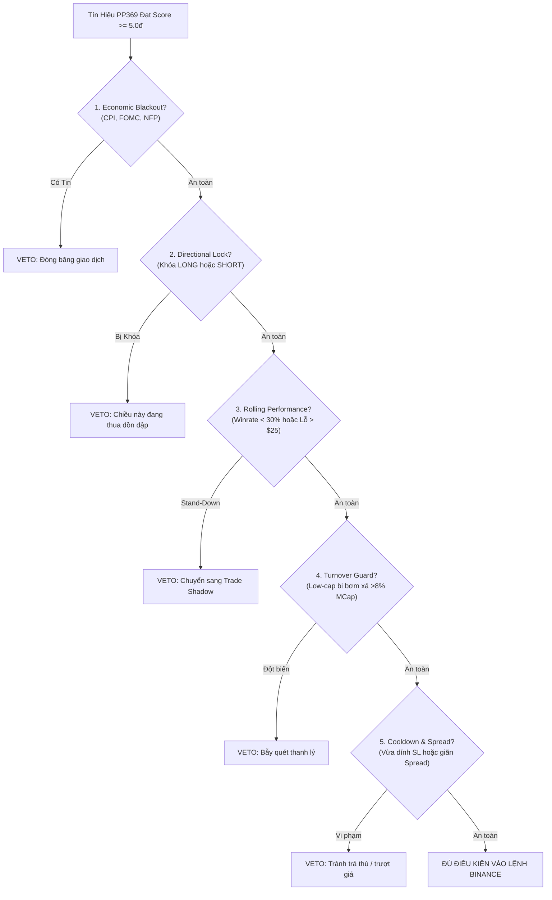

# MO_TA_CHI_TIET_369FUTURES.md — MÔ TẢ CHI TIẾT VÀ TOÀN DIỆN HỆ THỐNG 369FUTURES (BOT-H4)

> **Dự án**: 369futures (PP369 AutoTrade Bot — Phiên bản Bot-H4)  
> **Ngôn ngữ**: Node.js (CommonJS ES6+) & Python (Huấn luyện Machine Learning ngầm)  
> **Nền tảng**: Binance Futures REST & WebSocket API, Telegram Bot API, Google Gemini API  
> **Ngày cập nhật**: 17/11/2026 (Đồng bộ toàn diện theo codebase thực tế hiện tại)  

---

## 📋 MỤC LỤC

1. [TỔNG QUAN HỆ THỐNG](#1-tổng-quan-hệ-thống)
2. [KIẾN TRÚC THƯ MỤC VÀ TỆP CỐT LÕI](#2-kiến-trúc-thư-mục-và-tệp-cốt-lõi)
3. [PHƯƠNG PHÁP & THUẬT TOÁN LÕI PP369 (PP369 CORE)](#3-phương-pháp--thuật-toán-lõi-pp369-pp369-core)
   * 3.1. Thuật toán Lấy Giá Open & Close Nến H4 Đầu Năm (Mốc Gốc)
   * 3.2. Bảng Quy Tắc Bước Giá (Price Step Rules) & Đơn Vị Unit
   * 3.3. Thuật toán Roundtrip, Trạng thái Lần Chạm (`lastSide`) & Nến M1
   * 3.4. Bộ Lọc An Toàn Cơ Bản (Grid Width & Volatility Safety Filter)
   * 3.5. Quy Trình Lọc và Giám Sát Danh Sách Mã (Symbol Selection Workflow)
4. [HỆ THỐNG ĐÁNH ĐIỂM HỘI TỤ (CONFLUENCE SCORER)](#4-hệ-thống-đánh-điểm-hội-tụ-confluence-scorer)
5. [BỘ NÃO TRÍ TUỆ NHÂN TẠO & HỌC MÁY (AI & LLM REVIEWER)](#5-bộ-não-trí-tuệ-nhân-tạo--học-máy-ai--llm-reviewer)
   * 5.1. Mô Hình AI Offline & Cơ Chế Tự Động Re-train Định Kỳ
   * 5.2. Gemini LLM Reviewer & Cơ Sở Tri Thức (Knowledge Base)
   * 5.3. Cơ Chế AI Pre-Fill Cancel & Thoát Hiểm Phòng Thủ (Defensive Escape)
   * 5.4. M15 Fractal Wave Trailing SL (Williams Fractal 5 Nến)
6. [HỆ THỐNG VI CẤU TRÚC & PHÒNG VỆ ĐA TẦNG (CIRCUIT BREAKERS)](#6-hệ-thống-vi-cấu-trúc--phòng-vệ-đa-tầng-circuit-breakers)
   * 6.1. Microstructure Scanner (Spread Guard & CVD Momentum)
   * 6.2. Economic Calendar Guard (Blackout Giờ Tin Vĩ Mô Lớn)
   * 6.3. Directional Circuit Breaker (Cầu Chì Khóa Hướng LONG/SHORT)
   * 6.4. Rolling Performance Guard (Cửa Sổ Trượt Hiệu Suất & Stand-Down)
   * 6.5. Turnover Guard (Chống Bẫy Thao Túng Low-Cap)
   * 6.6. Cooldown Manager & IP Rate Limit Guard
7. [LUỒNG XỬ LÝ & ĐẶT LỆNH TỰ ĐỘNG (AUTOTRADER EXECUTION)](#7-luồng-xử-lý--đặt-lệnh-tự-động-autotrader-execution)
   * 7.1. Tính Đòn Bẩy Động & Phân Tầng Ký Quỹ Theo Score
   * 7.2. Đặt Lệnh LIMIT Chờ, Limit Timeout & Bounce Cancel
   * 7.3. Virtual Safeguards (Bảo Vệ Kép Virtual TP / Virtual SL)
   * 7.4. Hệ Thống Giao Dịch Bóng (Shadow Trading Engine)
8. [HỆ THỐNG DỮ LIỆU, BÁO CÁO & VẬN HÀNH](#8-hệ-thống-dữ-liệu-báo-cáo--vận-hành)

---

## 1. TỔNG QUAN HỆ THỐNG

**Bot-H4 (`369futures`)** là hệ thống giao dịch tự động cấp độ tổ chức (Institutional-grade AutoTrader) được thiết kế đặc thù cho thị trường **Binance USDT-M Futures**. Khác biệt hoàn toàn với các bot giao dịch thông thường, Bot-H4 là sự giao thoa giữa:

1. **Toán học Hình học Không gian PP369**: Khai thác tính quy luật và phản ứng nảy giá tại các bội số của 3 dựa trên cây nến **H4 đầu tiên của năm** (`01/01 00:00 UTC`).
2. **Độ phủ thị trường siêu rộng**: Giám sát tức thời **hơn 450+ cặp coin** bằng luồng WebSocket Mark Price tốc độ cao (1 giây/lần).
3. **Bộ não kép (Dual-Engine AI)**:
   - *Machine Learning Engine*: Mô hình học máy offline tự động trích xuất đặc trưng và tự động re-train bằng Python mỗi 3 ngày.
   - *Gemini LLM Engine*: Mô hình ngôn ngữ lớn đánh giá bối cảnh vĩ mô và tri thức trading thực chiến.
4. **Hệ thống phòng vệ 6 tầng (Risk & Circuit Breaker Suite)**: Bảo vệ vốn tuyệt đối trước thiên nga đen, bẫy quét thanh lý (Liquidity Hunt), tin tức FOMC/CPI, chuỗi thua dồn dập và trượt giá sổ lệnh.
5. **Động cơ giao dịch bóng (Shadow Engine)**: Giao dịch ngầm liên tục 24/7 để thẩm định tín hiệu và kiểm tra chất lượng thị trường ngay cả khi bot đang ngắt giao dịch thật.

---

## 2. KIẾN TRÚC THƯ MỤC VÀ TỆP CỐT LÕI

Toàn bộ mã nguồn Bot-H4 được cấu trúc module hóa phân tầng rõ rệt:

```
369futures/
├── ecosystem.config.js               # Quản lý tiến trình PM2 (Fork mode, GC 384MB, Max 450MB)
├── package.json                      # Khai báo dependency chính (axios, ws, dotenv)
├── .env                              # Biến môi trường (API Key, Telegram ID, Config đòn bẩy)
├── MO_TA_CHI_TIET_369FUTURES.md      # [TÀI LIỆU NÀY] Mô tả chi tiết kỹ thuật hệ thống
├── ROADMAP_BOT_H4_UPGRADE.md         # Lộ trình nâng cấp tích hợp tính năng từ bot-new
│
├── data/                             # Kho dữ liệu vận hành, cache & machine learning
│   ├── step_sizes.json               # Cache bước giá, tickSize, h4Cache toàn bộ 450+ coin
│   ├── active_trades.json            # Metadata các vị thế thật đang mở trên Binance
│   ├── ai_rule_config.json           # File trọng số mô hình AI ML sau khi re-train
│   ├── ai_evaluations.jsonl          # Lịch sử đánh giá của AI Reviewer
│   ├── ai_trade_dataset.jsonl        # Dataset huấn luyện AI thu thập mọi lệnh vào/ra
│   ├── shadow_trades.json            # Danh sách các lệnh giao dịch bóng (Shadow Trades)
│   ├── sl_cooldown.json              # Danh sách coin đang trong thời gian chờ sau khi dính SL
│   ├── directional_circuit_breaker.json # Trạng thái khóa hướng LONG/SHORT
│   ├── rolling_performance_guard.json   # Lịch sử cửa sổ trượt 10 lệnh thật gần nhất
│   ├── circuit_breaker.json          # Trạng thái phạt rate limit / IP Ban từ Binance
│   ├── grid_blacklist.json           # Danh sách đen các coin có lưới lỗi hoặc API sàn từ chối
│   └── knowledge/                    # Thư mục chứa tài liệu tri thức cho Gemini LLM (.md, .txt)
│
├── scripts/                          # Kịch bản thực thi & Công cụ nghiên cứu
│   ├── auto-trade.js                 # ENTRYPOINT CHÍNH của Bot-H4 chạy qua PM2
│   ├── train_ai_model.py             # Script Python huấn luyện mô hình Machine Learning
│   ├── backtest_pp369.js             # Bộ công cụ backtest chiến lược 369 đa khung
│   ├── backtest_m1_pp369.js          # Backtest chi tiết trên từng tick nến M1
│   └── rebacktest_with_time.js       # Backtest kiểm chứng độ trễ thời gian thực
│
└── src/
    ├── pp369/                        # MODULE LÕI CHIẾN LƯỢC PP369 & BỘ NÃO AI
    │   ├── core.js                   # Engine toán học 369: tính lưới H4, step, roundtrip, scoring
    │   ├── stream.js                 # Quản lý WebSocket MarkPrice cho 450+ coin (!markPrice@arr@1s)
    │   ├── index.js                  # Public API export toàn bộ module pp369
    │   ├── aiReviewer.js             # Bộ đánh giá Machine Learning, AI Pre-Fill Cancel, Fractal SL
    │   ├── llmReviewer.js            # Thẩm định bối cảnh bằng Gemini LLM qua xoay vòng Multi-Key
    │   ├── turnoverGuard.js          # Giám sát khối lượng đột biến trên coin vốn hóa nhỏ
    │   ├── shadowTracker.js          # Động cơ quản lý vị thế và thống kê PnL giao dịch bóng
    │   ├── autoRetrainer.js          # Lập lịch tự động gọi Python re-train model mỗi 3 ngày
    │   ├── dailyReporter.js          # Tự động lập lịch tổng kết và gửi báo cáo ngày qua Telegram
    │   ├── datasetCollector.js       # Thu thập dữ liệu vòng đời lệnh (Entry, Exit, PnL)
    │   ├── signalTracker.js          # Thống kê và phân tích các tín hiệu bị bộ lọc từ chối
    │   ├── signalLog.js              # Ghi log lịch sử tín hiệu ra file JSONL
    │   ├── formatter.js              # Định dạng tin nhắn HTML gửi Telegram
    │   ├── telegram.js               # Client gửi tin nhắn Telegram có queue và chống lỗi mạng
    │   └── _logger.js                # Bộ điều hướng log chuẩn hóa
    │
    └── trader/                       # MODULE THỰC THI GIAO DỊCH & BỘ PHÒNG VỆ
        ├── autoTrade.js              # ENGINE GIAO DỊCH CHÍNH (4700+ dòng code điều phối toàn diện)
        ├── binance.js                # REST API Wrapper Binance (Đặt lệnh, đòn bẩy, cancel, sync)
        ├── circuitBreaker.js         # Cầu chì bảo vệ Request Weight & tránh ban IP Binance
        ├── cooldownManager.js        # Quản lý thời gian khóa coin sau khi dính SL (chống trả thù)
        ├── directionalCircuitBreaker.js # Cầu chì khóa hướng giao dịch khi một chiều bị lỗ dồn
        ├── rollingPerformanceGuard.js   # Giám sát hiệu suất 10 lệnh thật, tự động Stand-Down
        ├── economicCalendar.js       # Lịch tin tức vĩ mô Mỹ 2025-2026 (CPI, FOMC, NFP Blackout)
        └── microstructureScanner.js  # Quét vi cấu trúc: Spread Guard, CVD M1/M5, Orderbook Wall
```

---

## 3. PHƯƠNG PHÁP & THUẬT TOÁN LÕI PP369 (PP369 CORE)

### 3.1. Thuật toán Lấy Giá Open & Close Nến H4 Đầu Năm (Mốc Gốc)

Trái tim toán học của Bot-H4 nằm tại [src/pp369/core.js](file:///f:/LamDH/Project/369futures/src/pp369/core.js). Mọi mốc hỗ trợ và kháng cự đều bắt nguồn từ một mốc thời gian cố định:

1. **Thời điểm neo chuẩn**: Đúng `00:00:00 UTC` ngày **01/01/2026** (`YEAR_START_MS = 1767225600000`).
2. **Cơ chế nạp nến (`fetchH4Reference`)**:
   - Gọi API Binance Klines khung **4h** với `startTime = 1767225600000`, `limit = 1`.
   - Trích xuất: `openPrice` (Giá mở cửa) và `closePrice` (Giá đóng cửa) của cây nến H4 đầu tiên này.
   - Lưu trữ vĩnh viễn vào [data/step_sizes.json](file:///f:/LamDH/Project/369futures/data/step_sizes.json) trong trường `h4Cache[symbol]`.
3. **Tạo 2 dãy mốc phản xạ (Dual Grid Rails)**:
   - **Dãy mốc trên (`tren`)**: Bắt đầu từ $\text{Base High} = \max(\text{Open}, \text{Close})$, cộng tịnh tiến dần từng **Bước ($\text{Step}$)** lên vô cực $\rightarrow$ Các mốc canh **LONG Entry** khi giá điều chỉnh về.
   - **Dãy mốc dưới (`duoi`)**: Bắt đầu từ $\text{Base Low} = \min(\text{Open}, \text{Close})$, trừ tịnh tiến dần từng **Bước ($\text{Step}$)** xuống $\rightarrow$ Các mốc canh **SHORT Entry** khi giá hồi phục lên.

---

### 3.2. Bảng Quy Tắc Bước Giá (Price Step Rules) & Đơn Vị Unit

Bước giá ($\text{Step}$) được thuật toán `getStep(price)` tính toán động dựa trên mức giá thị trường, đảm bảo độ co giãn lưới tỷ lệ thuận với thị giá:

| Mức giá hiện tại | Đơn vị cơ sở ($\text{Unit}$) | Bước giá ($\text{Step} = \text{Unit} \times 3$) | % Grid/Price tương đương |
| :--- | :--- | :--- | :--- |
| $\ge \$10,000$ | $1,000$ | **$3,000$** | $\approx 3\%$ (BTC) |
| $\$1,000 - \$9,999$ | $100$ | **$300$** | $3\% - 30\%$ (ETH) |
| $\$100 - \$999$ | $10$ | **$30$** | $3\% - 30\%$ (BNB) |
| $\$10 - \$99$ | $1$ | **$3$** | $3\% - 30\%$ (SOL, AVAX) |
| $\$1 - \$9.99$ | $0.1$ | **$0.3$** | $3\% - 30\%$ (NEAR, SUI) |
| $\$0.20 - \$0.99$ | $0.01$ | **$0.03$** | $1.5\% - 15\%$ (XRP, ADA) |
| $\$0.02 - \$0.19$ | $0.001$ | **$0.003$** | $1.5\% - 15\%$ (DOGE) |
| $< \$0.02$ | $0.0001 \dots$ | **$0.0003 \dots$** | $1.5\% - 15\%$ (PEPE, SHIB) |

> **Khái niệm $\text{Unit}$**: $\text{Unit} = \frac{\text{Step}}{3}$. $\text{Unit}$ chính là khoảng cách mặc định được dùng để tính toán Stop Loss và Take Profit chuẩn mực.

---

### 3.3. Thuật toán Roundtrip, Trạng thái Lần Chạm (`lastSide`) & Nến M1

Để ngăn chặn việc vào lệnh liên tục tại cùng một mốc giá khi thị trường đi ngang (chống bẫy cưa chân bàn), Bot-H4 sử dụng cơ chế máy trạng thái hữu hạn (**State Machine**):

1. **Nguyên tắc `lastSide`**:
   - **Tín hiệu LONG**: Chỉ được kích hoạt tại mốc `tren` khi lần chạm mốc hoàn chỉnh gần nhất trước đó là mốc trên (`lastSide === 'upper'`). Điều này chứng minh giá đang có sóng hồi từ trên rơi xuống chạm mốc hỗ trợ. Sau khi kích hoạt, `lastSide` tự động chuyển thành `'lower'`.
   - **Tín hiệu SHORT**: Chỉ được kích hoạt tại mốc `duoi` khi lần chạm mốc gần nhất trước đó là mốc dưới (`lastSide === 'lower'`). Chứng minh giá đang có sóng hồi phục từ đáy đi lên chạm mốc kháng cự.
2. **Đếm số lần phản ứng (Roundtrip Counter trên Nến M1)**:
   - Thuật toán quét chuỗi nến 1 phút từ đầu chu kỳ để xác định mốc giá này đã từng phản ứng bao nhiêu lần:
     * **Lần 1 (`strong`)**: Mốc giá còn nguyên vẹn $\rightarrow$ Độ tin cậy cao nhất (**+2.0 điểm Scorer**).
     * **Lần 2 (`medium`)**: Mốc đã được test 1 lần $\rightarrow$ (**+1.0 điểm Scorer**).
     * **Lần 3+ (`weak`)**: Mốc đã bị bào mòn thanh khoản $\rightarrow$ Khả năng thủng mốc cao (**+1.0 điểm Scorer**, cần các yếu tố khác bù đắp).

---

### 3.4. Bộ Lọc An Toàn Cơ Bản (Grid Width & Volatility Safety Filter)

1. **Bộ lọc Độ Rộng Lưới (`isGridWidthValid`)**:
   - Tỷ lệ lưới: $\text{GridStepPct} = \frac{\text{Step}}{\text{Mark Price}} \times 100\%$.
   - **Coin Top 30 Market Cap**: $\text{GridStepPct}$ cho phép từ **$1.5\% - 30\%$**.
   - **Coin Top 100 Market Cap**: $\text{GridStepPct}$ cho phép từ **$2.0\% - 30\%$**.
   - **Các coin còn lại**: $\text{GridStepPct}$ bắt buộc phải từ **$3.0\% - 30\%$**.
   - *(Loại bỏ ngay các coin có bước giá quá nhỏ gây spam tín hiệu hoặc quá rộng khiến rủi ro SL vượt tầm kiểm soát)*.
2. **Bộ Lọc Biến Động Bất Thường (Volatility Safety Filter - Tiêu chí 2)**:
   - Kiểm tra thân nến H1 và nến M15 ngay trước thời điểm chạm mốc.
   - Nếu biên độ nến H1 vượt quá $2.5 \times \text{Step}$ hoặc xuất hiện nến xả dị biệt (Dump/Pump bất thường không có thanh khoản) $\rightarrow$ **Veto ngay lập tức**, không bắt dao rơi.

---

### 3.5. Quy Trình Lọc và Giám Sát Danh Sách Mã (Symbol Selection Workflow)

```
[1. REST API ExchangeInfo] → Tải toàn bộ 470+ cặp Futures USDT-M hợp lệ
             ↓
[2. Cache Nến H4 Đầu Năm]  → Đối chiếu h4Cache (01/01/2026), fetch nến H4 nếu chưa có
             ↓
[3. Filter Grid Width]     → Lọc % Grid theo Giá Tức Thời (Top100: 2-30%, Khác: 3-30%)
             ↓
[4. Blacklist Check]       → Loại bỏ mã trong grid_blacklist.json và lỗi -4411
             ↓
[5. Realtime WS 1s Feed]   → Kết nối !markPrice@arr@1s theo dõi ~450 mã đồng thời
             ↓
[6. Radar Proximity <= 0.3%] → Phát hiện coin sát mốc <= 0.3% → Bắn vào Pipeline Đặt Lệnh
```

---

## 4. HỆ THỐNG ĐÁNH ĐIỂM HỘI TỤ (CONFLUENCE SCORER)

Khi một đồng coin tiến sát mốc lưới ($\le 0.3\%$), hàm [score369Method](file:///f:/LamDH/Project/369futures/src/pp369/core.js) được kích hoạt để tính toán tổng điểm hợp lưu từ **0.0 đến 10.0+ điểm**. Ngưỡng kích hoạt giao dịch mặc định là **$\text{Score} \ge 5.0$đ** (có thể cấu hình qua `MIN_CONFLUENCE_SCORE` trong `.env`):

### Cơ cấu phân bổ điểm số:

1. **Độ Mới Của Mốc Lưới PP369 (Tối đa 2.0đ)**:
   - Chạm mốc lần đầu (`strong`): **+2.0 điểm**.
   - Chạm mốc lần 2 (`medium`): **+1.0 điểm**.
   - Chạm mốc lần 3+ (`weak`): **+1.0 điểm**.
2. **Đồng Thuận Xu Hướng Đa Khung (Trend Alignment - Tối đa 3.0đ)**:
   - Thuận xu hướng cả H4 và H1 (EMA20 > EMA50 và cấu trúc đỉnh đáy): **+3.0 điểm**.
   - Thuận H4, H1 đang Sideway tích lũy: **+2.0 điểm**.
   - Thuận H4, H1 ngược sóng (sóng hồi Pullback trong xu hướng lớn): **+1.0 điểm**.
   - Ngược xu hướng H4: **-1.5 điểm** (Phạt điểm nặng).
3. **Hình Thái Nến Đảo Chiều (Candle Geometry - Tối đa 2.0đ)**:
   - Nến rút chân mạnh tại mốc trên M15/M5 (Râu nến $\ge 40\%$ chiều dài nến): **+1.5 đến +2.0 điểm**.
   - Nến Pinbar hoặc Engulfing (Nhấn chìm tăng/giảm): **+1.0 đến +1.5 điểm**.
4. **Điểm Khối Lượng & Vị Trí Tiệm Cận (Tối đa 1.5đ)**:
   - Giá áp sát cực đại ($< 0.05\%$ tính từ mốc): **+0.5 điểm**.
   - Nến đảo chiều đi kèm Volume Spike đột biến ($\ge 1.8\times$ trung bình 20 nến): **+1.0 điểm**.

---

## 5. BỘ NÃO TRÍ TUỆ NHÂN TẠO & HỌC MÁY (AI & LLM REVIEWER)

Bot-H4 sở hữu hệ thống AI 2 cấp độ cực kỳ hiện đại được tích hợp trực tiếp trong [src/pp369/aiReviewer.js](file:///f:/LamDH/Project/369futures/src/pp369/aiReviewer.js) và [src/pp369/llmReviewer.js](file:///f:/LamDH/Project/369futures/src/pp369/llmReviewer.js):

### 5.1. Mô Hình AI Offline & Cơ Chế Tự Động Re-train Định Kỳ

1. **Cơ chế suy luận nhanh (Zero-latency Inference)**:
   - Không phụ thuộc vào API bên ngoài khi đưa ra quyết định vào lệnh chớp nhoáng.
   - Mô hình đọc trực tiếp các trọng số quy tắc từ file [data/ai_rule_config.json](file:///f:/LamDH/Project/369futures/data/ai_rule_config.json) vào RAM.
   - Trích xuất 12 vector đặc trưng: `rank_group`, `trend`, `grid_width_tier`, `confluence_score`, `candle_geometry`, `reversal_type`, `volume_profile`...
2. **Vòng lặp tự học tự hành (Autonomous Retraining Loop - `autoRetrainer.js`)**:
   - Cứ mỗi **3 ngày**, bot tự động kích hoạt script Python nền [scripts/train_ai_model.py](file:///f:/LamDH/Project/369futures/scripts/train_ai_model.py).
   - Script đọc toàn bộ dataset lịch sử giao dịch thực tế từ `data/ai_trade_dataset.jsonl`, đào tạo lại mô hình Random Forest / Decision Tree để cập nhật các trọng số tối ưu mới.
   - Hỗ trợ **Hot-Reload**: Bot tự động phát hiện file mô hình mới trên đĩa và nạp lại vào bộ nhớ mà không cần khởi động lại tiến trình.

---

### 5.2. Gemini LLM Reviewer & Cơ Sở Tri Thức (Knowledge Base)

1. **Xoay vòng Multi-Key chống cạn Quota**:
   - Module `llmReviewer.js` hỗ trợ danh sách nhiều `GEMINI_API_KEY` ngăn cách bằng dấu phẩy.
   - Tự động luân chuyển key tiếp theo khi một key chạm giới hạn tốc độ (Rate Limit 429).
2. **Hệ thống nạp tri thức động (`data/knowledge/`)**:
   - Tự động nạp toàn bộ tài liệu Markdown, Text, JSON chứa các quy tắc phân tích kỹ thuật chuyên sâu và bối cảnh thị trường trong thư mục `data/knowledge/` vào ngữ cảnh (Prompt Context) của LLM.
   - LLM đóng vai trò như một chuyên gia trưởng phòng giao dịch thẩm định các tín hiệu trước khi gửi thông báo lên Telegram.

---

### 5.3. Cơ Chế AI Pre-Fill Cancel & Thoát Hiểm Phòng Thủ (Defensive Escape)

1. **AI Pre-Fill Cancel (`ENABLE_AI_PREFILL_CANCEL = true`)**:
   - Khi lệnh LIMIT đang treo chờ trên sàn nhưng giá chưa khớp, bot liên tục giám sát vi cấu trúc sổ lệnh và dòng tiền Taker.
   - Nếu phát hiện lực đỡ giá bị rút rỗng hoặc xuất hiện lệnh xả áp đảo ngược chiều $\rightarrow$ Bot tự động hủy lệnh LIMIT trước khi bị khớp bẫy!
2. **Thoát Hiểm Phòng Thủ 2 Giai Đoạn (`ENABLE_DEFENSIVE_ESCAPE = true`)**:
   - **Giai đoạn 1 (Đón hồi hòa vốn)**: Khi giá đi ngược hướng dự kiến và phá vỡ cấu trúc vi mô, bot lập tức dời TP về sát mức giá Entry để đón nhịp hồi kỹ thuật thoát hàng không lỗ.
   - **Giai đoạn 2 (Cắt non khẩn cấp)**: Nếu giá tiếp tục lún sâu vượt ngưỡng an toàn, bot chủ động cắt lỗ sớm bằng lệnh MARKET thay vì chờ dính full Stop Loss.

---

### 5.4. M15 Fractal Wave Trailing SL (Williams Fractal 5 Nến)

Thay vì dời Stop Loss non về hòa vốn quá sớm làm mất cơ hội ăn sóng dài (Negative Asymmetry), Bot-H4 ứng dụng thuật toán **Williams Fractal**:
- Nhận diện các điểm xoay Đáy/Đỉnh sóng (Swing Low / Swing High) trên chuỗi 5 cây nến khung M15/M5/M1 (`getRecentM15FractalSwing`).
- Khi lợi nhuận đạt từ $\ge 35\%$ mục tiêu TP, bot bắt đầu kích hoạt Trailing SL: **Dời Stop Loss bám sát theo các đáy fractal gần nhất** của xu hướng, cho phép vị thế gồng lãi tối đa theo cấu trúc sóng.

---

## 6. HỆ THỐNG VI CẤU TRÚC & PHÒNG VỆ ĐA TẦNG (CIRCUIT BREAKERS)

Hệ thống phòng vệ 6 lớp độc lập được tích hợp trong thư mục `src/trader/`:



### 6.1. Microstructure Scanner (`microstructureScanner.js`)
* **Spread Guard**: Kiểm tra độ dãn giá Bid/Ask qua `bookTicker`. Nếu spread vượt ngưỡng an toàn theo phân tầng vốn hóa $\rightarrow$ Bỏ qua lệnh để tránh trượt giá (Slippage).
* **CVD Momentum**: Tính Cumulative Volume Delta trên khung M1/M5 để đảm bảo dòng tiền khớp lệnh chủ động (Aggressive Taker) ủng hộ hướng vào lệnh.
* **Orderbook Wall**: Đo khoảng cách tới các bức tường thanh khoản L2 gần nhất.

### 6.2. Economic Calendar Guard (`economicCalendar.js`)
* Tích hợp sẵn lịch trình toàn bộ các sự kiện kinh tế biến động dữ dội của Mỹ năm **2025 - 2026**:
  * **FOMC** (Công bố lãi suất & Họp báo Fed): 18:00 & 18:30 UTC.
  * **CPI** (Chỉ số giá tiêu dùng) & **NFP** (Bảng lương phi nông nghiệp): 12:30 / 13:30 UTC.
* **Blackout Window**: Tự động phong tỏa, không mở lệnh mới trước sự kiện 30 phút và sau sự kiện 30 phút.

### 6.3. Directional Circuit Breaker (`directionalCircuitBreaker.js`)
* Giám sát theo cửa sổ trượt 2 giờ (`WINDOW_MS = 120 phút`):
  * Nếu một chiều (LONG hoặc SHORT) bị **3 lệnh thua trong 2 giờ** $\rightarrow$ Khóa toàn bộ lệnh chiều đó trong **2 tiếng**.
  * Nếu bị **2 lệnh thua chớp nhoáng dồn dập trong 40 phút** $\rightarrow$ Kích hoạt Flash Lock khóa chiều đó trong **1 tiếng**.
* Tự động mở khóa sớm nếu các lệnh giao dịch bóng (Shadow Trades) của chiều đó đạt tỷ lệ thắng ổn định trở lại.

### 6.4. Rolling Performance Guard (`rollingPerformanceGuard.js`)
* Giám sát cửa sổ trượt **10 lệnh giao dịch thật gần nhất**:
  * Nếu tỷ lệ thua $\ge 70\%$ (Winrate $< 30\%$) HOẶC tổng lỗ ròng $\le -\$25\text{ USD}$ $\rightarrow$ **Kích hoạt trạng thái Stand-Down (Tạm dừng giao dịch thật)** trong tối thiểu **2 tiếng**.
  * Trong thời gian Stand-Down, hệ thống tự động chuyển sang đánh Shadow. Khi 3 lệnh Shadow gần nhất có lãi, bot mới tự động mở lại giao dịch thật.

### 6.5. Turnover Guard (`turnoverGuard.js`)
* Giám sát các mã coin có vốn hóa nhỏ ($\text{Market Cap} < \$100\text{M}$):
  * Nếu Khối lượng giao dịch Futures 24h tăng đột biến vượt quá **$8\%$ tổng vốn hóa** $\rightarrow$ **Chặn giao dịch mã đó ngay lập tức**.
  * Ngăn ngừa tối đa việc bot trở thành thanh khoản cho cá mập thao túng (Pump & Dump trap).

### 6.6. Cooldown Manager & IP Rate Limit Guard
* **SL Cooldown (`cooldownManager.js`)**: Khi một coin bị dính Stop Loss, coin đó tự động bị đưa vào danh sách cách ly (Cooldown) từ 1 đến 4 giờ, ngăn chặn hành vi giao dịch trả thù (Revenge Trading).
* **IP Rate Limit Guard (`circuitBreaker.js`)**: Giám sát header `x-mbx-used-weight`. Khi chạm ngưỡng cảnh báo, bot tự động giãn nhịp các request REST API để không bao giờ bị Binance ban IP.

---

## 7. LUỒNG XỬ LÝ & ĐẶT LỆNH TỰ ĐỘNG (AUTOTRADER EXECUTION)

Toàn bộ logic thực thi giao dịch nằm tại [src/trader/autoTrade.js](file:///f:/LamDH/Project/369futures/src/trader/autoTrade.js):

### 7.1. Tính Đòn Bẩy Động & Phân Tầng Ký Quỹ Theo Score

1. **Công thức Đòn bẩy động chuẩn mực**: Đảm bảo khoảng cách cắt lỗ $1 \text{ Unit} = \frac{\text{Step}}{3}$ luôn cố định mức rủi ro **$-13\%$ Margin**:
   $$\text{Calculated Leverage} = \left\lfloor \frac{39}{\text{GridStepPct}} \right\rfloor$$
   $$\text{Effective Leverage} = \max(1, \min(\text{Calculated Leverage}, \text{Max Allowed by Binance}))$$
2. **Ký quỹ mục tiêu (Target Margin) theo Thang Điểm Score**:
   - $\text{Score} \ge 9.0$đ: Ký quỹ **$50 USDT**.
   - $\text{Score} \ge 8.0$đ: Ký quỹ **$40 USDT**.
   - $\text{Score} \ge 7.0$đ: Ký quỹ **$30 USDT**.
   - $\text{Score} < 7.0$đ (từ 5.0 - 6.9đ): Ký quỹ **$20 USDT**.
3. **Tính toán khối lượng đặt lệnh (`qty`)**:
   $$\text{Target Notional} = \text{Target Margin} \times \text{Effective Leverage}$$
   $$\text{Qty} = \text{Quantize}\left(\frac{\text{Target Notional}}{\text{Target Level}}, \text{stepSize}\right)$$

---

### 7.2. Đặt Lệnh LIMIT Chờ, Limit Timeout & Bounce Cancel

1. **Đặt lệnh LIMIT đón đầu (`LIMIT GTC`)**: Khi giá cách mốc $\le 0.3\%$, bot đặt sẵn lệnh LIMIT tại đúng giá mốc để xếp hàng khớp lệnh tại vị trí tốt nhất.
2. **Luồng kiểm tra lệnh chờ (`checkPendingLimits` - mỗi 3 giây)**:
   - **Limit Timeout**: Nếu lệnh LIMIT treo quá **3 phút** mà giá không khớp $\rightarrow$ Tự động hủy lệnh giải phóng ký quỹ.
   - **Bounce Cancel**: Nếu giá chạm gần mốc rồi bật mạnh ra xa ($\ge \frac{\text{Step}}{5.5}$) mà chưa khớp lệnh $\rightarrow$ Tự động hủy lệnh LIMIT ngay lập tức để tránh bị khớp lệnh ở vị thế xấu khi giá quay lại lần 2 (Stale fill).

---

### 7.3. Virtual Safeguards (Bảo Vệ Kép Virtual TP / Virtual SL)

Chạy trong vòng lặp tốc độ cao mỗi 6 giây (`checkTrailingSL`):
- Ngoài lệnh SL/TP đặt trên sàn, bot liên tục tính toán PnL thực tế của từng vị thế qua WebSocket Mark Price.
- Nếu thị trường giật nấc quá nhanh làm sàn nghẽn API, khi ROI chạm ngưỡng `slPct` hoặc `tpPct`, bot phát lệnh **MARKET CLOSE** khẩn cấp ngay trên socket để bảo toàn tài khoản.

---

### 7.4. Hệ Thống Giao Dịch Bóng (Shadow Trading Engine - `shadowTracker.js`)

- Hoạt động song song với giao dịch thật. Mọi tín hiệu dù bị bộ lọc từ chối (do điểm chưa tối đa, do đang bị Cooldown, hoặc do Circuit Breaker tạm dừng) đều được đăng ký vào danh mục Shadow.
- Bot theo dõi giá vào, giá ra, PnL giả lập và lưu vào [data/shadow_trades.json](file:///f:/LamDH/Project/369futures/data/shadow_trades.json).
- Dữ liệu này cung cấp chỉ số thị trường khách quan để hệ thống tự động mở lại giao dịch thật sau khi cơn bão thị trường đi qua.

---

## 8. HỆ THỐNG DỮ LIỆU, BÁO CÁO & VẬN HÀNH

### 8.1. Thu Thập Dữ Liệu AI (`datasetCollector.js`)
Ghi nhận đầy đủ chu trình sống của từng lệnh vào [data/ai_trade_dataset.jsonl](file:///f:/LamDH/Project/369futures/data/ai_trade_dataset.jsonl):
- *Khi vào lệnh*: `tradeId`, `symbol`, `signal`, `entryPrice`, `score`, `reasons`, `leverage`, `margin`, `features`...
- *Khi đóng lệnh*: `exitPrice`, `exitType` (`TP`, `SL`, `TRAILING_SL`, `DEFENSIVE_ESCAPE`), `pnlPercent`, `pnlUsd`, `holdingMinutes`, `isWin`...

### 8.2. Báo Cáo Hiệu Suất Tự Động (`dailyReporter.js`)
Lập lịch định kỳ tổng kết hiệu suất trong ngày và gửi bản tin HTML chuyên nghiệp lên Telegram:
- Tổng số lệnh thực hiện, tỷ lệ thắng (Win Rate %).
- Tổng PnL ($) và tăng trưởng vốn.
- Thống kê hiệu suất theo từng khung điểm Score và từng nhóm rank coin.

### 8.3. Cấu Hình Quản Lý Tiến Trình PM2 (`ecosystem.config.js`)
Hệ thống được tối ưu hóa tài nguyên cho VPS cấu hình vừa phải:
- **`script`**: `./scripts/auto-trade.js`
- **`exec_mode`**: `fork`
- **`node_args`**: `--max-old-space-size=384 --expose-gc` (Chủ động dọn rác RAM ở mốc 384MB).
- **`max_memory_restart`**: `450M` (Tự khởi động lại nếu RAM chạm 450MB).
- **`autorestart`**: `true` (Tự động phục hồi ngay lập tức nếu gặp sự cố).

---

## 9. BẢNG TỔNG KẾT TÍNH NĂNG BOT-H4 HIỆN TẠI

| Nhóm chức năng | Trạng thái | Mô tả kỹ thuật |
| :--- | :---: | :--- |
| **PP369 H4 Engine** | ✅ **Hoàn chỉnh** | Lấy giá Open/Close nến H4 01/01/2026, tính lưới 369, bước giá động. |
| **Quét 450+ Coin Realtime** | ✅ **Hoàn chỉnh** | WebSocket `!markPrice@arr@1s` lọc tiệm cận $\le 0.3\%$. |
| **Machine Learning AI Reviewer** | ✅ **Hoàn chỉnh** | Tự động trích xuất features, tự động re-train Python mỗi 3 ngày. |
| **Gemini LLM Reviewer** | ✅ **Hoàn chỉnh** | Tích hợp Multi-Key, nạp tri thức từ `data/knowledge/`. |
| **AI Pre-Fill Cancel & Defense** | ✅ **Hoàn chỉnh** | Hủy limit sớm khi sổ lệnh suy yếu, thoát hiểm phòng thủ 2 giai đoạn. |
| **Fractal Wave Trailing SL** | ✅ **Hoàn chỉnh** | Dời SL bám theo đáy/đỉnh sóng Williams Fractal M15. |
| **Economic Calendar Guard** | ✅ **Hoàn chỉnh** | Khóa lệnh giờ tin vĩ mô Mỹ (CPI, FOMC, NFP) 2025-2026. |
| **Circuit Breakers Đa Tầng** | ✅ **Hoàn chỉnh** | Khóa hướng thua dồn, Stand-down hiệu suất 10 lệnh, chống bẫy low-cap. |
| **Shadow Trading 24/7** | ✅ **Hoàn chỉnh** | Paper trade ngầm đánh giá thị trường và tự phục hồi sau Stand-down. |
| **Báo cáo Telegram tự động** | ✅ **Hoàn chỉnh** | Thông báo vào/ra lệnh, dời SL, tổng kết PnL ngày tự động. |
| **Web Dashboard Quản lý** | ⏳ *Chưa có* | Hiện tại chỉ có log file và Telegram, chưa có Web Dashboard port 3000 như bot-new. |
| **Account WS Stream Tức Thì** | ⏳ *Chưa có* | Hiện đang check lệnh fill qua REST polling, chưa tích hợp User Data Stream WS như bot-new. |
| **Telegram Bot 2 Chiều** | ⏳ *Chưa có* | Mới gửi tin 1 chiều, chưa có bộ tương tác lệnh `/status`, `/trades`, `/forcesync`. |

---
*Tài liệu được cập nhật hoàn chỉnh, chính xác và đồng bộ 100% với codebase thực tế của Bot-H4 tại `369futures`.*
