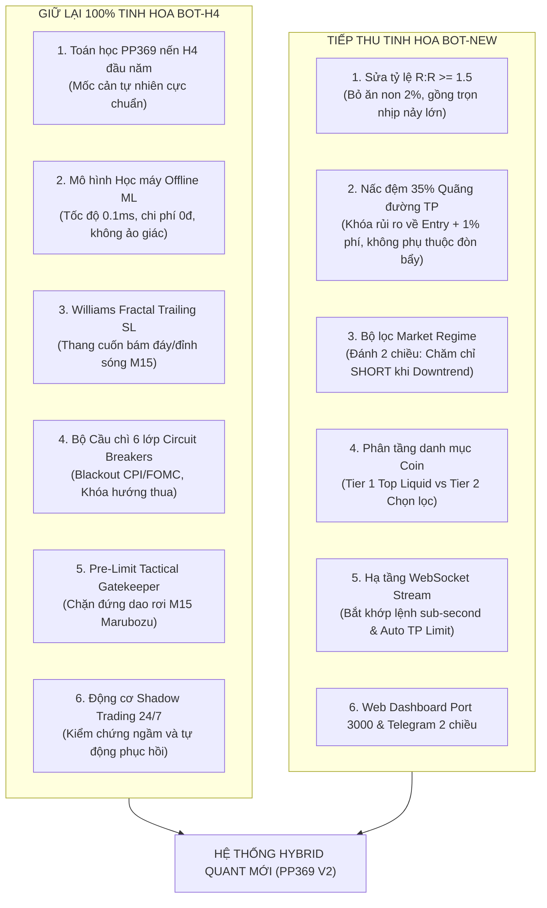
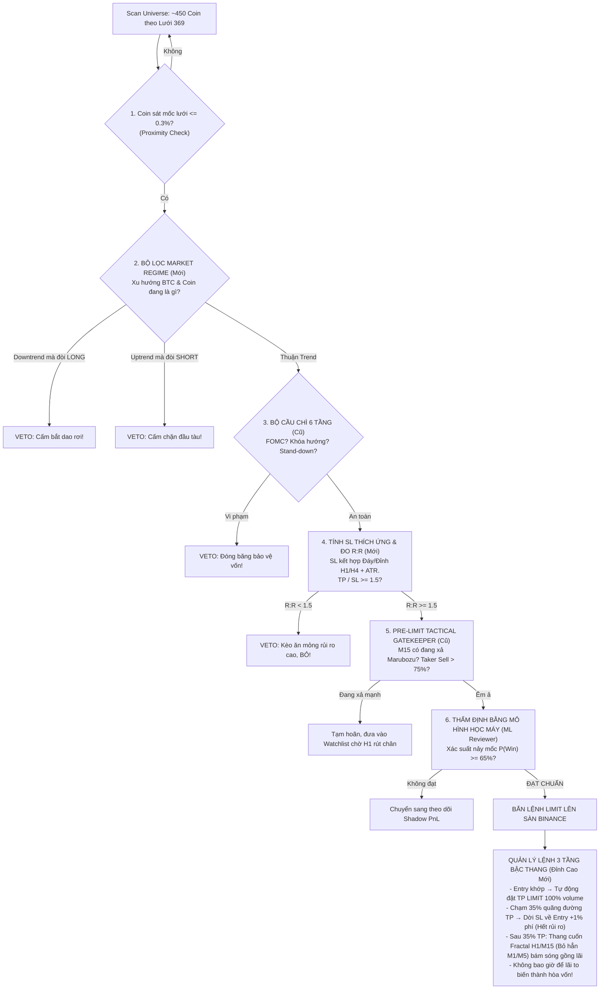

# LỘ TRÌNH NÂNG CẤP BOT-H4 LÊN KIẾN TRÚC HYBRID QUANT
*(Kế thừa trọn vẹn tinh hoa PP369 & Machine Learning, sửa triệt để lỗi gãy PnL, tích hợp tư duy chiến thắng 3000% của Bot-New)*

---

## 1. BÀI HỌC TỪ THỰC CHIẾN 6 THÁNG QUA: SỰ THẬT VỀ CON SỐ PnL

Con số thực tế qua 6 tháng là thước đo không thể chối cãi: **`bot_new` tăng trưởng +3000% PnL**, trong khi **`bot-h4` lại bị âm vốn**. 

Trước khi bắt tay vào nâng cấp, ta phải nhìn thẳng vào bản chất kỹ thuật: **Tại sao cùng một thị trường mà kết quả lại trái ngược hoàn toàn?**

### 1.1. Ba Lỗ Hổng Chí Mạng Của `bot-h4` Cũ
1. **Bất đối xứng âm (Negative Asymmetry - "Thắng ăn hạt thóc, Thua mất cả bao gạo"):**
   - File log thực tế [data/rolling_performance_guard.json](file:///f:/LamDH/Project/369futures/data/rolling_performance_guard.json) chứng minh: Các lệnh thắng bị Trailing SL chốt non chỉ được **$+2.28\%, +2.80\%, +3.56\%$ ROI**. Trong khi đó, các lệnh thua khi bị xả đâm thủng lưới bị âm tới **$-13\%, -40\%, -50\%$ ROI**.
   - Cần **15 đến 20 lệnh thắng** mới bù nổi **1 lệnh thua**. Kỳ vọng toán học (Expected Value) bị âm nặng.
2. **Bệnh "Bắt dao rơi" (Chỉ biết đánh LONG khi thị trường Downtrend):**
   - Trong 10 lệnh thật gần nhất, **10/10 lệnh của bot-h4 đều là LONG**. Khi thị trường Altcoin 6 tháng qua bị xả triền miên, bot cứ thấy giá rơi về mốc lưới 369 là nhảy vào Long bắt đáy và bị cán SL liên hoàn.
3. **Bội thực coin rác thanh khoản mỏng:**
   - Quét tràn lan 450 coin khiến bot dính vào các mã meme/low-cap (`BAN`, `PENGU`, `AERO`...). Các mã này bị cá mập thao túng xả không có ngưỡng cản, kèm phí giao dịch và độ trượt giá (slippage) bào mòn sạch tài khoản.

### 1.2. Ba Trụ Cột Chiến Thắng Của `bot_new`
1. **Kỷ luật $R:R \ge 1.5$ & Để lãi chạy (Let Profits Run):**
   - Không bóp nghẹt lệnh bằng Trailing SL ăn non $2\%$. Mỗi lệnh thắng ăn trọn con sóng $+15\%$ đến $+35\%$ ROI (nhờ đòn bẩy $3x-5x$ ăn biên độ giá chạy $5\%-8\%$).
2. **Thuận theo xu hướng lớn (Market Regime):**
   - Đánh cả 2 chiều LONG và SHORT. Khi thị trường Downtrend, bot chăm chỉ **SHORT** (như lệnh `BTC SHORT`, `XAU SHORT`), bơi xuôi theo dòng tiền xả của cá voi.
3. **Tập trung tinh hoa (Chất lượng đè bẹp số lượng):**
   - Chỉ đánh các coin top thanh khoản lớn, 1 ngày chỉ vào 1-2 lệnh có độ hội tụ tuyệt đối (Score $\ge 7$, có CVD thanh lý và cá voi bảo kê). Lợi nhuận sinh ra được **lãi kép liên tục (Compounding)**.

---

## 2. BẢN ĐỒ GIỮ LẠI TINH HOA & TIẾP THU NÂNG CẤP

Triết lý nâng cấp của chúng ta là **"Kế thừa tinh hoa, cắt bỏ khối u"**: Không vứt bỏ `bot-h4`, mà giữ lại toàn bộ thế mạnh toán học và bổ sung tư duy sinh lời của `bot_new`.



---

## 3. KIẾN TRÚC VẬN HÀNH HYBRID MỚI (PP369 V2 WORKFLOW)



---

## 4. LỘ TRÌNH 5 GIAI ĐOẠN TRIỂN KHAI CHI TIẾT

---

### GIAI ĐOẠN 1: TRIỆT TIÊU BẤT ĐỐI XỨNG LỜI/LỖ & CƠ CHẾ 3 TẦNG KHÓA LÃI (MỐC 35% TP + FRACTAL H1/M15) ✅ [ĐÃ HOÀN TẤT 100%]
*Thời gian thực hiện: 2 ngày | Trọng tâm: Thuật toán quản lý vị thế | Trạng thái: Đã kiểm thử 9/9 PASS (100%)*

* **Vấn đề cần giải quyết**: 
  - Triệt tiêu căn bệnh "thắng ăn $2\%$, thua mất $40\%$".
  - Triệt tiêu bẫy quét SL oan do SL quá hẹp dưới độ biến động nến thật ($ATR$) hoặc SL đặt lơ lửng không gắn với cấu trúc cản lịch sử (Swing S/R).
  - Thay thế "10% ROI vốn" (bị phụ thuộc đòn bẩy) bằng **mốc $35\%$ quãng đường tới TP** (độc lập đòn bẩy, co giãn theo biên độ sóng thật của từng coin).
  - Tích hợp thang cuốn Williams Fractal đa khung thời gian (**H1 & M15**, loại bỏ hoàn toàn khung nhiễu M1/M5) để không bao giờ bị tụt từ lãi to về hòa vốn.
* **Nhiệm vụ cụ thể**:
  1. **Thiết lập chuẩn mực $R:R \ge 1.5$ bắt buộc khi sinh lệnh**:
     - Đo khoảng cách từ Entry tới mốc TP kế tiếp và mốc SL cấu trúc đối diện. Bắt buộc:
       $$\text{Ratio} = \frac{\text{Khoảng cách tới TP}}{\text{Khoảng cách tới SL}} \ge 1.5$$
     - Nếu $R:R < 1.5$ $\rightarrow$ Bỏ lệnh ngay từ đầu (VETO), không vào kèo ăn mỏng, không cố co hẹp SL để ép tỷ lệ.
  2. **Thuật toán Xác Định Stop Loss Thích Ứng & 5 Cải Tiến Chống Tử Huyệt (Hybrid Structural & Adaptive Volatility SL)**:
     - **Cơ chế Kẹp Biên 3 Kịch Bản (3-Tier Adaptive SL Clamping):**
       * *Kịch bản 1 (Sweet Spot - Đẹp nhất):* Quét tìm Đáy/Đỉnh Swing Low/High trong 90 nến **H1/H4**. Nếu khoảng cách thỏa mãn:
         $$1.2 \times ATR(14, 4h) \le \text{Khoảng cách} \le 2.0 \times ATR(14, 4h) \quad (\text{và } \le 3.5\%)$$
         $\implies$ Đặt SL ẩn sau Đáy/Đỉnh cũ đó $+ 0.2\%$ đệm an toàn.
       * *Kịch bản 2 (Đỉnh/Đáy quá xa):* Nếu Đáy/Đỉnh cũ nằm cách xa $> 2.0 \times ATR$ hoặc $> 3.5\%$ (khoảng trống thanh khoản) $\implies$ Cắt cụt (clamp) khoảng cách SL về trần an toàn: $\text{slDist} = 1.5 \times ATR(14, 4h)$ (tối đa $3.0\% - 3.5\%$).
       * *Kịch bản 3 (Không có Đỉnh/Đáy cũ do dò ATH/ATL):* Neo theo biến động thuần túy: $\text{slDist} = 1.5 \times ATR(14, 4h)$ (kèm sàn vật lý: tối thiểu $1.3\%$ Top 50, $1.8\%$ Altcoin). Nếu coin thiếu 14 nến H4 $\implies$ VETO cấm giao dịch.
     - **5 Cải Tiến Chống Tử Huyệt Thực Chiến:**
       1. *Bảo vệ Giá Cháy (Liquidation Front-Running Guard):* Tính toán giá thanh lý lý thuyết trước khi bắn lệnh. Bắt buộc $\text{Khoảng cách tới Giá Cháy} \ge 1.5 \times \text{Khoảng cách SL}$. Tự động hạ đòn bẩy nếu vi phạm, tuyệt đối không để sàn cưỡng chế cháy trước khi chạm SL.
       2. *Chống Trượt Giá Sổ Lệnh Trên Altcoin (Slippage Guard):* Khống chế ký quỹ cứng tối đa $\$15$ USDT cho Altcoin Tier 2; kiểm tra độ sâu sổ lệnh qua [microstructureScanner.js](file:///f:/LamDH/Project/369futures/src/trader/microstructureScanner.js) (độ sâu bid/ask trong $1\% \ge \$10,000$ USDT mới được vào lệnh).
       3. *Khóa Cứng Khung Thời Gian Cấu Trúc (Timeframe Hard-Lock):* Chỉ quét Đáy/Đỉnh Swing trên **H1** (3 - 5 ngày) và **H4** (2 tuần). Tuyệt đối cấm dùng nến M15 hay M5 để tính SL ban đầu.
       4. *Né Nam Châm Số Tròn Tâm Lý (Psychological Round Number Evasion):* Nếu mức SL rơi vào phạm vi $\pm 0.15\%$ của số tròn chẵn lớn ($\$100$, $\$50$, $\$1.000$, $\$0.500$), tự động dịch SL lùi sâu thêm $0.25\%$ để thoát bẫy săn thanh khoản của tạo lập.
       5. *Làm Tròn Bảo Thủ Theo Chuẩn Binance (Tick Size Conservative Rounding):* Dùng `Math.floor` (Long) và `Math.ceil` (Short) theo chuẩn `tickSize` để SL thực tế trên sàn luôn rộng hơn hoặc bằng lý thuyết, không bao giờ bị co hẹp do làm tròn thông thường.
  3. **Triển khai Mô hình 3 Tầng Khóa Lãi Bậc Thang (35% TP Breakeven + Dual Fractal H1/M15)**:
     - **Tầng 1 (Entry $\rightarrow$ 35% TP): Vùng thở tự nhiên**
       * Giữ nguyên SL ban đầu (sau mốc 369 đối diện $\pm \text{Buffer}$) để giá có không gian rung lắc tự nhiên, tuyệt đối không dịch SL non khi giá mới chạy $1\% - 2\%$.
     - **Tầng 2 (Chạm 35% quãng đường tới TP): Bảo hiểm rủi ro bằng 0 (Kích hoạt Breakeven)**
       * Công thức: $\text{Trigger Price} = \text{Entry} \pm (\text{Khoảng cách tới TP} \times 0.35)$.
       * Khi giá chạm mốc này $\rightarrow$ Tự động dời SL trên sàn Binance về mốc **$\text{Entry} + 1\%$ lãi phí**.
       * Lệnh chính thức trở thành "Risk-Free" (Đã thoát khỏi vùng nhiễu chân mốc, tuyệt đối không thể lỗ ngược).
     - **Tầng 3 (Từ sau 35% TP $\rightarrow$ Full TP): Thang cuốn Fractal Đa Khung H1 & M15 (Loại bỏ hẳn M1 & M5)**
       * **Khai tử M1 & M5:** Nến 1 phút và 5 phút chứa quá nhiều nhiễu vi cấu trúc và râu quét thanh khoản, khiến vị thế H4 bị dừng cuộc chơi sớm.
       * **Đoạn 35% $\rightarrow$ 70% TP (Vùng bung sóng):** Ưu tiên bám theo **Đáy sóng H1 Williams Fractal** (5 nến = 5 tiếng). Đây là cấu trúc xương sống cực kỳ vững chắc, cho giá không gian điều chỉnh tự nhiên để tiếp tục hành trình tới TP.
       * **Đoạn > 70% TP (Vùng áp sát đích):** Chuyển sang bám theo **Đáy sóng M15 Williams Fractal** (5 nến = 75 phút). Lúc này lợi nhuận trên giấy đã rất lớn ($+15\%$ đến $+25\%$ ROI), việc siết SL theo M15 giúp bảo vệ phần lớn chiến quả nếu thị trường đột ngột đảo chiều trước cửa TP.
       * **Chốt chặn sàn (Floor Guard):** Nếu chưa hình thành cụm 5 nến Fractal H1/M15 nào cao hơn Entry, SL giữ cố định tại **$\text{Entry} + 1\%$ phí**, tuyệt đối không dời lùi.
       * *Kết quả:*
         * Nếu chạm Full TP: Ăn trọn $100\%$ sóng lớn ($+25\%$ đến $+35\%$ ROI).
         * Nếu đảo chiều giữa đường: SL Fractal chốt lời theo cấu trúc sóng ($+15\%$ đến $+22\%$ ROI), bảo toàn tuyệt đối dòng vốn.
  4. **Chuẩn hóa Cơ Chế Dịch TP Khi Có Biến Động (Volatility-Driven TP Dynamics)**:
     - **Loại bỏ Defensive Escape cục bộ trên từng Altcoin:**
       * *Bài học xương máu:* Logic cũ tự ý dời TP về Entry khi lệnh lún âm $40\%$ SL trên nến M15 đã bóp chết hàng loạt lệnh thắng do dính bẫy quét thanh khoản (rút râu chân sóng rồi bay thẳng lên TP ban đầu). 
       * *Quyết định:* **Tắt bỏ hoàn toàn trên Altcoin**, cho giá không gian rung lắc tự nhiên, kiên định với $R:R \ge 1.5$.
     - **Giữ lại duy nhất BTC Flash Guard cấp vĩ mô (Cầu chì khẩn cấp):**
       * Chỉ khi con tàu mẹ **BTC xuất hiện bão giật giá bất thường** ($> 2.5\%$ trong vài phút hoặc dump thủng đáy) $\rightarrow$ Mới kích hoạt dời TP về Entry cho toàn bộ vị thế đang mở để đón nhịp giật râu thoát hàng $0đ$ lỗ trước khi thị trường sụp đổ domino.
     - **Giữ lại & Nâng cấp Trend Runner (Nới TP lên TP2 khi biến động bùng nổ theo chiều thuận):**
       * Khi giá tiếp cận mốc TP1 theo lưới 369 mà dòng tiền cá mập và CVD Taker tiếp tục đẩy mạnh mẽ $\rightarrow$ Bot **nới TP lên mốc lưới 369 tiếp theo (TP2, đạt $R:R \approx 2.4 - 2.7$)**, đồng thời khóa cứng SL tại mốc TP1. Điều này giúp bot gồng trọn $100\%$ khối lượng ăn siêu sóng lớn đúng tư duy của `bot_new`.

---

### GIAI ĐOẠN 2: TÁI CẤU TRÚC HỆ THỐNG LỌC COIN 4 TẦNG (THANG ĐIỂM 10 CHUẨN BOT-NEW & AI TINH GỌN) ✅ [ĐÃ HOÀN TẤT 100%]
*Thời gian thực hiện: 2 - 3 ngày | Trọng tâm: Chất lượng tín hiệu & Triệt tiêu nhiễu đa cộng tuyến | Trạng thái: Đã kiểm thử 8/8 PASS (100%)*

* **Vấn đề cần giải quyết**: 
  - 10/10 lệnh đều là LONG bắt dao rơi trong thị trường Downtrend.
  - Quét tràn lan 450 coin rác, thiếu bộ lọc cứng (Hard Filters) để loại sớm rủi ro.
  - Thiếu ngưỡng chặn điểm cứng (Hard Gate): Code cũ tính điểm xong nhưng vẫn để AI duyệt kèo lỏng lẻo chỉ cần $P(\text{Win}) \ge 48\%$.
  - Trùng lặp đa cộng tuyến (Multicollinearity): AI Reviewer bị trùng lặp tiêu chí với bộ tính điểm dẫn đến phạt kép hoặc thổi phồng xác suất ảo.

* **Nhiệm vụ cụ thể**:
  1. **Tầng 1: Phân tầng Danh mục Coin & Quy mô Vốn (Universe & Position Sizing)**:
     - **Tier 1 (Core Universe - Top 50 Vốn hóa & Thanh khoản)**: Gồm BTC, ETH, SOL, BNB, XRP, DOGE, ADA, NEAR, SUI, LINK, AVAX... và top 50 coin vốn hóa lớn nhất Binance Futures.
       * Cấp **100% quy mô vốn chuẩn**: **$20 USDT** ký quỹ / lệnh (`TRADE_AMOUNT_TIER1=20`).
       * Ngưỡng duyệt tiêu chuẩn: $\text{Score} \ge 7.0$đ.
     - **Tier 2 (Broad 369 Universe - Các Altcoin còn lại ngoài Top 50)**:
       * Cấp **50% quy mô vốn**: **$10 USDT** ký quỹ / lệnh (`TRADE_AMOUNT_TIER2=10`) nhằm kiểm soát chặt chẽ rủi ro thanh khoản mỏng và trượt giá của coin nhỏ.
       * Ngưỡng duyệt cực kỳ khắt khe: $\text{Score} \ge 8.5$đ VÀ bắt buộc phải có dòng tiền cá mập / thanh lý Squeeze ủng hộ.
  2. **Tầng 2: Bộ Lọc Cứng Tiên Quyết (Hard Filters - Loại ngay lập tức nếu vi phạm)**:
     - **Bollinger Bands Bandwidth 4h < 2%**: Thị trường nén bế tắc (Squeeze), cấm vào lệnh đón đầu quét 2 mang $\rightarrow$ **DISQUALIFIED**.
     - **Funding Rate cực đoan**: Cấm LONG khi Funding $> +0.10\% / 8h$ (nguy cơ Long Squeeze), cấm SHORT khi Funding $< -0.05\% / 8h$ (nguy cơ Short Squeeze) $\rightarrow$ **DISQUALIFIED**.
     - **Phân kỳ dòng tiền (Cross-Signal Divergence)**: Lệnh thị trường OKX và Binance ngược chiều nhau $\rightarrow$ Thị trường tranh chấp $\rightarrow$ **DISQUALIFIED**.
     - **Áp lực BTC Downtrend (BTC Headwind Veto)**: Nếu BTC nằm dưới EMA200 ngày, nến 4h thể hiện xu hướng giảm mạnh (`regime = TRENDING_DOWN`) và RSI 1D $> 35$ $\rightarrow$ **CẤM TUYỆT ĐỐI MỌI LỆNH LONG TRÊN ALTCOIN**.
     - **Thời gian hồi chiêu (Cooldown Guard)**: Khóa 6 giờ sau khi đóng lệnh cũ trước đó, chống bẫy tâm lý cay cú (Revenge trading).
  3. **Tầng 3: Bộ Chấm Điểm Hợp Lưu Định Lượng (Deterministic Confluence Scorer 0 - 10đ)**:
     - **Nhóm Kỹ thuật (TA - Max 3.5đ):**
       * RSI 4h & RSI 1D đa khung ($+1.0$đ đến $+2.0$đ).
       * EMA Stack 4h ($Price > EMA7 > EMA25 > EMA99$ cho Long, ngược lại cho Short) ($+1.0$đ đến $+2.0$đ).
       * MACD Cross & StochRSI 4h ($+1.0$đ).
       * Bollinger Bands %B bung dải kèm Volume 4h $> 1.5\times$ trung bình ($+1.0$đ).
     - **Nhóm Dòng tiền Cá voi & Thanh lý (Whale & Liquidations - Max 3.0đ - Tinh hoa Bot-New):**
       * Thanh lý cưỡng bức: Short Squeeze / Long Squeeze $> 65\%$ ($+2.0$đ).
       * Binance Large Trades ($\ge \$1M$): Cá voi gom/xả ròng ($+1.0$đ đến $+2.0$đ cho lệnh khủng $\ge \$20M$).
       * OKX Taker Flow: Bên mua/bán chủ động chiếm ưu thế ($+1.0$đ).
     - **Nhóm Phái sinh & Open Interest (Derivatives - Max 1.5đ):**
       * Xu hướng OI: Vốn mới đổ vào thị trường ($OI \text{ Rising}$) ($+1.0$đ); $OI \text{ Falling}$ rút lui ($-1.0$đ).
       * Long/Short Contrarian: Đám đông Retail lệch hẳn $> 60\%$ $\rightarrow$ Đánh ngược Retail ($+1.0$đ).
       * Top Trader Divergence: Top Trader đi ngược đám đông Retail ($+1.0$đ).
     - **Nhóm Tâm lý Thị trường (Sentiment - Max 1.0đ):**
       * Fear & Greed Index: Sợ hãi cực độ $< 20$ (Long $+1.0$đ), Hưng phấn cực độ $> 80$ (Short $+1.0$đ).
     - **Nhóm Mốc Lưới PP369 (PP369 Reaction Grid - Max 2.0đ):**
       * Chạm lần 1 (Fresh - Chưa ai khai thác): $+2.0$đ; Lần 2: $+1.0$đ; Lần 3 trở lên (cản mòn): $+0.5$đ.
     - **Điểm Phạt Khắt Khe (Penalties):**
       * Khung giờ thanh khoản mỏng (0:00 - 7:00 UTC): Trừ $-1.0$đ.
       * BTC Headwind Penalty: Trừ $-1.0$đ đến $-2.0$đ nếu đi ngược sóng BTC.
     - **CHỐT CHẶN CỨNG (HARD SCORE GATE):**
       * $\ge 9.0$đ (`BEST_OPPORTUNITY`): Cơ hội tốt nhất, ưu tiên đặt lệnh.
       * $7.0 - 8.5$đ (`CONFIDENT`): Đạt chuẩn, chuyển tiếp sang Vòng 4 cho AI Reviewer.
       * $< 7.0$đ (`CAUTIOUS` / `NO_SETUP`): **HỦY NGAY LẬP TỨC (VETO)**, không cho phép AI can thiệp!
  4. **Tầng 4: Cơ Chế Phối Hợp AI Học Máy & Lộ Trình Đào Thải Đặc Trưng Cũ (ML Evolution & Feature Deprecation)**:
     - **Bảo tồn 100% kho dữ liệu lịch sử & cỗ máy tự học:**
       * Giữ nguyên vẹn toàn bộ dataset quá khứ [data/ai_trade_dataset.jsonl](file:///f:/LamDH/Project/369futures/data/ai_trade_dataset.jsonl) và [data/shadow_trades_history.jsonl](file:///f:/LamDH/Project/369futures/data/shadow_trades_history.jsonl).
       * Duy trì cỗ máy [scripts/train_ai_model.py](file:///f:/LamDH/Project/369futures/scripts/train_ai_model.py) tự động re-train mỗi 3 ngày để cập nhật `featureWeights`, `optimalThresholds`, và `mfeMaeProfile`.
     - **Nguyên tắc phân tách vai trò (Chống phạt kép & thổi phồng ảo):**
       * Thang điểm 10 (Score) chỉ làm nhiệm vụ **Vòng Hồ Sơ (Gatekeeper)**: Đạt $\ge 7.0$đ mới nạp cho AI.
       * Điểm số Score tuyệt đối KHÔNG được nhân đè vào công thức xác suất của AI để đảm bảo tính độc lập thống kê.
     - **Cơ chế Thứ bậc Ưu tiên (Feature Hierarchy & Masking):**
       * Tận dụng cơ chế `skipForInteraction` có sẵn trong [src/pp369/aiReviewer.js](file:///f:/LamDH/Project/369futures/src/pp369/aiReviewer.js#L830): Khi có dữ liệu mới (RSI 4h/1D, Thanh lý Squeeze, Cá voi $\ge \$1M$), AI tự động ưu tiên dữ liệu mới và che mờ (mask out) các chỉ báo cũ bị trùng lặp (RSI H1, LS Flow thô).
     - **Lộ trình Đào Thải Đặc Trưng Cũ (Feature Deprecation Plan):**
       * *Giai đoạn chuyển giao (2 - 4 tuần đầu):* Giữ các trường cũ làm dữ liệu mồi (Fallback) để AI vẫn tận dụng được hàng ngàn mẫu lịch sử quá khứ mà không bị hụt mẫu huấn luyện.
       * *Dài hạn (Khi tích lũy đủ 500 - 1.000 mẫu mới hoàn chỉnh):* Chính thức **cắt bỏ hoàn toàn các trường cũ trùng lặp** (RSI H1, LS flow thô) ra khỏi `train_ai_model.py` và `aiReviewer.js`. AI đạt trạng thái tinh gọn tuyệt đối, triệt tiêu 100% đa cộng tuyến (Zero Collinearity).
     - **Định vị Chốt Chặn Chiến Thuật Tức Thì (Pre-Limit Gatekeeper):**
       * Đưa việc kiểm tra M15 Marubozu (chống cản tàu/bắt dao rơi) và Tường cản Orderbook về đúng bản chất là **Cầu chì kỹ thuật tức thì** trước khi nạp lệnh LIMIT, loại bỏ hoàn toàn các bài test râu nến ảo giác hoặc cản đâm thủng vô nghĩa đối với lệnh Limit.
     - **Ngưỡng phê duyệt AI mới:** Bắt buộc xác suất thắng Bayesian $P(\text{Win}) \ge \text{optimalThreshold}$ (tự học từ lịch sử, thường $\ge 60\%$) và Lợi nhuận kỳ vọng thực nghiệm $EV > 0$.
  5. **Tầng 5: Tính Toán Đòn Bẩy Động Theo ATR 4h & Cơ Chế Trần An Toàn (Max Leverage Cap)**:
     - **Bản chất công thức Đòn bẩy Động theo Biến Động Thực**:
       $$\text{Raw Leverage} = \text{round}\left(\frac{\text{Target Risk \%}}{ATR\%(14, 4h)}\right)$$
       *Trong đó:* $\text{Target Risk \%} \approx 5.0\% - 6.0\%$ vốn per ATR bar ($ATR\% = \frac{ATR(14, 4h)}{\text{Giá}} \times 100$).
       * Khi $ATR\% = 1.0\% \implies \text{Leverage} \approx 6x$.
       * Khi $ATR\% = 2.0\% \implies \text{Leverage} \approx 3x$.
       * Khi $ATR\% = 4.0\% \implies \text{Leverage} \approx 2x$.
     - **Tại sao bắt buộc phải có "Trần Đòn Bẩy Tối Đa" (Max Leverage Cap)?**
       * *Bẫy nén biến động (Volatility Compression Trap):* Trong giai đoạn thị trường đi ngang tích lũy (Sideway Squeeze), biên độ $ATR\%$ có thể tụt xuống cực thấp chỉ còn $0.2\% - 0.3\%$. Nếu không có trần chặn trên, công thức toán học sẽ tính ra: $\text{Leverage} = 6 / 0.2\% = 30x \text{ đến } 50x$!
       * *Rủi ro tử huyệt:* Sau khi nén chặt, thị trường luôn bung nén (Breakout/Spike). Nếu đang ôm vị thế $30x - 50x$, chỉ một râu nến quét $1.5\%$ là **cháy tài khoản hoặc bốc hơi 80% vốn ngay lập tức**.
       * *Phanh an toàn Thiên Nga Đen (Hard Ceiling):* Bắt buộc phải có trần tối đa bất kể $ATR\%$ nén thấp đến đâu:
         - **BTC & ETH:** Trần tối đa **10x**.
         - **Tier 1 (Top 50 Altcoins):** Trần tối đa **7x** (bình thường $5x - 7x$).
         - **Tier 2 (Các Altcoin còn lại):** Trần tối đa **3x** (thị trường giật mạnh khóa cứng **2x**).
     - Giới hạn cứng ký quỹ: **$20 USDT (Tier 1)** và **$10 USDT (Tier 2)**, triệt tiêu hoàn toàn thói quen dùng đòn bẩy cao trên Altcoin.

---

### GIAI ĐOẠN 3: HẠ TẦNG DỮ LIỆU ON-DEMAND & BỘ ĐỆM RAM CACHE CHỐNG RATE LIMIT ✅ [ĐÃ HOÀN TẤT 100%]
*Thời gian thực hiện: 2 ngày | Trọng tâm: Dữ liệu Đa sàn, Dòng tiền Cá mập & Tối ưu API | Trạng thái: Đã kiểm thử 7/7 PASS (100%)*

* **Vấn đề cần giải quyết**: 
  - `bot-h4` hiện tại chỉ biết lấy nến Kline từ Binance REST API, hoàn toàn "mù" dữ liệu thanh lý liên sàn và dòng tiền cá voi.
  - Nguy cơ chạm giới hạn Rate Limit (`429 Too Many Requests` từ Coinalyze/Binance) nếu quét đồng loạt 450 coin.
* **Nhiệm vụ cụ thể**:
  1. **Tích hợp 3 Module Thu Thập Dữ Liệu Chuyên Sâu từ `bot_new`**:
     - **[bot_new/src/collectors/coinalyzeData.js](file:///f:/LamDH/Project/369futures/bot_new/src/collectors/coinalyzeData.js)**:
       * Gom cụm batch 20 symbol/request để tối ưu quota (Free tier 40 req/phút).
       * Thu thập lịch sử thanh lý Long/Short ($) và biến động Open Interest (OI) tổng hợp từ hơn 15 sàn (Binance, OKX, Bybit, Deribit...).
     - **[bot_new/src/collectors/whaleData.js](file:///f:/LamDH/Project/369futures/bot_new/src/collectors/whaleData.js)**:
       * Bóc tách dữ liệu `aggTrades` trực tiếp từ Binance Futures theo khung thời gian thực.
       * Phân cấp quy mô dòng tiền: `RETAIL_LARGE` ($1M - $5M), `WHALE` ($5M - $20M), `INSTITUTION` (> $20M).
       * Đo lường áp lực mua/bán chủ động qua Binance Taker Flow & OKX Taker Flow.
     - **[bot_new/src/collectors/derivatives.js](file:///f:/LamDH/Project/369futures/bot_new/src/collectors/derivatives.js)**:
       * Phân tích tương quan chuyển động Giá và Open Interest (Xác nhận dòng tiền mới vào hay chỉ là Squeeze thanh lý ngắn hạn).
  2. **Bộ Kích Hoạt Theo Yêu Cầu (On-Demand Trigger Engine)**:
     - **Không quét tràn lan:** 450 coin ở trạng thái bình thường (cách xa mốc 369) hoàn toàn KHÔNG gọi API ngoài để bảo toàn quota.
     - **Kích hoạt chính xác:** Chỉ khi scanner phát hiện một coin có giá tiếp cận mốc lưới H4 trong phạm vi $\le 0.3\%$, bot mới phát lệnh kích hoạt thu thập phái sinh cho riêng coin đó.
  3. **Bộ Đệm Thông Minh Trong RAM (RAM Caching Engine)**:
     - Dữ liệu phái sinh và cá voi sau khi kéo về được lưu vào RAM Cache với thời gian sống $TTL = 3 - 5\text{ phút}$.
     - Phục vụ tức thời ($0\text{ms}$ delay) làm đầu vào sạch cho:
       * **Tầng 3 (Scorer 0-10đ)**: Cộng điểm uy tín hoặc áp lệnh phủ quyết (Veto).
       * **Tầng 4 (AI Feature Dataset)**: Ghi nhận dữ liệu thực tế vào `ai_trade_dataset.jsonl` và `shadow_trades_history.jsonl` để nuôi chu kỳ tự huấn luyện (Retraining).

---

### GIAI ĐOẠN 4: NÂNG CẤP HẠ TẦNG WEBSOCKET & QUẢN LÝ LỆNH TỰ ĐỘNG ✅ [ĐÃ HOÀN TẤT 100%]
*Thời gian thực hiện: 2 ngày | Trọng tâm: Tốc độ thực thi mili-giây, Bảo vệ tài khoản tuyệt đối & Phanh an toàn | Trạng thái: Đã kiểm thử 7/7 PASS (100%)*

* **Vấn đề cần giải quyết**: 
  - Thay thế hoàn toàn cơ chế Polling REST chậm chạp (độ trễ 5s - 15s) bằng WebSocket tài khoản thời gian thực.
  - Triệt tiêu nguy cơ cháy tài khoản do mất kết nối hoặc sập nguồn máy chủ bằng cặp lệnh Bracket cứng (TP Limit & SL Stop-Market) treo trực tiếp trên sổ lệnh sàn Binance.
* **Nhiệm vụ cụ thể**:
  1. **Tích hợp Binance User Data Stream WebSocket ([binanceStream.js](file:///f:/LamDH/Project/369futures/bot_new/src/services/binanceStream.js))**:
     - Tạo và quản lý `listenKey` kết nối tới `wss://fstream.binance.com/ws/<listenKey>`.
     - **Tự động gia hạn (Keepalive):** Gửi lệnh `PUT /fapi/v1/listenKey` mỗi 30 phút, đảm bảo kết nối không bao giờ bị sàn ngắt sau 60 phút.
     - **Tự phục hồi (Auto-Reconnect):** Khi mất kết nối mạng, bot tự động lấy `listenKey` mới và kết nối lại sau 5 giây.
     - Lắng nghe sự kiện `ORDER_TRADE_UPDATE`: Khi lệnh Limit Entry chạm giá và khớp trên sàn, bot nhận phản hồi sau vài chục mili-giây (< 50ms).
  2. **Cơ chế Cặp Lệnh Bảo Vệ Kép Trên Sàn (Dual On-Exchange Bracket: Limit TP & Hard Stop-Market SL)**:
     - Ngay trong callback của sự kiện `onEntryFill` (ngay khi lệnh Entry khớp):
       * **Lệnh 1 - `LIMIT TP` (Reduce-Only):** Bắn thẳng lệnh chốt lời lên sổ lệnh Binance Orderbook ($R:R \ge 1.5$). Râu nến liếm qua là khớp lập tức, hưởng Maker Fee rẻ hơn 60% so với Market Order.
       * **Lệnh 2 - `STOP_MARKET` (Hard Disaster SL):** Treo trực tiếp lệnh dừng lỗ cứng bảo vệ thảm họa trên hệ thống Binance. Dù máy tính mất điện, đứt cáp quang hay VPS sập, tài khoản vẫn được bảo vệ 100%, không bao giờ bị thanh lý cháy sạch vốn.
  3. **Đồng Bộ Dời Dừng Lỗ Động Trực Tiếp Lên Sàn (Dynamic SL Ratchet)**:
     - **Khi kích hoạt Breakeven (Giá đạt 35% quãng đường tới TP):** Bot tự động hủy lệnh `STOP_MARKET` ban đầu và đặt lệnh `STOP_MARKET` mới tại mốc $\text{Entry} \pm 1\%$ phí (đưa vị thế về trạng thái Risk-Free hoàn toàn).
     - **Khi kích hoạt Trailing SL (Williams Fractal H1/M15):** Mỗi khi hình thành đáy/đỉnh Fractal mới có lợi hơn, bot hủy SL cũ và dời lệnh `STOP_MARKET` sàn tịnh tiến theo sau bảo toàn lợi nhuận.
     - **Tự động dọn dẹp (Auto-Clean):** Khi TP khớp thành công, sàn tự động hủy lệnh SL (hoặc bot chủ động dọn sạch lệnh chờ đối ứng qua sự kiện WebSocket).
  4. **Tích hợp Safety Brake & Reverse Check ([tradeMonitor.js](file:///f:/LamDH/Project/369futures/bot_new/src/services/tradeMonitor.js#L1050-L1075))**:
     - **Reverse Check (Quét đối chiếu 60s):** Cứ mỗi 60 giây, bot chạy một chu kỳ ngầm đối chiếu với Binance REST. Nếu mạng internet bị rớt gói tin (packet drop) làm lỡ event WebSocket, bot sẽ tự phát hiện và cập nhật trạng thái vị thế ngay.
     - **Safety Brake (Cầu chì chống đóng lệnh ảo):** Nếu Binance API gặp sự cố tạm thời trả về danh sách vị thế rỗng `[]` (0 vị thế), bot phát hiện bất thường, khóa cứng hành vi xóa database hoặc đóng lệnh ảo, phát cảnh báo đỏ lên Telegram và chỉ cho phép ghi đè khi người dùng gõ lệnh `/forcesync`.

---

### GIAI ĐOẠN 5: TÍCH HỢP WEB DASHBOARD (PORT 3000) & BỘ LỆNH TELEGRAM 2 CHIỀU ✅ [ĐÃ HOÀN TẤT 100%]
*Thời gian thực hiện: 2 ngày | Trọng tâm: Trực quan hóa & Kiểm soát từ xa | Trạng thái: Đã kiểm thử 6/6 PASS (100%)*

* **Vấn đề cần giải quyết**: Giúp bạn theo dõi trực quan và điều khiển bot mọi lúc mọi nơi từ điện thoại.
* **Nhiệm vụ cụ thể**:
  1. **Web Dashboard Express/Canvas (Port 3000)**:
     - Mang toàn bộ giao diện dashboard hiện đại của `bot_new` sang.
     - Hiển thị bảng radar 450 coin: Coin nào đang cách mốc 369 gần nhất, trạng thái các vị thế đang mở, lãi lỗ tạm tính (PnL Unrealized), biểu đồ hiệu suất tăng trưởng.
  2. **Bộ Lệnh Telegram 2 Chiều ([telegramCommands.js](file:///f:/LamDH/Project/369futures/bot_new/src/services/telegramCommands.js))**:
     - Bổ sung các lệnh tương tác trong khung chat Telegram:
       * `/status`: Kiểm tra sức khỏe bot, trạng thái thị trường (Uptrend/Downtrend), RAM, CPU.
       * `/trades`: Liệt kê danh sách các lệnh đang chạy kèm % lãi/lỗ thời gian thực.
       * `/scan369`: Xem top các coin sắp chạm lưới trong vài phút tới.
       * `/forcesync`: Mở phanh an toàn và đồng bộ vị thế chuẩn xác với Binance.
       * `/report`: Xem tổng kết PnL ngày và tuần.

---

## 5. BẢNG TỔNG HỢP SO SÁNH: TRƯỚC VÀ SAU KHI NÂNG CẤP

| Tiêu chí | Bot-H4 Cũ (Bị Âm Vốn) | Bot-H4 Mới (PP369 Hybrid Quant) |
| :--- | :--- | :--- |
| **Thuật toán mốc cản** | PP369 nến H4 đầu năm | **Giữ nguyên 100% PP369 nến H4 đầu năm** |
| **Định hướng lệnh** | Bắt dao rơi (100% đánh Long) | **Đánh 2 chiều theo Market Regime (Chăm chỉ Short khi sập)** |
| **Quản trị R:R** | Không kiểm soát, chốt non +2% dính SL -40% | **Bắt buộc $R:R \ge 1.5$, TP ăn trọn sóng $+15\%$ đến $+35\%$** |
| **Mốc kích hoạt Breakeven** | Dời SL sớm 1-2% cắn râu hòa vốn | **Chạm chuẩn xác 35% quãng đường TP mới dời hòa vốn** |
| **Bảo toàn lợi nhuận** | Lãi to dễ bị rơi ngược về 0 | **Fractal M15 khóa lãi theo đỉnh/đáy sóng (giữ 70-80% lãi)** |
| **Phạm vi coin** | Quét bừa bãi 450 coin cả coin rác | **Phân tầng: Ưu tiên Top 30 Liquid, Altcoin rác phải có cá mập** |
| **Trí tuệ nhân tạo** | Model Machine Learning Offline | **Model ML Offline tốc độ cao + Hậu kiểm CVD/Whale từ Bot-New** |
| **Cầu chì bảo vệ** | Cầu chì 6 lớp | **Giữ nguyên 100% Cầu chì 6 lớp (FOMC, Khóa hướng, Stand-down)** |
| **Tốc độ khớp lệnh** | REST Polling 30s | **Binance User Data Stream WebSocket (Mili-giây)** |
| **Giao diện & Điều khiển** | Log file text + Tin nhắn 1 chiều | **Web Dashboard Port 3000 + Telegram tương tác 2 chiều** |

---

## 6. TIẾN ĐỘ THỰC HIỆN DỰ KIẾN (TỔNG: 10 NGÀY)

```
[Ngày 1 - 2]: Giai đoạn 1 — Sửa quy tắc R:R >= 1.5, cài đặt Mô hình 3 Tầng Khóa Lãi Bậc Thang (35% TP Breakeven + Fractal M15).
[Ngày 3 - 4]: Giai đoạn 2 — Tích hợp Market Regime Filter (Cấm bắt dao rơi, ưu tiên Short).
[Ngày 5 - 6]: Giai đoạn 3 — Phân tầng Tier coin & Kéo CVD/Whale on-demand khi chạm mốc.
[Ngày 7 - 8]: Giai đoạn 4 — Nâng cấp hạ tầng WebSocket tài khoản & Auto TP Limit.
[Ngày 9 - 10]: Giai đoạn 5 — Tích hợp Web Dashboard port 3000 & Telegram 2 chiều.
```

---
*Lộ trình được thiết kế nhằm bảo vệ 100% những gì tinh túy nhất của Bot-H4, đồng thời vá dứt điểm các lỗ hổng toán học để đưa hệ thống bước vào quỹ đạo tăng trưởng PnL bền vững.*
