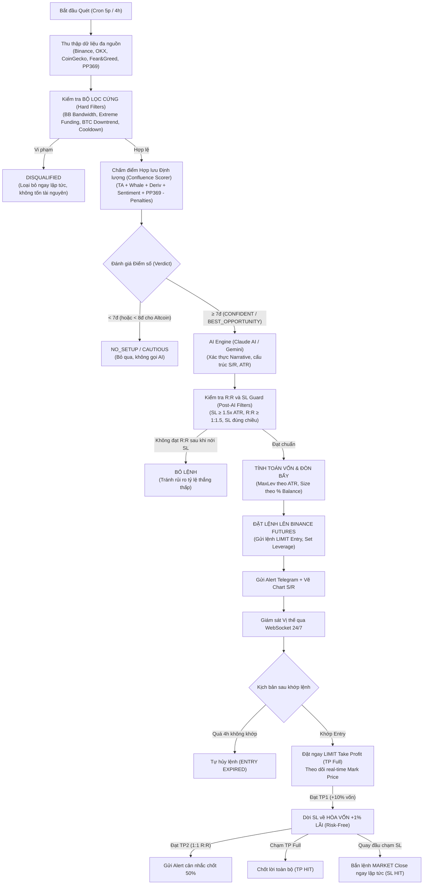

# KIẾN TRÚC VÀ LOGIC VÀO LỆNH CỦA CRYPTO BINANCE FUTURES TRADING BOT

---

## 1. TỔNG QUAN DỰ ÁN (PROJECT OVERVIEW)

Dự án là một hệ thống **giao dịch tự động và bán tự động (Automated / Semi-Automated Algorithmic Trading Bot)** trên thị trường **Binance USDT-Margined Futures**, được thiết kế theo trường phái **Quantitative Confluence Trading** (Giao dịch hợp lưu đa tín hiệu định lượng).

### 1.1. Mục tiêu cốt lõi
- **Chất lượng hơn số lượng**: Tuân thủ nguyên tắc thà không có lệnh (`0 lệnh tốt hơn 1 lệnh tệ`).
- **Loại bỏ cảm tính và ảo giác số liệu**: Sử dụng thuật toán định lượng (Deterministic Scorer) độc lập để tính toán mọi chỉ số, số liệu trước khi đưa vào mô hình AI (**Anthropic Claude**) để viết narrative, đánh giá bối cảnh và xác nhận cấu trúc thị trường.
- **Bảo vệ vốn nghiêm ngặt**: Đòn bẩy tính toán động theo biến động thực tế (ATR), tự động dời Stop Loss về điểm hòa vốn có lãi (Risk-Free) ngay khi đạt lợi nhuận ban đầu, lọc bỏ các lệnh có tỷ lệ R:R kém hoặc SL quá gần vùng nhiễu giá (Stop-hunt).
- **Hệ thống phục hồi tự động (Fault-tolerant & Self-healing)**: Chạy liên tục 24/7, duy trì kết nối WebSocket thời gian thực, có cơ chế đồng bộ vị thế với sàn Binance và phục hồi dữ liệu kể cả khi bot bị khởi động lại.

### 1.2. Công nghệ sử dụng
- **Ngôn ngữ & Nền tảng**: Node.js (v18+), ES6+, Chạy nền dạng Daemon với `node-cron`.
- **Sàn giao dịch & Dữ liệu**:
  - **Binance Futures API & WebSocket**: Đặt lệnh LIMIT, MARKET, kiểm tra số dư, vị thế, User Data Stream (lắng nghe khớp lệnh), Mark Price Stream (giám sát giá từng giây).
  - **OKX API**: Đối chiếu dòng tiền Taker Flow, kiểm tra phân kỳ dòng tiền và làm nguồn dự phòng Klines/OI.
  - **CoinGecko**: Lấy dữ liệu vốn hóa, biến động giá toàn thị trường, top coin thanh khoản cao, top gainers.
  - **Alternative.me**: Chỉ số Sợ hãi & Tham lam (Crypto Fear & Greed Index).
  - **Coinalyze & Blockchain Explorer (Mempool.space, Whale Alert)**: Dữ liệu thanh lý, Open Interest và On-chain.
- **Trí tuệ nhân tạo (AI Engine)**:
  - **Anthropic Claude AI (Chính)**: Sử dụng các model suy luận tài chính sắc bén như `claude-sonnet-5`, `claude-3-5-sonnet`, `claude-3-5-haiku`.
  - Hỗ trợ linh hoạt cả **Anthropic Native Messages API** (`api.anthropic.com`) lẫn **Custom Proxy / Relay API** (như `gpt.teamsoclo.site` hoặc OneAPI/NewAPI) với cơ chế tự động chuyển đổi định dạng và trích xuất khối văn bản (text extraction).
  - **Google Gemini API (Dự phòng)**: Hỗ trợ chuyển đổi nhanh qua cấu hình `AI_PROVIDER=claude|gemini`.
- **Giao diện & Cảnh báo**:
  - Telegram Bot: Báo cáo thị trường 4 tiếng/lần, gửi alert vào lệnh kèm Chart phân tích trực quan (QuickChart), cảnh báo TP/SL và tương tác lệnh qua Telegram Commands.
  - Web Dashboard: Giao diện trực quan tích hợp WebSocket server theo dõi real-time PnL, vị thế active và nhật ký hoạt động.

---

## 2. QUY TRÌNH KHI XUẤT HIỆN 1 ĐIỂM VÀO LỆNH (ENTRY POINT WORKFLOW)

Tại mỗi chu kỳ quét (Signal Scan 5 phút hoặc Job định kỳ 4 giờ), khi giá tiếp cận một vùng tiềm năng, bot thực thi quy trình 8 bước tuần tự và khép kín:



---

## 3. BOT ĐANG LÀM GÌ TẠI ĐIỂM VÀO LỆNH? (CHI TIẾT TỪNG GIAI ĐOẠN)

### Giai đoạn 1: Chuẩn bị Symbol và Thu thập Dữ liệu Song song
1. **Lọc danh sách coin theo dõi**:
   - `FIXED_COINS`: Các coin nền tảng bắt buộc theo dõi (`BTC`, `ETH`, `SOL`, `BNB`, `XRP`, `DOGE`, `ADA`).
   - `TIER2_COINS`: Coin vốn hóa lớn, thanh khoản cao (`LTC`, `AVAX`, `LINK`, `ATOM`, `DOT`, `NEAR`).
   - `EXTRA_LIQUID` & `GAINERS`: Lấy từ CoinGecko/Binance (tối đa tổng cộng 20 coins), loại trừ hoàn toàn Stablecoins.
2. **Kéo dữ liệu Klines & Phái sinh đa khung thời gian**:
   - Lấy nến 1h, 4h, 1d, 1w từ Binance Futures (nếu lỗi tự động fallback sang OKX).
   - Lấy dữ liệu độ sâu thanh khoản, Open Interest (OI), tỷ lệ Long/Short toàn mạng và Top Trader.
   - Quét dữ liệu giao dịch khớp lệnh lớn (Large Trades $\ge \$1M$) và lệnh thanh lý cưỡng bức (Liquidations) từ Binance.
   - Kéo chỉ số Sợ hãi & Tham lam, tâm lý mạng xã hội Reddit.
   - Tính toán mốc chu kỳ nến H1 đầu tháng theo phương pháp **PP369**.

### Giai đoạn 2: Lọc cứng (Hard Filters - Loại ngay lập tức)
Trước khi chấm điểm, bot chạy qua bộ lọc điều kiện tiên quyết. Nếu vi phạm chỉ **1 tiêu chí**, coin đó sẽ bị gán trạng thái `DISQUALIFIED` và dừng xử lý ngay lập tức:
- **Bollinger Bands Bandwidth < 2%**: Giá đang nén quá chặt trong biên hẹp (Sideway squeeze), dễ xảy ra hiện tượng quét 2 đầu, cấm vào lệnh đón đầu.
- **Funding Rate quá mức**:
  - Không mở lệnh LONG nếu Funding Rate $> +0.10\% / 8h$ (vị thế Long quá đông, nguy cơ bị Long Squeeze).
  - Không mở lệnh SHORT nếu Funding Rate $< -0.05\% / 8h$ (vị thế Short quá đông, nguy cơ bị Short Squeeze).
- **Phân kỳ dòng tiền (Cross-Signal Divergence)**: Lệnh thị trường của OKX và lệnh lớn của Binance đi ngược chiều nhau (ví dụ: Taker OKX bán tháo nhưng Binance gom hoặc ngược lại) $\rightarrow$ Thị trường tranh chấp, loại bỏ.
- **BTC Downtrend Headwind**: Nếu Bitcoin đang nằm dưới đường EMA200 ngày, nến 4h thể hiện xu hướng giảm mạnh (`regime = TRENDING_DOWN`) và RSI 1D $> 35$ $\rightarrow$ **Cấm tuyệt đối mọi lệnh LONG trên Altcoin**.
- **Tránh xung đột lệnh Active**:
  - Nếu đã có lệnh cùng chiều đang mở trên coin đó $\rightarrow$ Loại (tránh nhồi lệnh vô tội vạ).
  - Nếu có lệnh ngược chiều đang mở $\rightarrow$ Chỉ cho phép đảo chiều nếu điểm số đạt mức xuất sắc ($\ge 9$ điểm) và lệnh cũ đã mở được ít nhất 8 tiếng.
- **Thời gian hồi chiêu (Cooldown Guard)**: Nếu coin vừa mới đóng lệnh (dù TP hay SL) trong vòng 6 giờ gần nhất $\rightarrow$ Bỏ qua, tránh bẫy tâm lý giao dịch liên tục (Revenge trading).

### Giai đoạn 3: Chấm điểm Hợp lưu Định lượng (Deterministic Confluence Scorer)
Bot tính toán điểm độc lập bằng code logic thuần túy (không để AI tự tính điểm nhằm tránh ảo giác). Điểm tổng hợp dao động từ $0$ đến $10+$ điểm.

### Giai đoạn 4: Xác định Đòn bẩy Tối đa & Quy mô Vốn
- **Đòn bẩy dựa trên ATR 4h (Biến động thực)**:
  $$ATR\% = \frac{ATR(14, 4h)}{\text{Giá hiện tại}} \times 100$$
  - $ATR\% < 0.8\%$ (Thị trường êm dịu, thường là BTC/ETH): Cho phép tối đa **10x**.
  - $0.8\% \le ATR\% < 1.5\%$: Tối đa **7x**.
  - $1.5\% \le ATR\% < 2.5\%$: Tối đa **5x**.
  - $2.5\% \le ATR\% < 4.0\%$: Tối đa **3x**.
  - $ATR\% \ge 4.0\%$ (Altcoin biến động giật cục): Tối đa **2x**.
- **Giới hạn cứng theo Phân hạng Coin**:
  - BTC / ETH: Max **10x**.
  - Top 20 Altcoins: Max **5x**.
  - Altcoin khác: Max **3x**.
  - Nếu thị trường rơi vào trạng thái `VOLATILE` $\rightarrow$ Khóa cứng Max **2x**.
  - Nếu điểm tín hiệu chỉ ở mức thận trọng (`CAUTIOUS`) $\rightarrow$ Giảm tiếp 2 đơn vị đòn bẩy.
- **Quy mô vào lệnh (Position Size & Phân tầng vốn)**:
  - Cấu hình qua `.env`: `TRADE_SIZE_PCT=20` (20% số dư) và `TRADE_MAX_USDT=30` (trần $30).
  - **Tài khoản $> 100\text{ USDT}$**: Lấy $20\%$ số dư, nhưng không vượt quá trần **$30\text{ USDT}$** (ví dụ ví có $150 hay $1,000 thì đều vào tối đa $30 ký quỹ).
  - **Tài khoản $\le 100\text{ USDT}$**: Vào mức cố định **$20\text{ USDT}$ / lệnh**.
  - **Sàn tối thiểu**: Số dư khả dụng phải $\ge 10\text{ USDT}$ (quy định `MIN_NOTIONAL` của Binance).
  - **Chế độ chạy**: `TRADE_ENABLED=false` (chế độ Paper Trading / Signal Mode, an toàn không trừ tiền thật) hoặc `TRADE_ENABLED=true` (chế độ tự động đặt lệnh thật).

### Giai đoạn 5: Xác nhận qua AI Claude & Bộ lọc Rủi ro Sau Phân Tích
1. **Claude AI tiếp nhận dữ liệu**:
   - Claude nhận toàn bộ dữ liệu cấu trúc nến, bảng điểm hợp lưu, các mốc Cản/Hỗ trợ (S/R Clusters 4H & 1D có đếm số lần test) và biên độ biến động ATR.
   - Claude thẩm định bối cảnh: phân tích mô hình nến, kiểm tra xem cản có bị mòn không, xác nhận xu hướng và đề xuất mức giá cụ thể: `Entry`, `TP`, `SL`.
   - Hệ thống tự động bóc tách nội dung văn bản thông minh (hỗ trợ cả các model có khối suy nghĩ `thinking` của Claude).
2. **Bộ lọc hậu kiểm (Post-AI Risk Guards)**:
   - **Xác thực chiều Stop Loss**:
     - Lệnh LONG: Bắt buộc $SL < Entry$.
     - Lệnh SHORT: Bắt buộc $SL > Entry$.
     - Nếu AI đặt ngược mức giá $\rightarrow$ Hủy lệnh ngay lập tức.
   - **Tự động kéo dãn SL chống Stop-hunt (Anti Stop-hunt Guard)**:
     - Khoảng cách SL tối thiểu phải thỏa mãn: $|Entry - SL| \ge 1.5 \times ATR$.
     - Nếu AI đặt SL quá hẹp ($< 1.5 \times ATR$), bot tự động nới rộng SL ra mức đúng $1.5 \times ATR$.
   - **Kiểm tra tỷ lệ Lợi nhuận / Rủi ro ($R:R$)**:
     $$R:R = \frac{|TP - Entry|}{|SL - Entry|} \ge 1.5$$
     - Nếu sau khi nới rộng SL mà tỷ lệ $R:R < 1.5$ $\rightarrow$ **HỦY BỎ LỆNH** (Báo Telegram: "ATR quá cao, không đủ biên độ an toàn giữa SL và TP").

### Giai đoạn 6: Đặt lệnh lên sàn Binance Futures
Khi các điều kiện trên đều thỏa mãn và `TRADE_ENABLED=true`:
1. Gửi request đồng bộ đòn bẩy: `POST /fapi/v1/leverage`.
2. Tính toán chính xác khối lượng coin (`quantity`) theo quy tắc `stepSize` và độ chính xác thập phân (`quantityPrecision`) của cặp giao dịch, làm tròn xuống (Floor) để tránh lỗi API `-1111`.
3. Bắn lệnh chờ `LIMIT` vào sổ lệnh Binance (`POST /fapi/v1/order` với `timeInForce: 'GTC'`).
4. Gửi tin nhắn Telegram kèm hình ảnh biểu đồ nến kỹ thuật, đánh dấu rõ ràng vùng Entry, các mốc TP1, TP2, TP Full và SL.

### Giai đoạn 7: Giám sát và Xử lý Sau khi Vào Lệnh
- **Kiểm soát thời gian chờ (Entry Expiration)**: Nếu sau 4 tiếng lệnh chờ LIMIT chưa khớp (giá đi luôn hoặc đảo chiều) $\rightarrow$ Tự động hủy lệnh trên Binance và xóa khỏi danh sách theo dõi.
- **Khi lệnh LIMIT Entry khớp (Filled)**:
  - Nhận diện khớp lệnh ngay lập tức thông qua WebSocket `ORDER_TRADE_UPDATE`.
  - Bot lập tức bắn lệnh chốt lời `LIMIT reduceOnly` tại giá `targetPrice` lên sàn Binance.
  - Tính toán 2 mốc chiến thuật:
    - **TP1**: Mức giá mang lại lợi nhuận $+10\%$ trên vốn ký quỹ.
    - **TP2**: Mức giá đạt tỷ lệ $1:1$ so với khoảng cách rủi ro ban đầu.
- **Kích hoạt Cơ chế Bảo toàn Vốn (Risk-Free Transition)**:
  - Khi giá thị trường chạm **TP1**: Bot tự động dời mức Stop Loss về **Hòa vốn $+ 1\%$ lợi nhuận** (đã bù đắp đủ phí Taker 2 chiều). Từ thời điểm này, vị thế nắm chắc không bao giờ bị lỗ vốn.
  - Khi giá chạm **TP2**: Gửi thông báo Telegram khuyến nghị người dùng chốt lời từng phần ($50\%$).
- **Đóng vị thế**:
  - Nếu giá đạt TP Full: Lệnh LIMIT chốt lời trên sàn tự khớp $\rightarrow$ Bot ghi nhận PnL dương và thông báo `CHỐT LỜI THÀNH CÔNG`.
  - Nếu giá đảo chiều chạm SL: Bot giám sát giá Mark Price thời gian thực trên WebSocket, lập tức phát lệnh `MARKET close reduceOnly` để cắt vị thế ngay lập tức, triệt tiêu rủi ro trượt giá sâu.

---

## 4. BẢNG TIÊU CHÍ ĐÁNH GIÁ ĐIỂM VÀO LỆNH (EVALUATION CRITERIA)

Hệ thống Confluence Scorer đánh giá điểm vào lệnh dựa trên 7 nhóm tiêu chí độc lập:

### 4.1. Nhóm Phân tích Kỹ thuật (Technical Analysis - Tối đa ~9 điểm)
| Chỉ báo / Yếu tố | Điều kiện LONG | Điều kiện SHORT | Điểm số |
| :--- | :--- | :--- | :---: |
| **RSI 4h** | $< 30$ (Quá bán nặng)<br>$30 - 40$ (Quá bán) | $> 70$ (Quá mua nặng)<br>$60 - 70$ (Quá mua) | **+2**<br>**+1** |
| **RSI 1D (Khung ngày)** | $< 45$ (Xác nhận đa khung) | $> 55$ (Xác nhận đa khung) | **+1** |
| **StochRSI (4h)** | Đường K $< 20$ (Vùng đáy) | Đường K $> 80$ (Vùng đỉnh) | **+1** |
| **MACD (4h)** | Golden Cross (Cắt lên)<br>Trend Bullish (Histogram dương) | Death Cross (Cắt xuống)<br>Trend Bearish (Histogram âm) | **+2**<br>**+1** |
| **EMA Stack (4h)** | $Price > EMA7 > EMA25 > EMA99$<br>$Price > EMA7 > EMA25$ (Xếp chồng 1 phần) | $Price < EMA7 < EMA25 < EMA99$<br>$Price < EMA7 < EMA25$ (Xếp chồng 1 phần) | **+2**<br>**+1** |
| **Cụm Hỗ trợ / Kháng cự 1D** | Cách Support 1D $< 0.5\%$<br>Cách Support 1D $< 1.5\%$<br>*Bonus: Mức cản được test $\ge 3$ lần* | Cách Resistance 1D $< 0.5\%$<br>Cách Resistance 1D $< 1.5\%$<br>*Bonus: Mức cản được test $\ge 3$ lần* | **+2**<br>**+1**<br>*(+1)* |
| **Cụm Hỗ trợ / Kháng cự 4h** | Cách Support 4h $< 0.3\%$<br>Cách Support 4h $< 0.8\%$<br>*Bonus: S/R 4h trùng S/R 1D (confluence)* | Cách Resistance 4h $< 0.3\%$<br>Cách Resistance 4h $< 0.8\%$<br>*Bonus: S/R 4h trùng S/R 1D (confluence)* | **+2**<br>**+1**<br>*(+1)* |
| **Weekly Pivot (Tham chiếu Tuần)** | Cách Weekly Pivot Low $< 0.8\%$<br>Cách Weekly Pivot Low $< 2.0\%$ | Cách Weekly Pivot High $< 0.8\%$<br>Cách Weekly Pivot High $< 2.0\%$ | **+2**<br>**+1** |
| **Đột biến Khối lượng (Volume)** | Khối lượng nến 4h $> 1.5\times$ trung bình 20 nến | Khối lượng nến 4h $> 1.5\times$ trung bình 20 nến | **+1** |
| **Bollinger Bands %B** | $\%B < 15\%$ (Bung ra khỏi dải dưới) | $\%B > 85\%$ (Bung ra khỏi dải trên) | **+1** |
| **Phân kỳ OI (Open Interest)** | Giá tăng nhưng OI giảm $> 5\%$ $\rightarrow$ Bẫy tăng giá (Bull-trap) | | **-2** |
| **Vị thế so với EMA200 ngày** | Nằm dưới EMA200D (mà RSI 1D $> 35$) $\rightarrow$ Xu hướng dài hạn xấu | Nằm trên EMA200D (mà RSI 1D $< 65$) $\rightarrow$ Xu hướng dài hạn tốt | **-2** |
| **Trạng thái Thị trường (Regime)** | `TRENDING_UP`<br>`VOLATILE` (Thị trường giật mạnh, rủi ro) | `TRENDING_DOWN`<br>`VOLATILE` (Thị trường giật mạnh, rủi ro) | **+1**<br>**-1** |

### 4.2. Nhóm Dòng tiền Cá voi (Whale & Smart Money - Tối đa ~7 điểm)
| Tiêu chí | Điều kiện LONG | Điều kiện SHORT | Điểm số |
| :--- | :--- | :--- | :---: |
| **OKX Taker Flow** | `BUY_PRESSURE` (Bên mua chủ động chiếm ưu thế) | `SELL_PRESSURE` (Bên bán chủ động chiếm ưu thế) | **+1** |
| **Binance Large Trades ($\ge \$1M$)** | Tỷ lệ Mua áp đảo (`WHALE_BUY`) | Tỷ lệ Bán áp đảo (`WHALE_SELL`) | **+1** |
| **Phân tầng Lệnh Lớn** | Giao dịch Whale $(\$5M - \$20M)$ Mua ròng<br>Giao dịch Institution $(\ge \$20M)$ Mua ròng ⚡ | Giao dịch Whale $(\$5M - \$20M)$ Bán ròng<br>Giao dịch Institution $(\ge \$20M)$ Bán ròng ⚡ | **+1**<br>**+2** |
| **Cross-Signal Đồng thuận** | Cả OKX lẫn Binance cùng xác nhận Mua | Cả OKX lẫn Binance cùng xác nhận Bán | **+1** |
| **Thanh lý Cưỡng bức (Liquidations)** | `SHORT_SQUEEZE` (Thanh lý Short chiếm $> 65\%$) | `LONG_SQUEEZE` (Thanh lý Long chiếm $> 65\%$) | **+2** |

### 4.3. Nhóm Phái sinh & Khối lượng Hợp đồng (Derivatives)
| Tiêu chí | Cơ chế đánh giá | Tác động LONG | Tác động SHORT | Điểm số |
| :--- | :--- | :---: | :---: | :---: |
| **Xu hướng OI** | Vốn mới đổ vào thị trường (`OI RISING`) | Xác nhận xu hướng | Xác nhận dòng vốn Short | **+1** |
| **OI Sụt giảm** | Đóng vị thế tháo chạy (`OI FALLING`) | Dòng tiền rút lui | — | **-1** |
| **Long/Short Contrarian** | Đám đông Retail nghiêng hẳn về một phía | Retail quá Short ($>60\%$) | Retail quá Long ($>60\%$) | **+1** |
| **Top Trader Divergence** | Top Trader đi ngược đám đông Retail | Top Trader Long vs Retail Short | Top Trader Short vs Retail Long | **+1** |

### 4.4. Nhóm Chỉ số Tâm lý Thị trường (Sentiment Contrarian)
Hệ thống sử dụng nguyên tắc **Giao dịch ngược đám đông (Contrarian Trading)**:
- **Fear & Greed Index**:
  - Chỉ số $< 20$ (Sợ hãi cực độ): Cơ hội tốt cho phe LONG (**+1 điểm**).
  - Chỉ số $> 80$ (Hưng phấn cực độ): Cơ hội tốt cho phe SHORT (**+1 điểm**).
  - Nếu LONG khi chỉ số $> 80$ hoặc SHORT khi chỉ số $< 20$: Trừ **-1 điểm** (Rủi ro đu đỉnh / bán đáy).
- **Reddit Sentiment**:
  - Cộng đồng bi quan tột cùng (`BEARISH`) $\rightarrow$ Khuyến khích LONG (**+1 điểm**).
  - Cộng đồng lạc quan quá đà (`BULLISH`) $\rightarrow$ Khuyến khích SHORT (**+1 điểm**).

### 4.5. Phương pháp Chu kỳ Độc quyền PP369 (Monthly H1 Reaction Grid)
Phương pháp sử dụng nến 1 giờ (H1) đầu tiên của tháng để thiết lập lưới phản ứng giá:
- Lấy `Open` và `Close` của nến H1 đầu tháng làm mốc trục gốc.
- Tạo lưới phản ứng theo cấp số: $\pm (3 \times n \times Unit)$ với $n = 1, 2, 3...$
- **Điều kiện tín hiệu**:
  - Tín hiệu **LONG**: Giá giảm về mốc Dưới (Close level) sau khi đã chạm mốc Trên (Open level) $\rightarrow$ Đóng vai trò hỗ trợ chu kỳ.
  - Tín hiệu **SHORT**: Giá tăng lên mốc Trên (Open level) sau khi đã chạm mốc Dưới (Close level) $\rightarrow$ Đóng vai trò kháng cự chu kỳ.
- **Quy tắc số lần chạm (Touch Count)**:
  - Chạm lần 1 (Chưa ai khai thác): Tín hiệu mạnh nhất (`strong`) $\rightarrow$ **+2 điểm**.
  - Chạm lần 2: Tín hiệu trung bình (`medium`) $\rightarrow$ **+1 điểm**.
  - Chạm từ lần 3 trở lên: Mốc giá bị mòn (`weak`) $\rightarrow$ **+1 điểm**.

### 4.6. Các Điểm Phạt (Penalties)
- **Khung giờ thanh khoản thấp (Low Liquidity UTC Hour)**:
  - Nếu thời điểm vào lệnh rơi vào khoảng **0:00 - 7:00 UTC** (phiên đêm thanh khoản mỏng, dễ bị râu nến quét SL) $\rightarrow$ Trừ **-1 điểm**.
- **Áp lực từ Bitcoin (BTC Headwind Penalty)**:
  - Khi xét lệnh LONG cho Altcoin, nếu Bitcoin đang ở xu hướng giảm (`BTC regime = TRENDING_DOWN` và RSI 1D $> 35$) $\rightarrow$ Trừ **-1 điểm**.

---

## 5. THANG ĐIỂM QUYẾT ĐỊNH (VERDICT MATRIX)

Sau khi tổng hợp tất cả các nguồn điểm và điểm phạt, hệ thống phân loại setup theo các ngưỡng:

| Tổng điểm | Phân loại (Verdict) | Độ tin cậy | Hành động của Bot |
| :---: | :---: | :---: | :--- |
| **$\ge 9$ điểm** | `BEST_OPPORTUNITY` | $\ge 85\%$ | **Cơ hội tốt nhất**: Chấp nhận vào lệnh cho mọi nhóm coin (kể cả Altcoin gainers/liquid). Đòn bẩy tính theo ATR, $SL = 2 \times ATR$, $R:R \ge 1:2$. Được phép đảo chiều vị thế cũ nếu có. |
| **$7 - 8$ điểm** | `CONFIDENT` | $\sim 70\%$ | **Vào lệnh tiêu chuẩn**: Áp dụng cho nhóm `FIXED_COINS` và `TIER2_COINS`. Bắt buộc $SL \ge 1.5 \times ATR$, $R:R \ge 1:1.5$. Không áp dụng cho các coin rác hoặc gainers đột biến. |
| **$5 - 6$ điểm** | `CAUTIOUS` | $\sim 55\%$ | **Thận trọng**: Không đủ độ an toàn $\rightarrow$ **BỎ QUA**, không gọi AI, tiếp tục theo dõi thêm xác nhận. |
| **$< 5$ điểm** | `NO_SETUP` | $0\%$ | **Không có tín hiệu**: Không thỏa mãn các điều kiện thị trường. |
| **Vi phạm lọc** | `DISQUALIFIED` | $0\%$ | **Bị loại**: Vi phạm bộ lọc cứng (Squeeze, BTC Downtrend, lệch Funding). |

---

## 6. QUẢN LÝ VỊ THẾ VÀ CƠ CHẾ BẢO VỆ VỐN NÂNG CAO

```
     [Vào Lệnh LIMIT Entry]
               │
               ▼ (Khớp lệnh)
     [Đặt LIMIT TP Full] ──> [Theo dõi giá Mark Price thời gian thực]
               │
               ├──────────────────────────────────────────────┐
               ▼                                              ▼
     [Chạm TP1: Lãi +10% Vốn]                       [Chạm Stop Loss]
               │                                              │
               ▼                                              ▼
     [DỜI SL VỀ HÒA VỐN +1% LÃI]                     [Market Close khẩn cấp]
     (Vị thế trở thành Risk-Free!)
               │
               ├──────────────────────────────┐
               ▼                              ▼
     [Chạm TP2: Đạt 1:1 R:R]          [Chạm TP Full]
               │                              │
               ▼                              ▼
     [Báo chốt 50% vị thế]            [Chốt lời 100% Vị thế]
```

1. **Cơ chế Breakeven Lock (+1% Lợi nhuận)**:
   - Thay vì để vị thế có lãi rồi quay đầu cắn SL âm tiền, ngay khi giá tăng đến mốc TP1 ($+10\%$ trên số vốn bỏ ra), bot lập tức dời SL về mức giá hòa vốn cộng thêm khoản chênh lệch $+1\%$ vốn. Mức $+1\%$ này đã tính toán đủ để trả phí Taker 2 chiều của Binance ($0.04\% \times 2 = 0.08\%$).
2. **Cơ chế SL Client-side Real-time**:
   - Để tránh trường hợp các tài khoản Binance Portfolio Margin bị sàn từ chối lệnh điều kiện (`STOP_MARKET`), bot tự lắng nghe dòng giá Mark Price qua WebSocket trực tiếp từ sàn Binance. Khi giá vượt ngưỡng SL, bot bắn lệnh `MARKET close reduceOnly` để đóng ngay lập tức với độ trễ chỉ tính bằng mili-giây.
3. **Cơ chế chống đè lệnh ngược (One-Way Mode Safety)**:
   - Trên tài khoản chế độ 1 chiều (One-Way Mode), nếu vào lệnh ngược chiều thì sàn sẽ tự động cấn trừ (Netting) vị thế cũ. Do đó, bot có cơ chế khóa: không bao giờ mở lệnh mới ngược chiều cho đến khi lệnh cũ được xác nhận đã đóng hoàn toàn.
4. **Phục hồi sự cố (Self-Healing & Re-sync)**:
   - Nếu kết nối WebSocket bị rớt gói tin (drop events), bot có tiến trình quét nền chạy mỗi 5 phút (`syncManualPositions` và `WS fill fallback REST poll`) để kiểm tra vị thế thực tế trên sàn, tự động gắn lại mốc TP/SL cho các vị thế đang trôi nổi mà không có sự bảo vệ.

---

## 7. TỔNG KẾT

Điểm vào lệnh của Bot không dựa vào cảm tính hay một chỉ báo kỹ thuật đơn lẻ, mà là kết quả của một chuỗi **hợp lưu đa tầng**:
1. **Lọc sạch rủi ro vĩ mô** thông qua Bộ lọc cứng.
2. **Lượng hóa ưu thế** bằng Hệ thống chấm điểm Confluence định lượng (Kỹ thuật + Cá mập + Phái sinh + Tâm lý + PP369).
3. **Tối ưu hóa đòn bẩy và điểm dừng lỗ** dựa trên biến động thực tế nến 4h (ATR).
4. **Thẩm định cấu trúc** qua AI Claude (hoặc Gemini dự phòng).
5. **Bảo toàn thành quả tuyệt đối** nhờ cơ chế tự động dời SL về điểm hòa vốn có lãi ngay khi đạt cột mốc lợi nhuận đầu tiên.
