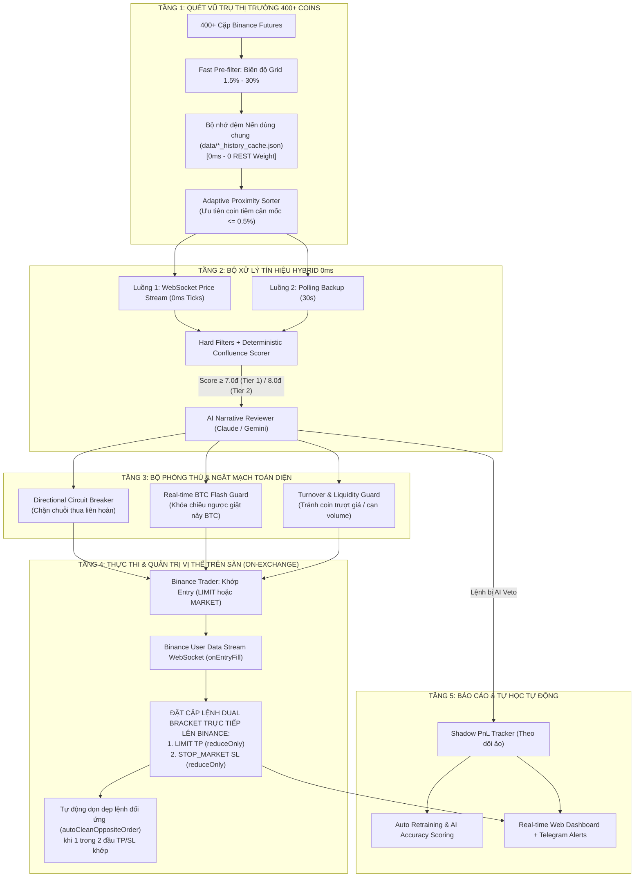

# 🚀 LỘ TRÌNH NÂNG CẤP TOÀN DIỆN BOT-NEW THEO KIẾN TRÚC TIÊN TIẾN CỦA BOT-H4

> **Tài liệu chiến lược**: Nâng cấp hạ tầng `bot-new` lên cấp độ tổ chức (Institutional / Fund-grade Trading System).  
> **Mục tiêu tối thượng**: Giữ nguyên **tỷ lệ thắng xuất sắc (High Win-rate)** và năng lực phân tích hợp lưu định lượng của `bot-new`, nhưng trang bị **hạ tầng thực thi 0ms**, **quét 400+ coin toàn thị trường**, và **hệ thống quản trị rủi ro trên sàn (On-exchange Dual Bracket)** của `bot-h4`.

---

## 1. BẢNG SO SÁNH ĐỐI CHIẾU KIẾN TRÚC: BOT-NEW VS. BOT-H4

| Tiêu chí | `bot-new` (Hiện tại) | `bot-h4` (Mục tiêu nâng cấp) | Mức độ ưu tiên |
| :--- | :--- | :--- | :---: |
| **Phạm vi quét thị trường** | Giới hạn ~20 coin tĩnh (`FIXED_COINS` + `TIER2_COINS`) | **Toàn bộ 400+ cặp** Binance Futures USDT-M | 🔴 **P1 (Cao)** |
| **Cơ chế đặt Stop Loss** | **Client-side** (bot tự watch giá, khi chạm mới bắn lệnh Market Close) | **On-exchange Dual Bracket** (Đặt sẵn lệnh `STOP_MARKET` trực tiếp lên Binance) | 🚨 **P0 (Khẩn cấp)** |
| **Độ trễ phát hiện tín hiệu** | **Cron Polling 5 phút** (Dễ bị trễ giá, lỡ nhịp nảy nhanh) | **Hybrid Real-time 0ms** (WebSocket Event Stream từng tick + Polling 30s) | 🔴 **P1 (Cao)** |
| **Cơ chế quản lý lệnh LIMIT** | Treo cố định, chờ 4 tiếng mới expire | **Bounce Cancel**: Hủy ngay nếu giá liếm sát mốc rồi nảy ra xa | 🟡 **P2 (Trung bình)** |
| **Bảo vệ ngược sóng BTC** | Check EMA200 nến 4h định kỳ | **Real-time BTC Flash Guard** (Bắt tốc độ giật biến tốc BTC 180s thời gian thực) | 🟡 **P2 (Trung bình)** |
| **Ngắt mạch chuỗi thua** | Cooldown coin đơn lẻ (6h) | **Directional Circuit Breaker**: Tự động khóa toàn bộ chiều LONG/SHORT khi dính bão | 🟡 **P2 (Trung bình)** |
| **Đo lường & Tự hoàn thiện** | Chỉ lưu trade_history thực | **Shadow PnL Tracker**: Giám sát ảo các lệnh bị AI Veto để tự học và đo lường | 🟢 **P3 (Nâng cao)** |
| **Giao diện giám sát** | Telegram Messages + Log console | **Local Real-time Web Dashboard** (WebSocket PnL, Controls, Charts) | 🟢 **P3 (Nâng cao)** |

---

## 2. KIẾN TRÚC MỤC TIÊU (TARGET ARCHITECTURE)



---

## 3. LỘ TRÌNH TRIỂN KHAI CHI TIẾT THEO 5 GIAI ĐOẠN

### GIAI ĐOẠN 1: BẢO VỆ VỊ THẾ TRỰC TIẾP TRÊN SÀN (ON-EXCHANGE DUAL BRACKET)
> **Mức độ ưu tiên**: 🚨 **P0 — KHẨN CẤP NHẤT**  
> **Mục tiêu**: Loại bỏ 100% rủi ro cháy tài khoản do mất kết nối hoặc sập bot khi SL đang nằm ở client-side.

#### 1. Hiện trạng rủi ro của `bot-new`
Hiện tại, `bot-new` chỉ đặt lệnh **TP (LIMIT)** lên sàn Binance. Lệnh **SL (Stop Loss)** lại được quản lý bằng biến `trade.slPrice` trong RAM:
```javascript
// RỦI RO LỚN trong bot_new hiện tại:
if (price <= trade.slPrice) {
  // Chỉ khi bot còn sống, còn kết nối mạng thì mới gửi Market Close!
  await binanceTrader.closePosition(trade.symbol);
}
```
> [!CAUTION]
> Nếu VPS bị khởi động lại, Binance áp dụng Circuit Breaker Rate Limit 429/418 trong 45s, hoặc đứt cáp mạng quốc tế khi thị trường biến động giật cục, bot sẽ **HOÀN TOÀN MẤT STOP LOSS**, dẫn tới nguy cơ thanh lý tài khoản.

#### 2. Giải pháp nâng cấp từ `bot-h4`
- Khi lệnh Entry khớp (bắt qua `onEntryFill` của Binance User Data Stream):
  1. Gửi đồng thời lệnh **LIMIT TP** (`reduceOnly: true`).
  2. Gửi ngay lập tức lệnh **STOP_MARKET SL** (`reduceOnly: true`, `stopPrice = trade.slPrice`) trực tiếp lên hệ thống khớp lệnh của Binance.
  3. Khi một đầu khớp (ví dụ TP khớp), hàm `autoCleanOppositeOrder` lập tức hủy lệnh SL còn lại trên sàn.
- **Kết quả**: Dù VPS sập nguồn hay bot tắt hoàn toàn, tài khoản vẫn được sàn bảo vệ tuyệt đối.

---

### GIAI ĐOẠN 2: MỞ RỘNG VŨ TRỤ QUÉT THỊ TRƯỜNG 400+ COINS
> **Mức độ ưu tiên**: 🔴 **P1 — RẤT CAO**  
> **Mục tiêu**: Tăng gấp 20 lần số lượng cơ hội chất lượng cao mà không làm tăng tải API.

#### 1. Hiện trạng của `bot-new`
- Chỉ quét cố định danh sách ~20 coin (`BTC, ETH, SOL, BNB, XRP, DOGE, ADA, LTC, AVAX...`).
- Bỏ lỡ những con sóng bùng nổ của các Altcoins vốn hóa vừa và nhỏ có điểm hợp lưu $\ge 9$đ.

#### 2. Kế thừa các thuật toán lõi từ `bot-h4`
1. **Lấy danh sách động toàn bộ Universe Futures**:
   - Tự động nạp toàn bộ danh sách cặp giao dịch USDT Futures còn hoạt động từ Binance Exchange Info (~420 coins).
2. **Bộ lọc sàn vật lý (Sanity Grid Width Filter)**:
   - Chỉ giữ lại các coin có bước giá lưới hợp lệ:
     $$1.5\% \le \text{GridWidth\%} \le 30.0\%$$
   - Loại bỏ các coin rác có bước giá quá hẹp (dễ cắn SL nhiễu) hoặc quá loãng.
3. **Thuật toán sắp xếp ưu tiên tiệm cận mốc (`Adaptive Proximity Sorter`)**:
   - Sử dụng hàm `getNearbySymbols(coins, levelCache, 0.005)` để chỉ lọc ra các coin đang cách mốc $\le 0.5\%$.
   - Sắp xếp độ gần mốc tăng dần $\rightarrow$ Chỉ đưa tối đa 8 coin tiệm cận nhất vào hàng đợi chấm điểm, tiết kiệm 95% CPU và API weight.
4. **Tích hợp Cache nến dùng chung (`data/*_history_cache.json`)**:
   - Sử dụng chung bộ nhớ đệm nến đã xây dựng ở local: Tốc độ đọc nến $0\text{ ms}$, tiêu thụ **0 điểm API weight**.

---

### GIAI ĐOẠN 3: KIẾN TRÚC REAL-TIME 0ms EVENT-DRIVEN STREAMING
> **Mức độ ưu tiên**: 🔴 **P1 — CAO**  
> **Mục tiêu**: Đón đầu chính xác từng cú nảy (bounce) tại mốc với độ trễ nano-second thay vì đợi cron 5 phút.

#### 1. Cơ chế hoạt động
- **Luồng 1 (WebSocket Event Stream 0ms)**:
  - Lắng nghe WebSocket stream giá đa luồng (`<symbol>@markPrice@1s` hoặc mini-ticker).
  - Tự động cập nhật danh sách đăng ký (`syncWebSocketSubscriptions`) cho các coin nằm trong bán kính $1.0\%$ so với mốc.
  - Ngay khi giá tiệm cận $0.3\%$ mốc: Kích hoạt quy trình chấm điểm và vào lệnh ngay trong mili-giây.
- **Luồng 2 (Polling dự phòng 30s)**:
  - Quét kiểm tra toàn diện mỗi 30 giây để đảm bảo không bỏ sót bất kỳ biến động nào trong trường hợp WebSocket bị gián đoạn gói tin.

---

### GIAI ĐOẠN 4: HỆ SINH THÁI NGẮT MẠCH & LÁ CHẮN BẢO VỆ CHUYÊN SÂU
> **Mức độ ưu tiên**: 🟡 **P2 — TRUNG BÌNH**  
> **Mục tiêu**: Ngăn chặn hiện tượng "chuỗi thua dây chuyền" khi thị trường xuất hiện tin tức thiên nga đen (Black Swan) hoặc flash dump.

#### 1. Directional Circuit Breaker (Ngắt mạch theo chiều)
- Nếu một chiều (ví dụ `LONG`) bị dính $2$ lệnh SL trong vòng $40$ phút hoặc $3$ lệnh SL trong $2$ giờ:
  - Bot lập tức kích hoạt **Ngắt Mạch Chiều LONG** trong $60$ phút.
  - Tạm dừng $100\%$ việc mở lệnh LONG mới, nhưng chiều SHORT vẫn hoạt động bình thường.
  - Tích hợp cơ chế tự động mở khóa sớm nếu các lệnh thử nghiệm ảo (Shadow Trades) cho thấy thị trường đã hồi phục ổn định.

#### 2. Real-time BTC Flash Guard (Bảo vệ biến tốc BTC 180s)
- Thuật toán trượt (Sliding Window 180s) theo dõi từng tick của BTC:
  - Nếu BTC giảm $> 1.0\%$ trong vòng 3 phút: Khóa ngay lập tức việc đặt lệnh LONG cho toàn bộ Altcoin (0ms latency, không chờ nến đóng).
  - Nếu BTC tăng giật $> 1.0\%$ trong 3 phút: Khóa chiều SHORT Altcoin.

#### 3. Cơ chế Hủy lệnh Bật Nảy (Bounce Cancel)
- Khi treo một lệnh LIMIT tại mốc hỗ trợ/kháng cự:
  - Nếu giá tiếp cận sát mốc ($\le 0.08\%$) rồi bật ngược ra xa ($> 0.6\%$) mà không khớp lệnh:
  - Bot nhận diện dòng tiền đã phản ứng xong tại mốc $\rightarrow$ Tự động hủy lệnh LIMIT ngay lập tức và khóa mốc $60$ phút.
  - Tránh rủi ro khi giá quay lại test lần thứ 2 (thường sẽ thủng mốc).

#### 4. Cooldown dính SL từng coin
- Bất kỳ coin nào bị chạm SL sẽ tự động rơi vào danh sách hồi chiêu (Cooldown) trong $6$ tiếng, ngăn chặn hoàn toàn tâm lý trả thù thị trường (Revenge trading).

---

### GIAI ĐOẠN 5: TỰ HỌC TỰ ĐỘNG, SHADOW PNL VÀ WEB DASHBOARD
> **Mức độ ưu tiên**: 🟢 **P3 — NÂNG CAO**  
> **Mục tiêu**: Minh bạch hóa dữ liệu, đánh giá độ chính xác của AI và quản trị trực quan.

#### 1. Shadow PnL Tracker (Theo dõi ảo các lệnh bị từ chối)
- Mọi setup đạt điểm Confluence cao nhưng bị AI Veto hoặc bị Hard Filter loại bỏ đều được lưu lại và theo dõi đường đi giá ảo (Shadow Position).
- Thống kê tự động:
  - *AI cứu thua bao nhiêu lần* (Veto giúp tránh SL)?
  - *AI làm lỡ bao nhiêu cơ hội* (Veto nhầm lệnh chạm TP)?
  - Tính toán chỉ số **Độ chính xác Veto (AI Accuracy %)** và giá trị ròng mang lại (Net USD Value).

#### 2. Local Real-time Web Dashboard
- Xây dựng giao diện Web Dashboard cục bộ (sử dụng WebSocket nội bộ):
  - Bảng PnL thời gian thực của các lệnh đang chạy.
  - Biểu đồ nhiệt (Heatmap) độ tiệm cận các mốc 369 của 400+ coin.
  - Danh sách lệnh trong hàng chờ Đảo chiều (`pendingReversals`).
  - Nút bấm điều khiển khẩn cấp: Đóng toàn bộ lệnh, tạm dừng quét, chuyển đổi chế độ Shadow/Live.

---

## 4. KẾ HOẠCH HÀNH ĐỘNG CỤ THỂ (ACTIONABLE CHECKLIST)

```markdown
- [ ] **Phase 1: Dual Bracket Execution (Ưu tiên số 1)**
  - [ ] Port module `bracketManager.js` từ bot-h4 sang `bot_new/src/services/`
  - [ ] Đấu nối sự kiện `onEntryFill` vào `binanceTrader.js`
  - [ ] Đặt tự động `STOP_MARKET` và `LIMIT TP` ngay khi khớp lệnh
  - [ ] Viết unit test kiểm thử hủy lệnh đối ứng `autoCleanOppositeOrder`

- [ ] **Phase 2: Mở rộng Vũ trụ 400+ Coins**
  - [ ] Viết bộ nạp Universe `getAllActiveFuturesSymbols()`
  - [ ] Tích hợp bộ lọc bước giá Grid và bộ nhớ đệm nến local
  - [ ] Tích hợp hàm sắp xếp ưu tiên `getNearbySymbols`

- [ ] **Phase 3: Real-time WebSocket Price Engine**
  - [ ] Tích hợp WebSocket Mark Price đa luồng
  - [ ] Đấu nối cơ chế Dynamic Subscription
  - [ ] Thiết lập chu kỳ kiểm tra kép (WebSocket 0ms + Poll 30s)

- [ ] **Phase 4: Bộ phòng thủ & Ngắt mạch**
  - [ ] Tích hợp `Directional Circuit Breaker`
  - [ ] Tích hợp `Real-time BTC Flash Guard`
  - [ ] Tích hợp `Bounce Cancel` cho các lệnh LIMIT treo lâu

- [ ] **Phase 5: Shadow Tracking & Web Dashboard**
  - [ ] Port module `shadowTracker.js`
  - [ ] Tích hợp Dashboard Server WebSocket và Web UI
```

---

> [!TIP]
> **Khuyến nghị thực hiện**: Hãy triển khai tuần tự theo đúng thứ tự ưu tiên từ **Phase 1** đến **Phase 5**. Ngay sau khi hoàn thành Phase 1 (Dual Bracket SL trên Binance), mức độ an toàn vốn của `bot-new` sẽ lập tức tăng từ cấp độ cá nhân lên cấp độ quỹ đầu tư chuyên nghiệp.
