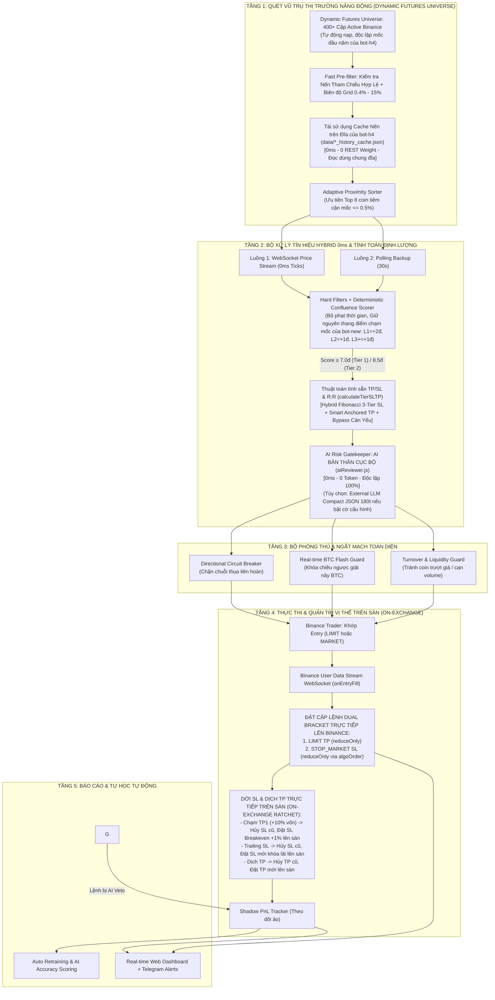
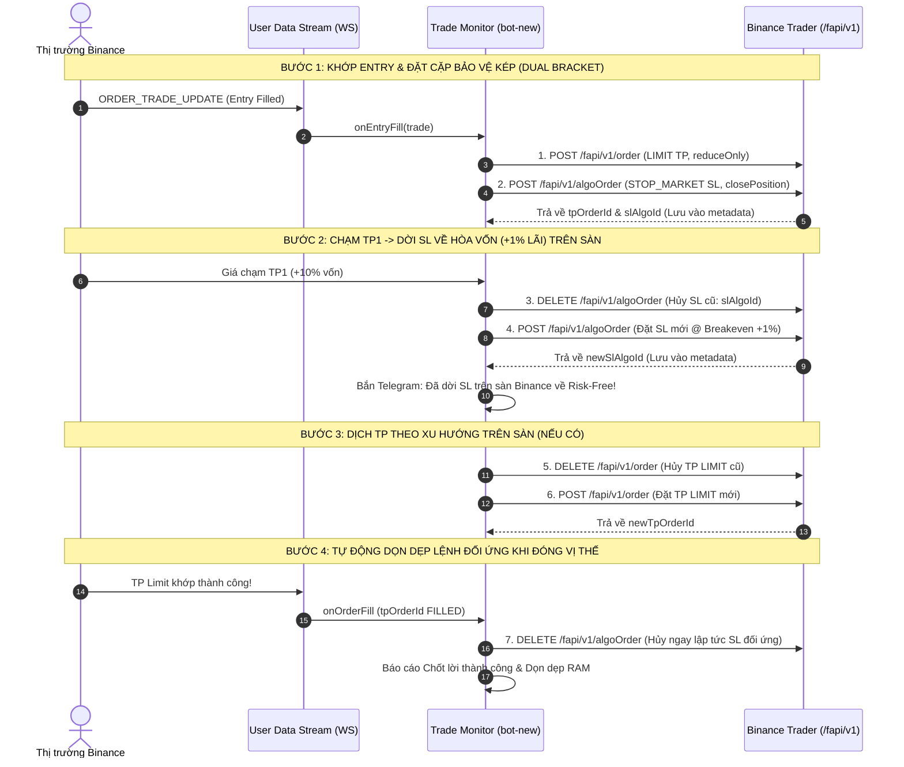

# 🚀 LỘ TRÌNH NÂNG CẤP TOÀN DIỆN BOT-NEW THEO KIẾN TRÚC TIÊN TIẾN CỦA BOT-H4

> **Tài liệu chiến lược**: Nâng cấp hạ tầng `bot-new` lên cấp độ tổ chức (Institutional / Fund-grade Trading System).  
> **Mục tiêu tối thượng**: Giữ nguyên **tỷ lệ thắng xuất sắc (High Win-rate)** và năng lực phân tích hợp lưu định lượng của `bot-new`, nhưng trang bị **hạ tầng thực thi 0ms**, **quét 400+ coin toàn thị trường**, và **hệ thống quản trị rủi ro trên sàn (On-exchange Dual Bracket)** của `bot-h4`.

---

## 1. BẢNG SO SÁNH ĐỐI CHIẾU KIẾN TRÚC: BOT-NEW VS. BOT-H4

| Tiêu chí | `bot-new` (Hiện tại) | `bot-h4` (Mục tiêu nâng cấp) | Mức độ ưu tiên |
| :--- | :--- | :--- | :---: |
| **Phạm vi quét thị trường** | Giới hạn ~20 coin tĩnh (`FIXED_COINS` + `TIER2_COINS`) | **Toàn bộ 400+ cặp** Binance Futures USDT-M | 🔴 **P1 (Cao)** |
| **Cơ chế tính TP / SL** | **AI tự nhẩm số học** (Gemini/Claude tự tính TP/SL, dễ bị ảo giác, prompt ngốn ~3,500 token) | **Thuật toán toán học 100%** (`calculateTierSLTP` đo ATR & cấu trúc sóng swing S/R chuẩn xác, AI chỉ thẩm định Duyệt/Hủy) | 🚨 **P0 (Khẩn cấp)** |
| **Quản trị Token AI** | Gửi toàn cảnh vĩ mô 20 coin (~3,500 token/lần), dễ chạm trần 429 | **Phễu lọc 4 tầng + Compact Features Vector (~180 tokens)**, Xoay vòng Multi-Key | 🔴 **P1 (Cao)** |
| **Cơ chế đặt Stop Loss** | **Client-side** (bot tự watch giá, khi chạm mới bắn lệnh Market Close) | **On-exchange Dual Bracket** (Đặt sẵn lệnh `STOP_MARKET` trực tiếp lên Binance) | 🚨 **P0 (Khẩn cấp)** |
| **Cơ chế Dời SL & Dịch TP** | **Client-side trong RAM** (Chỉ đổi biến số trong bot, không đổi trên sàn) | **On-exchange Dynamic Ratchet** (Hủy lệnh cũ, đặt lệnh SL/TP mới trực tiếp lên Binance) | 🚨 **P0 (Khẩn cấp)** |
| **Độ trễ phát hiện tín hiệu** | **Cron Polling 5 phút** (Dễ bị trễ giá, lỡ nhịp nảy nhanh) | **Hybrid Real-time 0ms** (WebSocket Event Stream từng tick + Polling 30s) | 🔴 **P1 (Cao)** |
| **Cơ chế quản lý lệnh LIMIT** | Treo cố định, chờ 4 tiếng mới expire | **Bounce Cancel**: Hủy ngay nếu giá liếm sát mốc rồi nảy ra xa | 🟡 **P2 (Trung bình)** |
| **Bảo vệ ngược sóng BTC** | Check EMA200 nến 4h định kỳ | **Real-time BTC Flash Guard** (Bắt tốc độ giật biến tốc BTC 180s thời gian thực) | 🟡 **P2 (Trung bình)** |
| **Ngắt mạch chuỗi thua** | Cooldown coin đơn lẻ (6h) | **Directional Circuit Breaker**: Tự động khóa toàn bộ chiều LONG/SHORT khi dính bão | 🟡 **P2 (Trung bình)** |
| **Đo lường & Tự hoàn thiện** | Chỉ lưu trade_history thực | **Shadow PnL Tracker**: Giám sát ảo các lệnh bị AI Veto để tự học và đo lường | 🟢 **P3 (Nâng cao)** |
| **Giao diện giám sát** | Telegram Messages + Log console | **Local Real-time Web Dashboard** (WebSocket PnL, Controls, Charts) | 🟢 **P3 (Nâng cao)** |

---

## 2. KIẾN TRÚC MỤC TIÊU (TARGET ARCHITECTURE)



---

## 3. LỘ TRÌNH TRIỂN KHAI CHI TIẾT THEO 5 GIAI ĐOẠN

### GIAI ĐOẠN 1: BẢO VỆ VỊ THẾ & ĐIỀU CHỈNH ĐỘNG TRỰC TIẾP TRÊN SÀN (ON-EXCHANGE DUAL BRACKET & ON-EXCHANGE DYNAMIC SL/TP RATCHET)
> **Mức độ ưu tiên**: 🚨 **P0 — KHẨN CẤP NHẤT**  
> **Mục tiêu**: Đưa 100% lệnh Stop Loss, Take Profit và các thao tác **Dời SL (Breakeven/Trailing)** và **Dịch TP** lên trực tiếp hệ thống khớp lệnh của sàn Binance. Triệt tiêu hoàn toàn rủi ro client-side.

#### 1. Hiện trạng rủi ro và hạn chế trong `bot-new` hiện tại
1. **Stop Loss ban đầu chỉ là Client-side**:
   - Hiện tại `bot-new` chỉ đặt lệnh **TP (LIMIT)** lên Binance. Lệnh **SL** chỉ là một biến số `trade.slPrice` được lưu trong RAM/JSON.
   - Hàm `placeSLAfterFill` trong `binanceTrader.js` đang để trống và log `client-side`.
   - Mỗi chu kỳ giám sát giá, bot tự so sánh giá hiện tại với `slPrice`. Nếu giá chạm SL, bot mới phát lệnh `Market Close`.
   ```javascript
   // RỦI RO LỚN trong bot_new hiện tại (tradeMonitor.js):
   if (price <= trade.slPrice) {
     // Chỉ khi bot còn sống, VPS có mạng thì bot mới gửi Market Close!
     await binanceTrader.closePosition(trade.symbol);
   }
   ```
2. **Dời SL về Hòa Vốn (+1% lãi) chỉ sửa trong RAM**:
   - Khi giá chạm `TP1 (+10% vốn)`, bot tính mức giá hòa vốn mới `newSlPrice = Entry ± 1% lãi`.
   - Tuy nhiên, hàm `moveSLToBreakeven` trong `binanceTrader.js` (dòng 232) hiện tại **chỉ là hàm giả lập (mock)**:
   ```javascript
   async function moveSLToBreakeven(trade) {
     if (!isEnabled()) return null;
     log.trade(`BINANCE: SL dời (client-side) ${trade.symbol}`, { newSL: trade.slPrice });
     return 'CLIENT_SIDE'; // KHÔNG HỀ ĐẶT GÌ LÊN SÀN BINANCE!
   }
   ```
   - Trên sàn Binance, vị thế hoàn toàn không có lệnh bảo vệ nào được dời theo!
3. **Chưa có cơ chế Dịch TP trên sàn**:
   - Nếu muốn điều chỉnh TP (ví dụ nới TP theo xu hướng hoặc kéo TP gần lại), `bot-new` chưa có cơ chế tự động hủy lệnh cũ và thay thế lệnh mới (`Cancel-and-Replace`) trên sàn.

> [!CAUTION]
> **Rủi ro chí mạng**: Nếu VPS khởi động lại, Binance phạt IP Rate Limit 429/418 tạm ngắt 45s, hoặc đứt kết nối mạng quốc tế lúc thị trường Flash Dump/Pump, toàn bộ vị thế của `bot-new` **hoàn toàn trơ trọi không có Stop Loss trên sàn**, dẫn tới nguy cơ cháy tài khoản tức thì!

---

#### 2. Giải pháp nâng cấp kế thừa từ `bot-h4`



#### Chi tiết 5 quy trình vận hành trên sàn:

1. **Khởi tạo Dual Bracket ngay khi Entry khớp**:
   - Sử dụng đúng endpoint chuẩn của Binance Futures:
     - **TP**: `POST /fapi/v1/order` (`type: 'LIMIT'`, `timeInForce: 'GTC'`, `reduceOnly: 'true'`).
     - **SL**: `POST /fapi/v1/algoOrder` (`algoType: 'CONDITIONAL'`, `type: 'STOP_MARKET'`, `triggerPrice: slPriceStr`, `closePosition: 'true'`).
       *(Dùng `/fapi/v1/algoOrder` khắc phục triệt để lỗi `-4131` của Binance khi đặt lệnh điều kiện).*
   - Lưu trữ song song cả `binanceTpOrderId` và `binanceSlOrderId` (hoặc `algoId`).

2. **Dời SL về Hòa Vốn (+1% lãi) trực tiếp trên sàn (`moveSLToBreakeven`)**:
   - Khi giá chạm `TP1 (+10% vốn)`:
   - Bot thực thi quy trình nguyên tử (atomic operation):
     1. Gửi lệnh hủy SL cũ: `DELETE /fapi/v1/algoOrder?symbol=SYM&algoId=OLD_ID`.
     2. Gửi ngay lệnh SL mới: `POST /fapi/v1/algoOrder` tại mức giá `newSlPrice` (khóa lãi +1% vốn sau phí).
     3. Cập nhật `trade.binanceSlOrderId = newSlId`.
     4. Gửi thông báo Telegram xác nhận SL trên Binance đã được dịch chuyển thành công.

3. **Trailing SL nâng dần theo cấu trúc giá (`ratchetTrailingSL`)**:
   - Khi giá tiếp tục di chuyển thuận lợi và tạo đáy/đỉnh mới (theo Fractal H1 hoặc nấc % lợi nhuận):
   - Kiểm tra điều kiện tiên quyết: Mức SL mới **bắt buộc phải tốt hơn** mức SL đang có trên sàn (`newSL > currentSL` cho LONG, `newSL < currentSL` cho SHORT).
   - Hủy lệnh SL Algo cũ trên sàn $\rightarrow$ Đặt lệnh SL Algo mới $\rightarrow$ Cập nhật `algoId`.

4. **Dịch chuyển TP trực tiếp trên sàn (`replaceTPOrder`)**:
   - Khi bot hoặc tín hiệu AI điều chỉnh mục tiêu chốt lời (Target TP):
   - Bot thực thi:
     1. Hủy lệnh TP Limit cũ: `DELETE /fapi/v1/order?symbol=SYM&orderId=OLD_TP_ID`.
     2. Đặt lệnh TP Limit mới: `POST /fapi/v1/order` tại mức `newTargetPrice` (`reduceOnly: true`).
     3. Cập nhật `trade.binanceTpOrderId = newTpId`.
     4. Gửi thông báo Telegram xác nhận TP trên Binance đã được dịch chuyển.

5. **Tự động dọn dẹp lệnh đối ứng (`autoCleanOppositeOrder`)**:
   - Khi vị thế đóng qua TP $\rightarrow$ Hủy ngay lập tức lệnh SL Algo trên sàn.
   - Khi vị thế đóng qua SL $\rightarrow$ Hủy ngay lập tức lệnh TP Limit trên sàn.
   - Ngăn chặn triệt để tình trạng "lệnh mồ côi" (orphan orders) nằm lại trên sàn dẫn tới khớp ngược vị thế ngoài ý muốn.

6. **Cơ chế an toàn mạng & Retry Queue**:
   - Nếu trong quá trình dịch SL/TP gặp lỗi nghẽn mạng Binance, bot tự động retry với exponential backoff (thử lại sau 1s, 2s).
   - Đảm bảo trong mọi tình huống, vị thế không bao giờ bị thả trôi không có lệnh bảo vệ trên sàn quá 2 giây.

---

### GIAI ĐOẠN 2: MỞ RỘNG VŨ TRỤ QUÉT 400+ COINS, THUẬT TOÁN TÍNH SẴN TP/SL & QUẢN TRỊ TOKEN AI CHUYÊN SÂU
> **Mức độ ưu tiên**: 🔴 **P1 — RẤT CAO**  
> **Mục tiêu**: Tăng gấp 20 lần số lượng cơ hội chất lượng cao từ toàn bộ 400+ cặp Binance Futures; chuyển giao việc tính toán TP/SL sang thuật toán toán học 100% chuẩn xác; tinh gọn Prompt AI từ ~3,500 tokens xuống ~180 tokens để triệt tiêu hoàn toàn nguy cơ kiệt quota (429) và tối ưu độ trễ vào lệnh.

#### 1. Hiện trạng rủi ro và bất cập của `bot-new` hiện tại
1. **Phạm vi quét hạn hẹp**:
   - Chỉ quét cố định danh sách ~20 coin (`BTC, ETH, SOL, BNB, XRP, DOGE, ADA...`), bỏ lỡ những con sóng bùng nổ của các Altcoins vốn hóa vừa và nhỏ có điểm hợp lưu $\ge 8.5$đ - $9$đ.
2. **Bắt AI làm "máy tính số học" tự tính TP/SL**:
   - Bot nạp toàn bộ nến và chỉ số vào Gemini/Claude để AI tự "nghĩ ra" mức giá Entry, TP, SL trong văn bản.
   - AI là mô hình ngôn ngữ, không phải máy tính số học $\rightarrow$ rất hay bị **ảo giác (hallucination)**, tính nhầm số thập phân, làm tròn sai bước giá `tickSize` của Binance hoặc cho tỷ lệ $R:R < 1.5$.
   - Khiến `tradeMonitor.js` phải viết một đống code hậu kiểm `parseTrades` để kiểm tra xem AI có tính nhầm không.
3. **Prompt khổng lồ (~3,500 tokens) gây sập Quota và nghẽn độ trễ**:
   - Để AI tự tính được TP/SL, Prompt phải nhồi nhét: On-chain Mempool TX, Reddit posts, văn bản giải thích lý thuyết OI, toàn bộ TA của 20 coin, hướng dẫn định dạng HTML...
   - Mỗi lần gọi ngốn **~3,500 tokens đầu vào + 800 tokens đầu ra**.
   - Nếu áp nguyên cách này vào 400+ coin, khi thị trường biến động mạnh sẽ có hàng chục coin chạm mốc $\rightarrow$ **Ngay lập tức làm sập hạn mức API (Lỗi 429 / Resource Exhausted)**, chi phí API tăng vọt và độ trễ 6–10 giây khiến bot lỡ mất nhịp nảy giá 0ms.

---

#### 2. Giải pháp chuyển giao kiến trúc đột phá từ `bot-h4`

```mermaid
flowchart TD
    A["Dynamic Active Universe: 400+ Cặp Binance Futures\n(Tự động nạp toàn bộ cặp USDT active, độc lập mốc đầu năm của bot-h4)"] -->|BƯỚC 1: Proximity Filter| B["getNearbySymbols: Sắp xếp độ gần mốc\nCHỈ LẤY TOP 8 MÃ SÁT MỐC NHẤT (slice 0,8)"]
    B -->|BƯỚC 2: Hàng đợi tuần tự giãn cách 600ms| C["processSignalQueue:\nTránh nghẽn API & giật weight Binance"]
    C -->|BƯỚC 3: Confluence Scorer 0 - 10đ\n(Bỏ phạt thời gian, Giữ nguyên thang chạm mốc bot-new: L1=+2đ, L2=+1đ, L3+=+1đ)| D{"Chốt chặn điểm:\nTier 1 &ge; 7.0đ\nTier 2 &ge; 8.5đ"}
    D -- Không đạt --> E["Loại bỏ / Lưu Log"]
    D -- "Đạt chuẩn (10-20 mã)" --> F["Sắp xếp Confluence Score giảm dần\nCHỈ CHỌN TOP 1 (HOẶC TOP 2) CAO NHẤT"]
    F --> G["Thuật toán calculateTierSLTP MỚI (Hybrid Fibonacci & Cluster Zones):\n- Tái sử dụng Cache Nến trên đĩa của bot-h4: H1(300), H4(300), D1(180)\n- SL 3 Tầng: Cản gần -> Cản D1 -> Fibonacci 0.786 / Golden ATR\n- TP Neo Cản Thông Minh: Front-running 0.2% + Bypass Cản Yếu (R:R &ge; 1.5)\n- BE Trigger 35% TP: Dời SL khóa lãi +0.33% sau phí"]
    G --> H{"Kiểm tra Cooldown 30p?"}
    H -- "Trong Cooldown 30p" --> I["Bỏ qua để tránh spam (0 Token)"]
    H -- "Setup mới hợp lệ" --> J["AI Risk Gatekeeper:\nAI BẢN THÂN CỤC BỘ (aiReviewer.js)\n[0.01ms - 0 Token - Hoàn toàn không cần gọi LLM ngoài]"]
    J -->|Duyệt APPROVE| K["Đẩy lệnh lên sàn Binance"]
    J -. Tùy chọn mở rộng (USE_EXTERNAL_LLM=true) .-> L["External LLM (Gemini/Claude):\nPrompt Compact JSON (~180 tokens) lấy nhận định chi tiết"]
```

#### Chi tiết 6 trụ cột kiến trúc Giai đoạn 2:

##### 1. Quản trị Vũ trụ Động (Dynamic Active Universe) & Tái sử dụng Cache Nến trên đĩa của `bot-h4`
- **Tái sử dụng 100% Bộ nhớ đệm Nến trên đĩa của `bot-h4` (`data/*_history_cache.json`)**:
  - `bot-h4` đã có sẵn cơ chế nạp và lưu trữ bền vững nến sâu trên ổ cứng: `data/h1_history_cache.json` ($300\text{ nến}$), `data/h4_history_cache.json` ($300\text{ nến}$), `data/d1_history_cache.json` ($180\text{ nến}$).
  - `bot-new` nằm chung repository và chạy trên cùng VPS, nên **tái sử dụng trực tiếp** các file cache này:
    - Nạp từ đĩa vào RAM trong $0\text{ ms}$ lúc khởi động.
    - **Tiêu thụ đúng 0 điểm REST API weight Binance**, triệt tiêu nguy cơ bị Binance phạt IP (418/429) do tải nến hàng loạt.
    - Không lưu trùng lặp dữ liệu, tiết kiệm tối đa dung lượng ổ đĩa.
    - Đối với coin mới niêm yết mà cache chưa kịp có, `bot-new` chỉ fetch bổ sung riêng cho coin đó.
- **Vũ trụ Năng động Độc lập (Không dùng nguyên số lượng mã từ đầu năm của `bot-h4`)**:
  - Trong `bot-h4`, mốc nến H4 được lấy cố định vào thời khắc đầu năm 01/01/2026 (`YEAR_START_MS`). Hậu quả là có tới **273 coin niêm yết mới trong năm bị đánh dấu thất bại (failed)** và bị loại bỏ (chỉ còn 606 coin hợp lệ).
  - `bot-new` hướng tới việc giao dịch các coin đang hoạt động mạnh mẽ trên sàn Binance Futures và chu kỳ mốc cản của nó vận hành theo chu kỳ tháng (`monthStartMs()`) hoặc chu kỳ động.
  - Do đó, `bot-new` **tuyệt đối không sao chép danh sách mã cứng từ đầu năm của `bot-h4`**.
  - Thay vào đó, `bot-new` xây dựng bộ nạp Universe động:
    1. Gọi `/fapi/v1/exchangeInfo` lấy toàn bộ các cặp USDT đang giao dịch `TRADING` (~420 cặp).
    2. Kiểm tra tính hợp lệ của nến tham chiếu theo chu kỳ riêng của `bot-new`.
    3. Lọc bước giá lưới ($0.4\% \le \text{gridStepPct} \le 15\%$) và thanh khoản tối thiểu.
    4. Tự động sinh ra danh sách `activeSymbols` chuẩn xác và độc lập cho `bot-new`.

##### 2. Chuyển giao tính toán TP/SL sang Thuật toán Hybrid Fibonacci & Cluster Zones (`calculateTierSLTP`)
Thay vì để AI tự nhẩm hay nhân máy móc tỷ lệ cố định, **code thuật toán tự động tính toán chính xác 100% trong $0.01\text{ ms}$** trước khi gửi cho AI thẩm định:
- **Hệ thống Cluster Zones (Gom cụm S/R đa khung thời gian)**:
  - Tự động gom các đỉnh/đáy swing point H1, H4, D1 nằm trong dung sai $0.5\%$ thành các cụm hỗ trợ / kháng cự hợp lưu.
  - Phân loại rõ ràng:
    - *Cản Yếu (Minor/Weak S/R)*: Đỉnh/đáy H1 đơn lẻ ($touches = 1$) hoặc cản nằm quá sát Entry ($< 1.0\text{x ATR}$). Dễ bị xuyên phá khi có xung lực.
    - *Cản Cứng (Major/Strong S/R)*: Cụm H4 có $touches \ge 2$, Cản D1 (Khung Ngày 6 tháng), hoặc Mốc ô lưới 369. Đây là những bức tường cản thực sự có khả năng đảo chiều giá.
- **Stop Loss 3 Tầng Thích Ứng (3-Tier Adaptive SL)**:
  - *Tầng 1 (Cản Sweet Spot H1/H4 gần kề)*: Đặt SL nép sau cụm cản $[1.2 \times ATR, 2.0 \times ATR]$ kèm buffer $0.2\%$ an toàn.
  - *Tầng 2 (Cản D1 tầm trung 6 tháng)*: Khi cản gần bị phá, bám cản D1 lịch sử $(\le 2.2 \times ATR$ hoặc $\le 4.0\%)$, tự động hạ đòn bẩy để bảo toàn rủi ro cố định $\$3.00\text{ USD}$.
  - *Tầng 3 (Cản Động Fibonacci - Khi coin phá đỉnh/đáy lịch sử)*:
    - *Fibonacci Retracement 0.786 trên sóng đẩy H1 gần nhất*: SL nép sau mốc $0.786 \pm 0.2\%$ buffer.
    - *Fibonacci Golden ATR ($1.618 \times ATR$)*: Fallback khi sóng phẳng: $\text{slDist} = \min(\max(1.618 \times ATR, \text{minSlPct}), 3.2\%)$.
    - **Xóa bỏ hoàn toàn trần cứng $3.5\%$ mù quáng** (từng làm dính SL oan uổng ở SOLV và ICNT).
  - *Kẹp an toàn thích ứng theo ATR*: Sàn $minSlPct = \max(1.8\%, \min(3.5\%, 1.8 \times ATR))$, trần $maxSlPct = \max(3.5\%, \min(6.0\%, 3.0 \times ATR))$.
  - Thuật toán né nam châm số tròn tâm lý (`evadeRoundNumber`) và làm tròn bảo thủ theo đúng `tickSize` của Binance.
- **Take Profit Thông Minh (Smart Anchored TP) & Cơ Chế Bypass Cản Yếu (Tránh Reject Oan Uổng)**:
  - *Neo theo Cản Đối Diện & Mốc 369 (S/R & Grid Anchored)*: Tìm cụm cản mục tiêu phía trên (LONG) hoặc phía dưới (SHORT).
  - *Kỹ thuật Front-Running TP (Đi trước cản 0.2%)*: Đặt TP lùi lại $0.2\% - 0.3\%$ trước cản để lệnh khớp chắc chắn trước khi áp lực xả/mua của thị trường xuất hiện.
  - *Cơ chế Bypass Cản Yếu (Weak S/R Bypass)*:
    - **TUYỆT ĐỐI KHÔNG REJECT LỆNH** chỉ vì vướng một cản yếu H1 ở cự ly gần làm $R:R < 1.5$.
    - Thuật toán tự động "nhìn xuyên qua" cản yếu đó để vươn tới **CẢN CỨNG TIẾP THEO (hoặc Mốc Lưới 369 kế tiếp / Fibonacci Extension 1.272, 1.618 / Fallback Ratio $R:R \ge 1.5$)**.
    - Vị thế được bảo hiểm an toàn bởi **Break-Even Trigger 35%**: Nếu giá chạm cản yếu rồi rung lắc, mốc 35% đã kịp dời SL về hòa vốn. Nếu xuyên thủng cản yếu $\rightarrow$ Lệnh phi thẳng tới Cản Cứng để ăn trọn sóng lớn!
    - **Điều kiện DUY NHẤT để Bot VETO Hủy Kèo**: Chỉ VETO khi **BỨC TƯỜNG CẢN CỨNG THỰC SỰ** (H4 $\ge 2$ chạm, D1, hoặc Mốc 369) chặn ngay trước đầu mà khoảng cách không đủ đạt $R:R \ge 1.48$.
- **Cột mốc Quản trị Vị thế Động (Break-Even Trigger 35%)**:
  - Khi giá đi được **35% quãng đường tới TP** $\rightarrow$ Tự động dời SL lên/xuống khóa trước lợi nhuận **`+0.33%`** sau khi trừ phí giao dịch Binance (Risk-Free sau phí).
- **Đòn bẩy & Ký quỹ an toàn**:
  - Tự động tính toán theo mức rủi ro cố định: $Margin \times Leverage \times SL\% = TargetLossUSD$ ($3.00 USD).
  - Khóa trần đòn bẩy chống quét râu thanh lý trước SL ($MaxSafeLev = \frac{1}{1.5 \times SL\% + MMR}$).

##### 3. Đồng bộ Confluence Scorer: Giữ nguyên thang điểm chạm mốc của `bot-new`
- **Giữ nguyên thang điểm số lần chạm Mốc cản PP369 trong `bot-new`**:
  - Lần 1: **+2đ** (`strong`)
  - Lần 2: **+1đ** (`medium`)
  - Lần 3 trở đi: **+1đ** (`weak`)
  - *Lý do*: `bot-new` tính chu kỳ mốc cản theo chu kỳ tháng (`monthStartMs()`), do đó số lần chạm trong tháng là phản ứng giá mới trong tháng, thang điểm phân hóa (+2đ cho lần 1, +1đ cho lần 2 và 3+) là hoàn toàn chuẩn xác và hợp lý, không bị mòn như mốc cả năm của bot-h4.
- **Bỏ hoàn toàn hình phạt thời gian (`timePenalty = 0`)**: Thị trường crypto giao dịch toàn cầu 24/7/365, việc trừ $1.0$đ khung giờ 00:00 - 07:00 UTC là phi lý và bóp nghẹt cơ hội vào lệnh.
- **Phễu lọc 4 tầng phân tầng rõ rệt**:
  - *Tầng 1 (Proximity Filter)*: Chỉ đo khoảng cách toán học $\le 0.5\%$, sort tăng dần và cắt Top 8.
  - *Tầng 2 (Hard Filter)*: Lưới gridStep $0.4\% - 15\%$, Funding rate không cực đoan, BB Bandwidth $\ge 2\%$.
  - *Tầng 3 (Confluence Scorer 0 - 10đ)*: Chỉ những coin đạt $\ge 7.0$đ (Tier 1) hoặc $\ge 8.5$đ (Tier 2) mới được đi tiếp.
  - *Tầng 4 (Top 1-2 Cap + 600ms Queue + Cooldown 30p)*: Chọn tối đa Top 1 hoặc Top 2 mã xuất sắc nhất gửi AI.

##### 4. AI Risk Gatekeeper: Sử dụng AI Bản Thân Cục Bộ (`aiReviewer.js`) là chính, Không cần phụ thuộc Model AI ngoài
- **Định vị cốt lõi**: Nếu đã có **AI Bản Thân (`aiReviewer.js`)**, hệ thống **HOÀN TOÀN KHÔNG CẦN gọi sang model AI ngoài (Gemini/Claude)** trong luồng giao dịch tiêu chuẩn!
- **Tại sao AI Bản Thân vượt trội hoàn toàn cho việc thẩm định lệnh?**:
  - **Tốc độ $0.01\text{ ms}$**: Chạy trực tiếp trong bộ nhớ CPU máy chủ, đánh giá ngay lập tức khi giá chạm mốc, không có độ trễ 1-3 giây của mạng internet.
  - **Chi phí $0\text{ USD}$ (0 Token)**: Không tiêu tốn bất kỳ token nào, vĩnh viễn không bao giờ gặp lỗi 429 (Resource Exhausted) hay hết hạn mức ngày.
  - **Mô hình ML chuyên sâu**: Đã được huấn luyện sẵn trên hơn 10.000 mẫu (`v1.4.0-auto, mẫu N=10493`), tính toán xác suất thắng dựa trên độ lệch giá, vi cấu trúc nến, râu nến và biến tốc BTC.
- **Cơ chế cấu hình phân tầng linh hoạt (`AI_GATEKEEPER_MODE`)**:
  - **Chế độ `LOCAL` (Mặc định & Khuyến nghị)**: 100% sử dụng **AI Bản Thân** (`aiReviewer.js`) làm Risk Gatekeeper. 0 Token, 0ms, tự chủ hoàn toàn.
  - **Chế độ `HYBRID` (Tùy chọn mở rộng qua cờ `ENABLE_EXTERNAL_LLM=true`)**: AI Bản Thân lọc trước $0\text{ ms}$. Chỉ khi xuất hiện Siêu Kèo Tier 2 ($\ge 8.5$đ), bot mới tùy chọn gửi Compact JSON sang Gemini/Claude để lấy thêm tóm tắt tiếng Việt và nhận định thị trường gửi về Telegram.
  - **Chế độ `DISABLED`**: Chỉ tin tưởng 100% vào Confluence Scorer và thuật toán `calculateTierSLTP`.

##### 5. Tinh gọn Prompt (Prompt Compression) cho Module External LLM Tùy chọn
Dành riêng cho trường hợp người dùng bật cờ `ENABLE_EXTERNAL_LLM = true` để lấy phân tích tiếng Việt:
- **Cắt bỏ hoàn toàn**: Dữ liệu Mempool BTC, Reddit posts, văn bản giải thích lý thuyết OI, và TA của 399 coin còn lại.
- **Chuyển sang Compact JSON Features Vector**:
  ```json
  Bạn là Chuyên gia Quản trị Rủi ro Futures 369. Hãy thẩm định nhanh setup:
  {
    "coin": "NEARUSDT",
    "signal": "LONG",
    "entry": 4.521,
    "tp": 4.880,
    "sl": 4.350,
    "rr": 2.12,
    "sl_scenario": "TIER1_SWEET_SPOT",
    "tp_scenario": "H1_SR_ANCHOR",
    "be_trigger": 4.646,
    "confluence_score": 8.5,
    "btc_flash_180s": "STABLE",
    "candle_m15": "PINBAR_REJECTION",
    "opposing_wick_pct": 12,
    "orderbook_wall_ahead": false,
    "reasons": ["Mốc 369 H4 trùng Support D1", "Funding âm -0.015%", "Vol nảy 2.1x"]
  }
  Yêu cầu: Đánh giá xem có nên duyệt lệnh không. Trả về DUY NHẤT 1 JSON:
  { "winProbability": 78, "isApproved": true, "reason": "Cấu trúc R:R tốt, không có cản lớn phía trước" }
  ```
- **Hiệu quả vượt trội khi kích hoạt**:
  - Token đầu vào: **~180 tokens** (giảm $95\%$).
  - Token đầu ra: **~60 tokens** (giảm $92\%$).
  - Thời gian phản hồi: **0.8s – 1.2s** (nhanh gấp 6 lần).
  - Tích hợp Xoay vòng Multi-Key (`GEMINI_API_KEY=key1,key2,key3`) và Fallback tự động về AI Bản Thân nếu mạng quốc tế bị nghẽn.

---

### GIAI ĐOẠN 3: KIẾN TRÚC REAL-TIME 0ms EVENT-DRIVEN STREAMING
> **Mức độ ưu tiên**: 🔴 **P1 — CAO**  
> **Mục tiêu**: Đón đầu chính xác từng cú nảy (bounce) tại mốc với độ trễ nano-second thay vì đợi cron 5 phút.

#### 1. Cơ chế hoạt động
- **Luồng 1 (WebSocket Event Stream 0ms)**:
  - Lắng nghe WebSocket stream giá đa luồng (`<symbol>@markPrice@1s` hoặc mini-ticker).
  - Tự động cập nhật danh sách đăng ký (`syncWebSocketSubscriptions`) cho các coin nằm trong bán kính $1.0\%$ so với mốc.
  - Ngay khi giá tiệm cận $0.3\%$ mốc: Kích hoạt quy trình chấm điểm và vào lệnh ngay trong mili-giây.
- **Luồng 2 (Polling dự phòng 30s)**:
  - Quét kiểm tra toàn diện mỗi 30 giây để đảm bảo không bỏ sót bất kỳ biến động nào trong trường hợp WebSocket bị gián đoạn gói tin.

---

### GIAI ĐOẠN 4: HỆ SINH THÁI NGẮT MẠCH & LÁ CHẮN BẢO VỆ CHUYÊN SÂU
> **Mức độ ưu tiên**: 🟡 **P2 — TRUNG BÌNH**  
> **Mục tiêu**: Ngăn chặn hiện tượng "chuỗi thua dây chuyền" khi thị trường xuất hiện tin tức thiên nga đen (Black Swan) hoặc flash dump.

#### 1. Directional Circuit Breaker (Ngắt mạch theo chiều)
- Nếu một chiều (ví dụ `LONG`) bị dính $2$ lệnh SL trong vòng $40$ phút hoặc $3$ lệnh SL trong $2$ giờ:
  - Bot lập tức kích hoạt **Ngắt Mạch Chiều LONG** trong $60$ phút.
  - Tạm dừng $100\%$ việc mở lệnh LONG mới, nhưng chiều SHORT vẫn hoạt động bình thường.
  - Tích hợp cơ chế tự động mở khóa sớm nếu các lệnh thử nghiệm ảo (Shadow Trades) cho thấy thị trường đã hồi phục ổn định.

#### 2. Real-time BTC Flash Guard (Bảo vệ biến tốc BTC 180s)
- Thuật toán trượt (Sliding Window 180s) theo dõi từng tick của BTC:
  - Nếu BTC giảm $> 1.0\%$ trong vòng 3 phút: Khóa ngay lập tức việc đặt lệnh LONG cho toàn bộ Altcoin (0ms latency, không chờ nến đóng).
  - Nếu BTC tăng giật $> 1.0\%$ trong 3 phút: Khóa chiều SHORT Altcoin.

#### 3. Cơ chế Hủy lệnh Bật Nảy (Bounce Cancel)
- Khi treo một lệnh LIMIT tại mốc hỗ trợ/kháng cự:
  - Nếu giá tiếp cận sát mốc ($\le 0.08\%$) rồi bật ngược ra xa ($> 0.6\%$) mà không khớp lệnh:
  - Bot nhận diện dòng tiền đã phản ứng xong tại mốc $\rightarrow$ Tự động hủy lệnh LIMIT ngay lập tức và khóa mốc $60$ phút.
  - Tránh rủi ro khi giá quay lại test lần thứ 2 (thường sẽ thủng mốc).

#### 4. Cooldown dính SL từng coin
- Bất kỳ coin nào bị chạm SL sẽ tự động rơi vào danh sách hồi chiêu (Cooldown) trong $6$ tiếng, ngăn chặn hoàn toàn tâm lý trả thù thị trường (Revenge trading).

---

### GIAI ĐOẠN 5: TỰ HỌC TỰ ĐỘNG, SHADOW PNL VÀ WEB DASHBOARD
> **Mức độ ưu tiên**: 🟢 **P3 — NÂNG CAO**  
> **Mục tiêu**: Minh bạch hóa dữ liệu, đánh giá độ chính xác của AI và quản trị trực quan.

#### 1. Shadow PnL Tracker (Theo dõi ảo các lệnh bị từ chối)
- Mọi setup đạt điểm Confluence cao nhưng bị AI Veto hoặc bị Hard Filter loại bỏ đều được lưu lại và theo dõi đường đi giá ảo (Shadow Position).
- Thống kê tự động:
  - *AI cứu thua bao nhiêu lần* (Veto giúp tránh SL)?
  - *AI làm lỡ bao nhiêu cơ hội* (Veto nhầm lệnh chạm TP)?
  - Tính toán chỉ số **Độ chính xác Veto (AI Accuracy %)** và giá trị ròng mang lại (Net USD Value).

#### 2. Local Real-time Web Dashboard
- Xây dựng giao diện Web Dashboard cục bộ (sử dụng WebSocket nội bộ):
  - Bảng PnL thời gian thực của các lệnh đang chạy.
  - Biểu đồ nhiệt (Heatmap) độ tiệm cận các mốc 369 của 400+ coin.
  - Danh sách lệnh trong hàng chờ Đảo chiều (`pendingReversals`).
  - Nút bấm điều khiển khẩn cấp: Đóng toàn bộ lệnh, tạm dừng quét, chuyển đổi chế độ Shadow/Live.

---

## 4. KẾ HOẠCH HÀNH ĐỘNG CỤ THỂ (ACTIONABLE CHECKLIST)

```markdown
- [x] **Phase 1: Dual Bracket Execution & Dynamic On-Exchange SL/TP (Ưu tiên P0) — [HOÀN THÀNH 100%]**
  - [x] Port & tích hợp `bracketManager.js` từ `bot-h4` sang `bot_new/src/services/`
  - [x] Nâng cấp `binanceTrader.js`:
    - [x] Thêm hàm `placeStopOrder(symbol, side, 'STOP_MARKET', stopPrice)` gọi `POST /fapi/v1/algoOrder`
    - [x] Thêm hàm `cancelAlgoOrder(symbol, algoId)` gọi `DELETE /fapi/v1/algoOrder`
    - [x] Thêm hàm `getOpenAlgoOrders(symbol)` gọi `GET /fapi/v1/openAlgoOrders`
    - [x] Thay thế hoàn toàn hàm mock `moveSLToBreakeven` bằng logic thật: Hủy SL cũ trên Binance $\rightarrow$ Đặt SL mới tại `Entry ± 1% lãi` lên Binance
    - [x] Thêm hàm `replaceTPOrder(trade, newTpPrice)`: Hủy TP Limit cũ trên Binance $\rightarrow$ Đặt TP Limit mới lên Binance
  - [x] Đấu nối sự kiện `onEntryFill` vào `tradeMonitor.js`: Tự động đặt cặp Dual Bracket (TP Limit + SL Algo) ngay khi khớp lệnh
  - [x] Đấu nối sự kiện chạm TP1 (+10% vốn): Tự động dời SL về Hòa Vốn (+1% lãi) trực tiếp trên sàn Binance
  - [x] Đấu nối `autoCleanOppositeOrder`: Khi TP khớp thì hủy SL Algo trên sàn, khi SL khớp thì hủy TP Limit trên sàn
  - [x] Viết bộ unit test `bot_new/test/test_phase1_dual_bracket.js` kiểm thử toàn diện 7/7 bài test vượt qua 100%

- [ ] **Phase 2: Mở rộng Vũ trụ Động, Thuật toán Hybrid SL/TP & Tích hợp AI Bản Thân (Ưu tiên P1)**
  - [ ] Tái sử dụng Persistent Deep Candle Cache từ đĩa của `bot-h4`: Đọc dùng chung `data/*_history_cache.json` (H1 300, H4 300, D1 180), nạp RAM 0ms, tiêu thụ 0 REST API weight Binance
  - [ ] Xây dựng bộ nạp Universe Năng Động (`getAllActiveFuturesSymbols()`): Tự động nạp toàn bộ cặp USDT active đang giao dịch, kiểm tra nến tham chiếu độc lập (không copy cứng danh sách đầu năm của `bot-h4`) + lọc lưới bước giá ($0.4\% \le \text{gridStepPct} \le 15\%$)
  - [ ] Port thuật toán `buildClusterZones`: Gom cụm S/R đa khung (H1/H4/D1, dung sai 0.5%), phân loại Cản Yếu (Minor 1 chạm) vs Cản Cứng (Major &ge; 2 chạm / D1 / Mốc 369)
  - [ ] Port thuật toán toán học `calculateTierSLTP` MỚI:
    - [ ] SL 3 Tầng: Cản gần [1.2x-2.0x ATR] &rarr; Cản D1 tầm trung (&le; 2.2x ATR / 4.0%) &rarr; Fibonacci Retracement 0.786 / Golden ATR 1.618x (Xóa bỏ trần 3.5% cứng)
    - [ ] Kẹp biên an toàn thích ứng ATR (Sàn 1.8%, Trần 6.0%), né số tròn tâm lý (`evadeRoundNumber`), tickSize Binance
    - [ ] Smart Anchored TP: Neo cụm cản đối diện với Front-running buffer 0.2% an toàn
    - [ ] Cơ chế Bypass Cản Yếu (Tránh reject oan): Nhìn xuyên cản yếu H1 để vươn tới cản cứng tiếp theo hoặc Fibonacci Extension 1.272/1.618 hoặc Fallback Ratio R:R &ge; 1.5. Chỉ VETO khi vướng Cản Cứng thực sự
    - [ ] Quản trị vị thế động: Break-Even Trigger @ 35% quãng đường TP (dời SL khóa lãi an toàn +0.33% sau phí)
  - [ ] Đồng bộ `confluenceScorer.js` trong `bot_new`:
    - [ ] Bỏ hoàn toàn hình phạt thời gian (`timePenalty = 0`)
    - [ ] Giữ nguyên thang điểm số lần chạm Mốc cản PP369 của `bot-new`: Lần 1 = +2đ, Lần 2 = +1đ, Lần 3+ = +1đ
  - [ ] Tích hợp phễu lọc `getNearbySymbols`: Sắp xếp khoảng cách tăng dần, chỉ lấy Top 8 mã sát mốc nhất (`slice(0, 8)`)
  - [ ] Xây dựng hàng đợi tuần tự `processSignalQueue` với giãn cách 600ms giữa các mã
  - [ ] Tích hợp AI Risk Gatekeeper bằng **AI Bản Thân Cục Bộ (`aiReviewer.js`)**: Thẩm định siêu tốc 0.01ms, 0 Token, 100% offline không cần gọi External LLM
  - [ ] Module mở rộng tùy chọn (`ENABLE_EXTERNAL_LLM`): Prompt Compact JSON (~180 tokens đầu vào, ~60 tokens đầu ra) + Xoay vòng Multi-Key
  - [ ] Tích hợp cơ chế Top 1–2 Cap khi có nhiều mã đủ điểm + Cooldown 30 phút cho từng coin
  - [ ] Viết bộ unit test `bot_new/test/test_phase2_universe_scorer.js` kiểm thử toàn diện các kịch bản: Tái sử dụng cache đĩa, Universe năng động, SL 3 tầng, Smart Anchored TP, Weak S/R Bypass, Scorer giữ nguyên thang điểm chạm, và AI Bản Thân 0ms/0t

- [ ] **Phase 3: Real-time WebSocket Price Engine**
  - [ ] Tích hợp WebSocket Mark Price đa luồng
  - [ ] Đấu nối cơ chế Dynamic Subscription
  - [ ] Thiết lập chu kỳ kiểm tra kép (WebSocket 0ms + Poll 30s)

- [ ] **Phase 4: Bộ phòng thủ & Ngắt mạch**
  - [ ] Tích hợp `Directional Circuit Breaker`
  - [ ] Tích hợp `Real-time BTC Flash Guard`
  - [ ] Tích hợp `Bounce Cancel` cho các lệnh LIMIT treo lâu

- [ ] **Phase 5: Shadow Tracking & Web Dashboard**
  - [ ] Port module `shadowTracker.js`
  - [ ] Tích hợp Dashboard Server WebSocket và Web UI
```

---

> [!TIP]
> **Khuyến nghị thực hiện**: Hãy triển khai tuần tự theo đúng thứ tự ưu tiên từ **Phase 1** đến **Phase 5**. Ngay sau khi hoàn thành Phase 1 (Dual Bracket SL trên Binance), mức độ an toàn vốn của `bot-new` sẽ lập tức tăng từ cấp độ cá nhân lên cấp độ quỹ đầu tư chuyên nghiệp.
