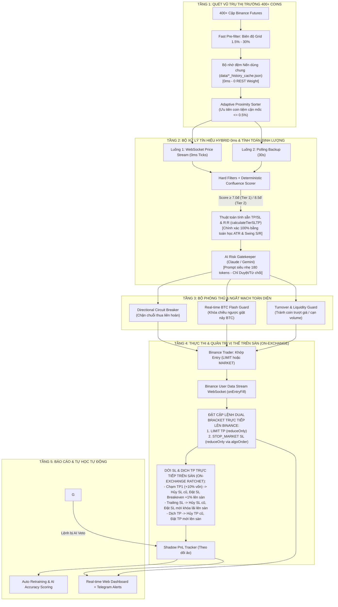
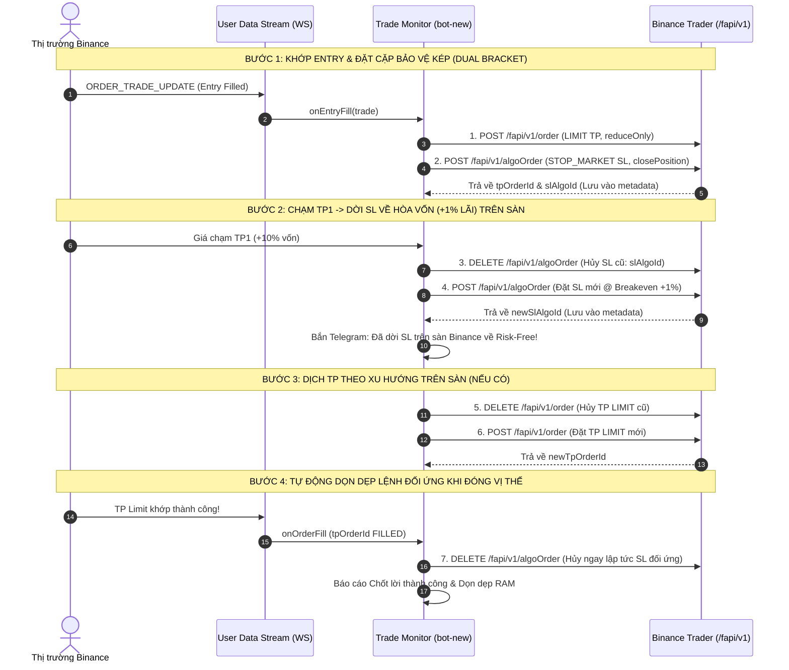
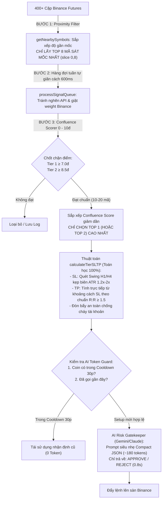

# 🚀 LỘ TRÌNH NÂNG CẤP TOÀN DIỆN BOT-NEW THEO KIẾN TRÚC TIÊN TIẾN CỦA BOT-H4

> **Tài liệu chiến lược**: Nâng cấp hạ tầng `bot-new` lên cấp độ tổ chức (Institutional / Fund-grade Trading System).  
> **Mục tiêu tối thượng**: Giữ nguyên **tỷ lệ thắng xuất sắc (High Win-rate)** và năng lực phân tích hợp lưu định lượng của `bot-new`, nhưng trang bị **hạ tầng thực thi 0ms**, **quét 400+ coin toàn thị trường**, và **hệ thống quản trị rủi ro trên sàn (On-exchange Dual Bracket)** của `bot-h4`.

---

## 1. BẢNG SO SÁNH ĐỐI CHIẾU KIẾN TRÚC: BOT-NEW VS. BOT-H4

| Tiêu chí | `bot-new` (Hiện tại) | `bot-h4` (Mục tiêu nâng cấp) | Mức độ ưu tiên |
| :--- | :--- | :--- | :---: |
| **Phạm vi quét thị trường** | Giới hạn ~20 coin tĩnh (`FIXED_COINS` + `TIER2_COINS`) | **Toàn bộ 400+ cặp** Binance Futures USDT-M | 🔴 **P1 (Cao)** |
| **Cơ chế tính TP / SL** | **AI tự nhẩm số học** (Gemini/Claude tự tính TP/SL, dễ bị ảo giác, prompt ngốn ~3,500 token) | **Thuật toán toán học 100%** (`calculateTierSLTP` đo ATR & cấu trúc sóng swing S/R chuẩn xác, AI chỉ thẩm định Duyệt/Hủy) | 🚨 **P0 (Khẩn cấp)** |
| **Quản trị Token AI** | Gửi toàn cảnh vĩ mô 20 coin (~3,500 token/lần), dễ chạm trần 429 | **Phễu lọc 4 tầng + Compact Features Vector (~180 tokens)**, Xoay vòng Multi-Key | 🔴 **P1 (Cao)** |
| **Cơ chế đặt Stop Loss** | **Client-side** (bot tự watch giá, khi chạm mới bắn lệnh Market Close) | **On-exchange Dual Bracket** (Đặt sẵn lệnh `STOP_MARKET` trực tiếp lên Binance) | 🚨 **P0 (Khẩn cấp)** |
| **Cơ chế Dời SL & Dịch TP** | **Client-side trong RAM** (Chỉ đổi biến số trong bot, không đổi trên sàn) | **On-exchange Dynamic Ratchet** (Hủy lệnh cũ, đặt lệnh SL/TP mới trực tiếp lên Binance) | 🚨 **P0 (Khẩn cấp)** |
| **Độ trễ phát hiện tín hiệu** | **Cron Polling 5 phút** (Dễ bị trễ giá, lỡ nhịp nảy nhanh) | **Hybrid Real-time 0ms** (WebSocket Event Stream từng tick + Polling 30s) | 🔴 **P1 (Cao)** |
| **Cơ chế quản lý lệnh LIMIT** | Treo cố định, chờ 4 tiếng mới expire | **Bounce Cancel**: Hủy ngay nếu giá liếm sát mốc rồi nảy ra xa | 🟡 **P2 (Trung bình)** |
| **Bảo vệ ngược sóng BTC** | Check EMA200 nến 4h định kỳ | **Real-time BTC Flash Guard** (Bắt tốc độ giật biến tốc BTC 180s thời gian thực) | 🟡 **P2 (Trung bình)** |
| **Ngắt mạch chuỗi thua** | Cooldown coin đơn lẻ (6h) | **Directional Circuit Breaker**: Tự động khóa toàn bộ chiều LONG/SHORT khi dính bão | 🟡 **P2 (Trung bình)** |
| **Đo lường & Tự hoàn thiện** | Chỉ lưu trade_history thực | **Shadow PnL Tracker**: Giám sát ảo các lệnh bị AI Veto để tự học và đo lường | 🟢 **P3 (Nâng cao)** |
| **Giao diện giám sát** | Telegram Messages + Log console | **Local Real-time Web Dashboard** (WebSocket PnL, Controls, Charts) | 🟢 **P3 (Nâng cao)** |

---

## 2. KIẾN TRÚC MỤC TIÊU (TARGET ARCHITECTURE)



---

## 3. LỘ TRÌNH TRIỂN KHAI CHI TIẾT THEO 5 GIAI ĐOẠN

### GIAI ĐOẠN 1: BẢO VỆ VỊ THẾ & ĐIỀU CHỈNH ĐỘNG TRỰC TIẾP TRÊN SÀN (ON-EXCHANGE DUAL BRACKET & ON-EXCHANGE DYNAMIC SL/TP RATCHET)
> **Mức độ ưu tiên**: 🚨 **P0 — KHẨN CẤP NHẤT**  
> **Mục tiêu**: Đưa 100% lệnh Stop Loss, Take Profit và các thao tác **Dời SL (Breakeven/Trailing)** và **Dịch TP** lên trực tiếp hệ thống khớp lệnh của sàn Binance. Triệt tiêu hoàn toàn rủi ro client-side.

#### 1. Hiện trạng rủi ro và hạn chế trong `bot-new` hiện tại
1. **Stop Loss ban đầu chỉ là Client-side**:
   - Hiện tại `bot-new` chỉ đặt lệnh **TP (LIMIT)** lên Binance. Lệnh **SL** chỉ là một biến số `trade.slPrice` được lưu trong RAM/JSON.
   - Hàm `placeSLAfterFill` trong `binanceTrader.js` đang để trống và log `client-side`.
   - Mỗi chu kỳ giám sát giá, bot tự so sánh giá hiện tại với `slPrice`. Nếu giá chạm SL, bot mới phát lệnh `Market Close`.
   ```javascript
   // RỦI RO LỚN trong bot_new hiện tại (tradeMonitor.js):
   if (price <= trade.slPrice) {
     // Chỉ khi bot còn sống, VPS có mạng thì bot mới gửi Market Close!
     await binanceTrader.closePosition(trade.symbol);
   }
   ```
2. **Dời SL về Hòa Vốn (+1% lãi) chỉ sửa trong RAM**:
   - Khi giá chạm `TP1 (+10% vốn)`, bot tính mức giá hòa vốn mới `newSlPrice = Entry ± 1% lãi`.
   - Tuy nhiên, hàm `moveSLToBreakeven` trong `binanceTrader.js` (dòng 232) hiện tại **chỉ là hàm giả lập (mock)**:
   ```javascript
   async function moveSLToBreakeven(trade) {
     if (!isEnabled()) return null;
     log.trade(`BINANCE: SL dời (client-side) ${trade.symbol}`, { newSL: trade.slPrice });
     return 'CLIENT_SIDE'; // KHÔNG HỀ ĐẶT GÌ LÊN SÀN BINANCE!
   }
   ```
   - Trên sàn Binance, vị thế hoàn toàn không có lệnh bảo vệ nào được dời theo!
3. **Chưa có cơ chế Dịch TP trên sàn**:
   - Nếu muốn điều chỉnh TP (ví dụ nới TP theo xu hướng hoặc kéo TP gần lại), `bot-new` chưa có cơ chế tự động hủy lệnh cũ và thay thế lệnh mới (`Cancel-and-Replace`) trên sàn.

> [!CAUTION]
> **Rủi ro chí mạng**: Nếu VPS khởi động lại, Binance phạt IP Rate Limit 429/418 tạm ngắt 45s, hoặc đứt kết nối mạng quốc tế lúc thị trường Flash Dump/Pump, toàn bộ vị thế của `bot-new` **hoàn toàn trơ trọi không có Stop Loss trên sàn**, dẫn tới nguy cơ cháy tài khoản tức thì!

---

#### 2. Giải pháp nâng cấp kế thừa từ `bot-h4`



#### Chi tiết 5 quy trình vận hành trên sàn:

1. **Khởi tạo Dual Bracket ngay khi Entry khớp**:
   - Sử dụng đúng endpoint chuẩn của Binance Futures:
     - **TP**: `POST /fapi/v1/order` (`type: 'LIMIT'`, `timeInForce: 'GTC'`, `reduceOnly: 'true'`).
     - **SL**: `POST /fapi/v1/algoOrder` (`algoType: 'CONDITIONAL'`, `type: 'STOP_MARKET'`, `triggerPrice: slPriceStr`, `closePosition: 'true'`).
       *(Dùng `/fapi/v1/algoOrder` khắc phục triệt để lỗi `-4131` của Binance khi đặt lệnh điều kiện).*
   - Lưu trữ song song cả `binanceTpOrderId` và `binanceSlOrderId` (hoặc `algoId`).

2. **Dời SL về Hòa Vốn (+1% lãi) trực tiếp trên sàn (`moveSLToBreakeven`)**:
   - Khi giá chạm `TP1 (+10% vốn)`:
   - Bot thực thi quy trình nguyên tử (atomic operation):
     1. Gửi lệnh hủy SL cũ: `DELETE /fapi/v1/algoOrder?symbol=SYM&algoId=OLD_ID`.
     2. Gửi ngay lệnh SL mới: `POST /fapi/v1/algoOrder` tại mức giá `newSlPrice` (khóa lãi +1% vốn sau phí).
     3. Cập nhật `trade.binanceSlOrderId = newSlId`.
     4. Gửi thông báo Telegram xác nhận SL trên Binance đã được dịch chuyển thành công.

3. **Trailing SL nâng dần theo cấu trúc giá (`ratchetTrailingSL`)**:
   - Khi giá tiếp tục di chuyển thuận lợi và tạo đáy/đỉnh mới (theo Fractal H1 hoặc nấc % lợi nhuận):
   - Kiểm tra điều kiện tiên quyết: Mức SL mới **bắt buộc phải tốt hơn** mức SL đang có trên sàn (`newSL > currentSL` cho LONG, `newSL < currentSL` cho SHORT).
   - Hủy lệnh SL Algo cũ trên sàn $\rightarrow$ Đặt lệnh SL Algo mới $\rightarrow$ Cập nhật `algoId`.

4. **Dịch chuyển TP trực tiếp trên sàn (`replaceTPOrder`)**:
   - Khi bot hoặc tín hiệu AI điều chỉnh mục tiêu chốt lời (Target TP):
   - Bot thực thi:
     1. Hủy lệnh TP Limit cũ: `DELETE /fapi/v1/order?symbol=SYM&orderId=OLD_TP_ID`.
     2. Đặt lệnh TP Limit mới: `POST /fapi/v1/order` tại mức `newTargetPrice` (`reduceOnly: true`).
     3. Cập nhật `trade.binanceTpOrderId = newTpId`.
     4. Gửi thông báo Telegram xác nhận TP trên Binance đã được dịch chuyển.

5. **Tự động dọn dẹp lệnh đối ứng (`autoCleanOppositeOrder`)**:
   - Khi vị thế đóng qua TP $\rightarrow$ Hủy ngay lập tức lệnh SL Algo trên sàn.
   - Khi vị thế đóng qua SL $\rightarrow$ Hủy ngay lập tức lệnh TP Limit trên sàn.
   - Ngăn chặn triệt để tình trạng "lệnh mồ côi" (orphan orders) nằm lại trên sàn dẫn tới khớp ngược vị thế ngoài ý muốn.

6. **Cơ chế an toàn mạng & Retry Queue**:
   - Nếu trong quá trình dịch SL/TP gặp lỗi nghẽn mạng Binance, bot tự động retry với exponential backoff (thử lại sau 1s, 2s).
   - Đảm bảo trong mọi tình huống, vị thế không bao giờ bị thả trôi không có lệnh bảo vệ trên sàn quá 2 giây.

---

### GIAI ĐOẠN 2: MỞ RỘNG VŨ TRỤ QUÉT 400+ COINS, THUẬT TOÁN TÍNH SẴN TP/SL & QUẢN TRỊ TOKEN AI CHUYÊN SÂU
> **Mức độ ưu tiên**: 🔴 **P1 — RẤT CAO**  
> **Mục tiêu**: Tăng gấp 20 lần số lượng cơ hội chất lượng cao từ toàn bộ 400+ cặp Binance Futures; chuyển giao việc tính toán TP/SL sang thuật toán toán học 100% chuẩn xác; tinh gọn Prompt AI từ ~3,500 tokens xuống ~180 tokens để triệt tiêu hoàn toàn nguy cơ kiệt quota (429) và tối ưu độ trễ vào lệnh.

#### 1. Hiện trạng rủi ro và bất cập của `bot-new` hiện tại
1. **Phạm vi quét hạn hẹp**:
   - Chỉ quét cố định danh sách ~20 coin (`BTC, ETH, SOL, BNB, XRP, DOGE, ADA...`), bỏ lỡ những con sóng bùng nổ của các Altcoins vốn hóa vừa và nhỏ có điểm hợp lưu $\ge 8.5$đ - $9$đ.
2. **Bắt AI làm "máy tính số học" tự tính TP/SL**:
   - Bot nạp toàn bộ nến và chỉ số vào Gemini/Claude để AI tự "nghĩ ra" mức giá Entry, TP, SL trong văn bản.
   - AI là mô hình ngôn ngữ, không phải máy tính số học $\rightarrow$ rất hay bị **ảo giác (hallucination)**, tính nhầm số thập phân, làm tròn sai bước giá `tickSize` của Binance hoặc cho tỷ lệ $R:R < 1.5$.
   - Khiến `tradeMonitor.js` phải viết một đống code hậu kiểm `parseTrades` để kiểm tra xem AI có tính nhầm không.
3. **Prompt khổng lồ (~3,500 tokens) gây sập Quota và nghẽn độ trễ**:
   - Để AI tự tính được TP/SL, Prompt phải nhồi nhét: On-chain Mempool TX, Reddit posts, văn bản giải thích lý thuyết OI, toàn bộ TA của 20 coin, hướng dẫn định dạng HTML...
   - Mỗi lần gọi ngốn **~3,500 tokens đầu vào + 800 tokens đầu ra**.
   - Nếu áp nguyên cách này vào 400+ coin, khi thị trường biến động mạnh sẽ có hàng chục coin chạm mốc $\rightarrow$ **Ngay lập tức làm sập hạn mức API (Lỗi 429 / Resource Exhausted)**, chi phí API tăng vọt và độ trễ 6–10 giây khiến bot lỡ mất nhịp nảy giá 0ms.

---

#### 2. Giải pháp chuyển giao kiến trúc đột phá từ `bot-h4`



#### Chi tiết 5 trụ cột kiến trúc Giai đoạn 2:

##### 1. Chuyển giao tính toán TP/SL sang Thuật toán Toán học (`calculateTierSLTP`)
Thay vì để AI tự nhẩm, **code thuật toán tự động tính toán chính xác 100% trong $0.01\text{ ms}$** trước khi hỏi AI:
- **Entry**: Là mốc toán học 369 chuẩn xác.
- **Stop Loss (SL)**: 
  - Tự động quét 90 nến H1 và 45 nến H4 tìm đáy/đỉnh Swing Point cấu trúc sóng.
  - Kẹp biên thích ứng 3 tầng theo biến động $ATR(14, 4h)$: Tối thiểu $1.2\text{x} \text{ ATR}$, tối đa $2.0\text{x} \text{ ATR}$ (trần an toàn $3.5\%$).
  - Thuật toán né nam châm số tròn tâm lý (`evadeRoundNumber`) và làm tròn bảo thủ theo đúng `tickSize` của Binance.
- **Take Profit (TP)**:
  - **Tính toán trực tiếp 100% từ Stop Loss (SL)**: Khoảng cách chốt lời TP được xác định trực tiếp từ khoảng cách SL theo công thức chuẩn quản trị rủi ro:
    $$\text{TargetTpDist} = \text{slDist} \times \text{targetRR} \quad (\text{với } \text{targetRR} \ge 1.5)$$
  - Luôn bảo đảm tỷ lệ Lời/Lỗ chuẩn $R:R \ge 1.5$ (hoặc tùy biến $1:2$). Làm tròn bảo thủ theo đúng bước giá `tickSize` của Binance.
  - Nếu sau khi tính toán mà tỷ lệ $R:R < 1.48 \rightarrow$ VETO hủy kèo ngay lập tức để bảo toàn vốn.
- **Đòn bẩy (Leverage)**:
  - Tự động tính toán theo trần thanh lý an toàn (Liquidation Front-Running Guard):
    $$\text{MaxSafeLev} = \frac{1}{1.5 \times \text{SL\%} + \text{MMR}}$$
    Ngăn chặn tuyệt đối tình trạng râu nến quét thanh lý trước khi cắn SL.

##### 2. Tái định vị vai trò của AI: Từ "Máy tính số học" sang "Chuyên gia Thẩm định Rủi ro (Risk Auditor / Gatekeeper)"
- AI **không cần làm công việc tính nhẩm số học nữa**.
- AI chỉ đóng vai trò là **người gác cổng thẩm định rủi ro**: Đọc bối cảnh vi cấu trúc nến M15/H1, độ dãn spread, biến tốc BTC, và trả lời ngắn gọn:
  $$\text{Duyệt (APPROVE) hay Từ chối (REJECT)}$$

##### 3. Xử lý triệt để bài toán: 50 coin tiệm cận $\le 0.5\%$ và 10–20 coin đủ điểm
Kế thừa chính xác giải pháp từ `bot-h4`:
- **Giải quyết 50 coin tiệm cận mốc $\le 0.5\%$**:
  - Hàm `getNearbySymbols` tính khoảng cách thực tế của từng coin tới mốc: $\text{dist} = \frac{|\text{Price} - \text{Level}|}{\text{Price}}$.
  - Sắp xếp tăng dần theo khoảng cách $\rightarrow$ **Chỉ lấy đúng Top 8 mã gần nhất** (`scanNearby.slice(0, 8)`).
  - 42 mã còn lại nằm chờ ở chu kỳ tiếp theo, tiết kiệm $85\%$ tải CPU và API.
- **Giải quyết 10–20 mã đủ điểm Confluence cùng lúc**:
  - Đưa vào hàng đợi `processSignalQueue` xử lý tuần tự, **giãn cách $600\text{ ms}$ giữa các mã** để bảo vệ API weight Binance.
  - **Quy tắc Top 1–2 Cap**: Trong 10–20 mã đủ điểm, bot sắp xếp theo điểm Confluence từ cao xuống thấp và **CHỈ GỬI ĐÚNG TOP 1 (HOẶC TOP 2) MÃ CAO NHẤT** cho AI thẩm định.
  - **Bộ nhớ đệm Cooldown 30 phút**: Coin nào AI đã duyệt hoặc từ chối trong 30 phút qua sẽ không bao giờ bị gọi lại lần 2 $\rightarrow$ Triệt tiêu hoàn toàn nguy cơ spam API.

##### 4. Tinh gọn Prompt (Prompt Compression): Từ ~3,500 tokens xuống ~180 tokens
- **Cắt bỏ hoàn toàn**: Dữ liệu Mempool BTC, Reddit posts, văn bản giải thích lý thuyết OI, và TA của 399 coin còn lại.
- **Chuyển sang Compact JSON Features Vector**:
  ```json
  Bạn là Chuyên gia Quản trị Rủi ro Futures 369. Hãy thẩm định nhanh setup:
  {
    "coin": "NEARUSDT",
    "signal": "LONG",
    "entry": 4.521,
    "tp": 4.880,
    "sl": 4.350,
    "rr": 2.12,
    "confluence_score": 8.5,
    "btc_flash_180s": "STABLE",
    "candle_m15": "PINBAR_REJECTION",
    "opposing_wick_pct": 12,
    "orderbook_wall_ahead": false,
    "reasons": ["Mốc 369 H4 trùng Support 1D", "Funding âm -0.015%", "Vol nảy 2.1x"]
  }
  Yêu cầu: Đánh giá xem có nên duyệt lệnh không. Trả về DUY NHẤT 1 JSON:
  { "winProbability": 78, "isApproved": true, "reason": "Cấu trúc R:R tốt, không có cản lớn phía trước" }
  ```
- **Hiệu quả vượt trội**:
  - Token đầu vào: **~180 tokens** (giảm $95\%$).
  - Token đầu ra: **~60 tokens** (giảm $92\%$).
  - Thời gian phản hồi: **0.8s – 1.2s** (nhanh gấp 6 lần).
  - Gói Free 500 RPD có thể quét cả ngày mà **không bao giờ lo cạn quota hay dính 429**.

##### 5. Cơ chế Xoay vòng Multi-Key & Fallback an toàn (Kế thừa từ `llmReviewer.js`)
- Cấu hình danh sách nhiều key: `GEMINI_API_KEY=key1,key2,key3`.
- Tự động xoay sang Key tiếp theo ngay trong mili-giây nếu Key hiện tại gặp lỗi 429 hoặc cạn quota.
- **Fail-safe Fallback**: Nếu toàn bộ API Key bị nghẽn mạng quốc tế, bot tự động kích hoạt **Lõi AI Cục bộ (`aiReviewer.js`)** để thẩm định bằng toán học offline $0\text{ ms}$, đảm bảo bot không bao giờ bị tê liệt hay bỏ lỡ cơ hội.

##### 6. Bộ nhớ đệm nến dùng chung (`data/*_history_cache.json`)
- Đọc nến H4/D1 từ file JSON local đã được sync định kỳ: Tốc độ đọc $0\text{ ms}$, **tiêu thụ 0 điểm API weight Binance**, giải quyết triệt để vấn đề cảnh báo 429/1900 weight.

---

### GIAI ĐOẠN 3: KIẾN TRÚC REAL-TIME 0ms EVENT-DRIVEN STREAMING
> **Mức độ ưu tiên**: 🔴 **P1 — CAO**  
> **Mục tiêu**: Đón đầu chính xác từng cú nảy (bounce) tại mốc với độ trễ nano-second thay vì đợi cron 5 phút.

#### 1. Cơ chế hoạt động
- **Luồng 1 (WebSocket Event Stream 0ms)**:
  - Lắng nghe WebSocket stream giá đa luồng (`<symbol>@markPrice@1s` hoặc mini-ticker).
  - Tự động cập nhật danh sách đăng ký (`syncWebSocketSubscriptions`) cho các coin nằm trong bán kính $1.0\%$ so với mốc.
  - Ngay khi giá tiệm cận $0.3\%$ mốc: Kích hoạt quy trình chấm điểm và vào lệnh ngay trong mili-giây.
- **Luồng 2 (Polling dự phòng 30s)**:
  - Quét kiểm tra toàn diện mỗi 30 giây để đảm bảo không bỏ sót bất kỳ biến động nào trong trường hợp WebSocket bị gián đoạn gói tin.

---

### GIAI ĐOẠN 4: HỆ SINH THÁI NGẮT MẠCH & LÁ CHẮN BẢO VỆ CHUYÊN SÂU
> **Mức độ ưu tiên**: 🟡 **P2 — TRUNG BÌNH**  
> **Mục tiêu**: Ngăn chặn hiện tượng "chuỗi thua dây chuyền" khi thị trường xuất hiện tin tức thiên nga đen (Black Swan) hoặc flash dump.

#### 1. Directional Circuit Breaker (Ngắt mạch theo chiều)
- Nếu một chiều (ví dụ `LONG`) bị dính $2$ lệnh SL trong vòng $40$ phút hoặc $3$ lệnh SL trong $2$ giờ:
  - Bot lập tức kích hoạt **Ngắt Mạch Chiều LONG** trong $60$ phút.
  - Tạm dừng $100\%$ việc mở lệnh LONG mới, nhưng chiều SHORT vẫn hoạt động bình thường.
  - Tích hợp cơ chế tự động mở khóa sớm nếu các lệnh thử nghiệm ảo (Shadow Trades) cho thấy thị trường đã hồi phục ổn định.

#### 2. Real-time BTC Flash Guard (Bảo vệ biến tốc BTC 180s)
- Thuật toán trượt (Sliding Window 180s) theo dõi từng tick của BTC:
  - Nếu BTC giảm $> 1.0\%$ trong vòng 3 phút: Khóa ngay lập tức việc đặt lệnh LONG cho toàn bộ Altcoin (0ms latency, không chờ nến đóng).
  - Nếu BTC tăng giật $> 1.0\%$ trong 3 phút: Khóa chiều SHORT Altcoin.

#### 3. Cơ chế Hủy lệnh Bật Nảy (Bounce Cancel)
- Khi treo một lệnh LIMIT tại mốc hỗ trợ/kháng cự:
  - Nếu giá tiếp cận sát mốc ($\le 0.08\%$) rồi bật ngược ra xa ($> 0.6\%$) mà không khớp lệnh:
  - Bot nhận diện dòng tiền đã phản ứng xong tại mốc $\rightarrow$ Tự động hủy lệnh LIMIT ngay lập tức và khóa mốc $60$ phút.
  - Tránh rủi ro khi giá quay lại test lần thứ 2 (thường sẽ thủng mốc).

#### 4. Cooldown dính SL từng coin
- Bất kỳ coin nào bị chạm SL sẽ tự động rơi vào danh sách hồi chiêu (Cooldown) trong $6$ tiếng, ngăn chặn hoàn toàn tâm lý trả thù thị trường (Revenge trading).

---

### GIAI ĐOẠN 5: TỰ HỌC TỰ ĐỘNG, SHADOW PNL VÀ WEB DASHBOARD
> **Mức độ ưu tiên**: 🟢 **P3 — NÂNG CAO**  
> **Mục tiêu**: Minh bạch hóa dữ liệu, đánh giá độ chính xác của AI và quản trị trực quan.

#### 1. Shadow PnL Tracker (Theo dõi ảo các lệnh bị từ chối)
- Mọi setup đạt điểm Confluence cao nhưng bị AI Veto hoặc bị Hard Filter loại bỏ đều được lưu lại và theo dõi đường đi giá ảo (Shadow Position).
- Thống kê tự động:
  - *AI cứu thua bao nhiêu lần* (Veto giúp tránh SL)?
  - *AI làm lỡ bao nhiêu cơ hội* (Veto nhầm lệnh chạm TP)?
  - Tính toán chỉ số **Độ chính xác Veto (AI Accuracy %)** và giá trị ròng mang lại (Net USD Value).

#### 2. Local Real-time Web Dashboard
- Xây dựng giao diện Web Dashboard cục bộ (sử dụng WebSocket nội bộ):
  - Bảng PnL thời gian thực của các lệnh đang chạy.
  - Biểu đồ nhiệt (Heatmap) độ tiệm cận các mốc 369 của 400+ coin.
  - Danh sách lệnh trong hàng chờ Đảo chiều (`pendingReversals`).
  - Nút bấm điều khiển khẩn cấp: Đóng toàn bộ lệnh, tạm dừng quét, chuyển đổi chế độ Shadow/Live.

---

## 4. KẾ HOẠCH HÀNH ĐỘNG CỤ THỂ (ACTIONABLE CHECKLIST)

```markdown
- [ ] **Phase 1: Dual Bracket Execution & Dynamic On-Exchange SL/TP (Ưu tiên P0)**
  - [ ] Port & tích hợp `bracketManager.js` từ `bot-h4` sang `bot_new/src/services/`
  - [ ] Nâng cấp `binanceTrader.js`:
    - [ ] Thêm hàm `placeStopOrder(symbol, side, 'STOP_MARKET', stopPrice)` gọi `POST /fapi/v1/algoOrder`
    - [ ] Thêm hàm `cancelAlgoOrder(symbol, algoId)` gọi `DELETE /fapi/v1/algoOrder`
    - [ ] Thay thế hoàn toàn hàm mock `moveSLToBreakeven` bằng logic thật: Hủy SL cũ trên Binance $\rightarrow$ Đặt SL mới tại `Entry ± 1% lãi` lên Binance
    - [ ] Thêm hàm `replaceTPOrder(symbol, newTpPrice)`: Hủy TP Limit cũ trên Binance $\rightarrow$ Đặt TP Limit mới lên Binance
  - [ ] Đấu nối sự kiện `onEntryFill` vào `tradeMonitor.js`: Tự động đặt cặp Dual Bracket (TP Limit + SL Algo) ngay khi khớp lệnh
  - [ ] Đấu nối sự kiện chạm TP1 (+10% vốn): Tự động dời SL về Hòa Vốn (+1% lãi) trực tiếp trên sàn Binance
  - [ ] Đấu nối `autoCleanOppositeOrder`: Khi TP khớp thì hủy SL Algo trên sàn, khi SL khớp thì hủy TP Limit trên sàn
  - [ ] Xây dựng hàng đợi Retry Queue xử lý lỗi timeout/mạng khi dời SL/TP
  - [ ] Viết bộ unit test kiểm thử toàn diện quy trình On-Exchange Dual Bracket & Dời SL/Dịch TP

- [ ] **Phase 2: Mở rộng Vũ trụ 400+ Coins, Thuật toán TP/SL & Quản trị Token AI (Ưu tiên P1)**
  - [ ] Port thuật toán toán học `calculateTierSLTP` từ `bot-h4`: Tự động tính sẵn Entry, TP, SL (Swing S/R + ATR), R:R >= 1.5, Đòn bẩy an toàn
  - [ ] Chuyển đổi vai trò AI từ "tính toán TP/SL" sang "Risk Gatekeeper" (chỉ duyệt APPROVE / REJECT)
  - [ ] Viết bộ nạp Universe động `getAllActiveFuturesSymbols()` (~420 cặp USDT)
  - [ ] Tích hợp Cache nến local dùng chung (`data/*_history_cache.json`) tiêu tốn 0 API weight
  - [ ] Tích hợp bộ lọc bước giá Grid ($1.5\% \le \text{GridWidth\%} \le 30\%$)
  - [ ] Tích hợp `getNearbySymbols` + Sắp xếp khoảng cách tăng dần + Cắt `slice(0, 8)`
  - [ ] Xây dựng hàng đợi tuần tự `processSignalQueue` với giãn cách 600ms
  - [ ] Tinh gọn Prompt AI thành Compact JSON Features Vector (~180 tokens đầu vào, ~60 tokens đầu ra)
  - [ ] Tích hợp cơ chế Top 1–2 Cap khi có nhiều mã đủ điểm + Cooldown 30 phút cho từng coin
  - [ ] Tích hợp cơ chế Xoay vòng Multi-Key (`GEMINI_API_KEY=key1,key2,key3`) và Fallback tự động sang AI Cục bộ

- [ ] **Phase 3: Real-time WebSocket Price Engine**
  - [ ] Tích hợp WebSocket Mark Price đa luồng
  - [ ] Đấu nối cơ chế Dynamic Subscription
  - [ ] Thiết lập chu kỳ kiểm tra kép (WebSocket 0ms + Poll 30s)

- [ ] **Phase 4: Bộ phòng thủ & Ngắt mạch**
  - [ ] Tích hợp `Directional Circuit Breaker`
  - [ ] Tích hợp `Real-time BTC Flash Guard`
  - [ ] Tích hợp `Bounce Cancel` cho các lệnh LIMIT treo lâu

- [ ] **Phase 5: Shadow Tracking & Web Dashboard**
  - [ ] Port module `shadowTracker.js`
  - [ ] Tích hợp Dashboard Server WebSocket và Web UI
```

---

> [!TIP]
> **Khuyến nghị thực hiện**: Hãy triển khai tuần tự theo đúng thứ tự ưu tiên từ **Phase 1** đến **Phase 5**. Ngay sau khi hoàn thành Phase 1 (Dual Bracket SL trên Binance), mức độ an toàn vốn của `bot-new` sẽ lập tức tăng từ cấp độ cá nhân lên cấp độ quỹ đầu tư chuyên nghiệp.
